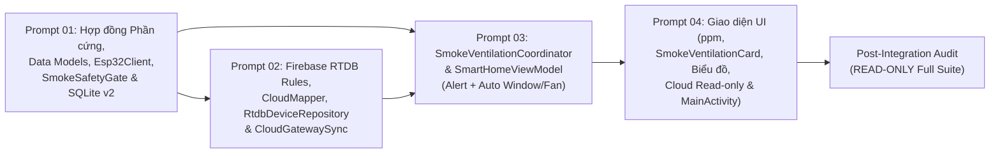

# KẾ HOẠCH KIẾN TRÚC & TÍCH HỢP — CẢM BIẾN KHÓI MQ-2, CẢNH BÁO PPM & THÔNG GIÓ TỰ ĐỘNG (CỬA SỔ + QUẠT)

- **Trạng thái:** Kế hoạch & Hợp đồng tích hợp đã chốt (App + Firebase đi trước, sẵn sàng khớp nối phần cứng ESP32)
- **Đơn vị hiển thị:** `ppm` (Parts Per Million, dải hợp lệ `0..10000`)
- **Ngưỡng mặc định:** **`300 ppm`** (cảnh báo về điện thoại + tự động mở cửa sổ & bật quạt thông gió)
- **Kiến trúc bất biến:** `LAN-first` (`Android ↔ HTTP LAN ↔ ESP32`) + `Firebase RTDB` (đồng bộ trạng thái, cấu hình ngưỡng, telemetry, sự kiện & hiển thị dự phòng chỉ đọc khi mất LAN)
- **Checkpoint nền:** Branch `master`, commit gốc `452abb2399c182b1088e0eb1b3da62970653db89` (`452abb2`)

---

## 1. Chiến lược triển khai khi chưa có code phần cứng ESP32

Do firmware phần cứng (`esp32/SmartHomeESP32/SmartHomeESP32.ino`) hiện chưa gắn cảm biến MQ-2, servo cửa sổ và mạch điều khiển quạt, chiến lược kỹ thuật tối ưu là **Contract-First + Dual-Layer Safety**:

1. **Chốt cứng Hợp đồng Giao tiếp Phần cứng (Hardware Wire Contract)** ngay từ đầu cho 3 kênh của ESP32 (`GET /sensor`, `GET /events`, và các endpoint `POST /window`, `POST /fan`, `POST /smoke/config`) theo đúng quy ước của `Clothesline` và `AlarmSettings` đã có trong dự án.
2. **Tương thích ngược 100% với Firmware 3.5 hiện tại:**
   - Mọi trường JSON mới từ `/sensor` đều là **tùy chọn** (`nullable`/có cờ `has_mq2`, `has_window`, `has_fan` mặc định `false`).
   - Khi kết nối với mạch ESP32 cũ chưa có code MQ-2, ứng dụng hoạt động bình thường 100%, không văng lỗi parse, và hiển thị trạng thái hướng dẫn chờ kết nối phần cứng MQ-2 / Cửa sổ / Quạt (giống hệt cách `ClotheslineCard` xử lý `hasClothesline != true`).
3. **Bảo vệ Tự động 2 Lớp (Dual-Layer Auto-Ventilation) tại ngưỡng `300 ppm`:**
   - **Lớp 1 — Firmware-native (Ưu tiên khi nạp code phần cứng mới):** ESP32 đọc MQ-2 tại chỗ, khi `smoke_ppm >= 300` tự mở servo cửa sổ (`window_open = 1`), bật quạt (`fan_on = 1`), bật cờ `smoke_alert = 1` và ghi sự kiện `smoke_detected` + `smoke_auto_vent`. App nhận dữ liệu sẽ cập nhật UI, phát thông báo đẩy về điện thoại (`Notifier`) và đồng bộ lên Firebase mà **không** gửi lại lệnh mở thừa.
   - **Lớp 2 — App-level Auto-Dispatch Fallback (Đảm bảo thông luồng ngay cả khi firmware sơ khai chỉ mới xuất `smoke_ppm` + `/window` + `/fan`):** Nếu `SmartHomeViewModel` đọc thấy `smoke_ppm >= smokeLimit` (mặc định `300 ppm`) và `smokeAutoVentilation == true`, nhưng trạng thái phần cứng báo cửa sổ đang đóng (`hasWindow && windowOpen == false`) hoặc quạt đang tắt (`hasFan && fanOn == false`), App **tự động gửi lệnh `POST /window?state=1` và `POST /fan?state=1`** xuống ESP32 (vượt qua khóa `AWAY`/`SLEEP` vì đây là tác vụ an toàn khẩn cấp chống ngạt khói), kèm phát thông báo khẩn về điện thoại.
4. **Thông luồng toàn diện lên Firebase RTDB ngay từ bây giờ:**
   - Mở rộng `database.rules.src.json` (và `database.rules.json`) theo hướng **backward-compatible** (bổ sung trường tùy chọn có kiểm tra kiểu & biên chặt chẽ, không phá vỡ bất kỳ test B1–B3/F1–F5 nào).
   - Đồng bộ đầy đủ `smokePpm`, `smokeAlert`, `window`, `fan` lên `state/gateway`, `smokePpm` lên `telemetry/{yyyyMMddHHmm}_g`, `smokeLimit` (`300`) + `smokeAuto` lên `config`, sự kiện khói mức `critical` lên `events`, và hiển thị trên thẻ **Cloud chỉ đọc** (`CloudReadOnlySummaryCard`) khi người dùng ở ngoài mạng LAN.

---

## 2. Đặc tả Hợp đồng Phần cứng ESP32 (Hardware Integration Spec cho giai đoạn nạp mạch)

Khi viết code cho ESP32 ở giai đoạn phần cứng tiếp theo, chỉ cần tuân thủ đúng bảng hợp đồng dưới đây là **toàn bộ App Android + Thông báo + Biểu đồ CSV + Firebase Cloud tự động thông luồng 100% mà không cần sửa lại App**:

### 2.1 Các trường bổ sung trong `GET /sensor` (JSON)

| Khóa JSON | Kiểu dữ liệu | Giá trị hợp lệ | Ý nghĩa & Quy ước |
|---|---|---|---|
| `has_mq2` | `Int` (`0\|1`) | `0` hoặc `1` | `1` khi mạch có gắn cảm biến MQ-2 (nếu lược bỏ nhưng có `smoke_ppm` hợp lệ, App tự hiểu `hasMq2 = true`). |
| `smoke_ppm` | `Int \| null` | `0..10000` hoặc `null` | Nồng độ khói/khí dễ cháy quy đổi sang đơn vị **`ppm`**. `null` khi cảm biến đang làm nóng (preheat) hoặc lỗi đọc. |
| `smoke_alert` | `Int` (`0\|1`) | `0` hoặc `1` | `1` khi ESP32 xác định đang vượt ngưỡng khói nguy hiểm. |
| `has_window` | `Int` (`0\|1`) | `0` hoặc `1` | `1` khi mạch có gắn cơ cấu mở cửa sổ (servo/actuator). |
| `window_open` | `Int \| null` | `0`, `1` hoặc `null` | `1` = cửa sổ đang mở, `0` = cửa sổ đang đóng. |
| `has_fan` | `Int` (`0\|1`) | `0` hoặc `1` | `1` khi mạch có gắn quạt thông gió (relay/MOSFET). |
| `fan_on` | `Int \| null` | `0`, `1` hoặc `null` | `1` = quạt đang bật, `0` = quạt đang tắt. |
| `smoke_auto_enabled` | `Int \| null` | `0`, `1` hoặc `null` | `1` = bật tự động mở cửa sổ & quạt khi khói vượt ngưỡng trên ESP32. |
| `smoke_threshold_ppm` | `Int` | `50..5000` (mặc định `300`) | Ngưỡng cảnh báo khói hiện hành trên ESP32 (mặc định `300` ppm). |

### 2.2 Các HTTP Endpoint điều khiển trên ESP32 (Port 80, Header `X-Device-Key` nếu bật khóa)

| Phương thức & Đường dẫn | Tham số Query | Phản hồi thành công | Mã lỗi đặc thù |
|---|---|---|---|
| `POST /window` | `state=1` (mở) hoặc `state=0` (đóng) | `200 OK` body `"OK"` | `412` nếu `state=0` trong khi đang có khói vượt ngưỡng & chế độ tự động đang bật; `409` nếu `state=1\|0` khi đang `AWAY` và **không** có khói. |
| `POST /fan` | `state=1` (bật) hoặc `state=0` (tắt) | `200 OK` body `"OK"` | `412` nếu `state=0` trong khi đang có khói vượt ngưỡng & chế độ tự động đang bật; `409` nếu đang `AWAY` và **không** có khói. |
| `POST /smoke/config` | `auto=1\|0&threshold=<50..5000>` | `200 OK` body `"OK"` | `400` nếu tham số ngoài biên `50..5000`. |

### 2.3 Các mã sự kiện `kind` bổ sung trong `GET /events`

| Mã `kind` (≤ 23 ký tự) | Mức Cloud (`severity`) | Loại Alert trên App | Tiêu đề hiển thị tiếng Việt trên App & Cloud |
|---|---|---|---|
| `smoke_detected` | `critical` | `AlertType.SMOKE` (bắn Notification) | `Phát hiện khói vượt ngưỡng` *(hoặc gộp `Phát hiện khói vượt ngưỡng · Đã mở cửa sổ & bật quạt` nếu đi kèm `smoke_auto_vent`)* |
| `smoke_auto_vent` | `critical` | `AlertType.SMOKE` (bắn Notification) | `Có khói · tự động mở cửa sổ và bật quạt` |
| `smoke_cleared` | `info` | `AlertType.SMOKE` | `Nồng độ khói đã về mức an toàn` |
| `window_opened` | `info` | *(Chỉ lưu Hoạt động)* | `Đã mở cửa sổ` |
| `window_closed` | `info` | *(Chỉ lưu Hoạt động)* | `Đã đóng cửa sổ` |
| `fan_on` | `info` | *(Chỉ lưu Hoạt động)* | `Đã bật quạt thông gió` |
| `fan_off` | `info` | *(Chỉ lưu Hoạt động)* | `Đã tắt quạt thông gió` |
| `smoke_rule_changed` | `info` | *(Chỉ lưu Hoạt động)* | `Đã đổi thiết lập cảnh báo khói` |

### 2.4 Khuyến nghị chân GPIO cho ESP32 (tránh xung đột Wi-Fi & chân hiện có)
- Các chân đã dùng trong `SmartHomeESP32.ino`: GPIO `4, 14, 16, 17, 18, 19, 25, 26, 27, 32, 33`.
- Các chân khuyến nghị khi lắp mạch mới:
  - **MQ-2 (`AO`)**: **GPIO 34** (thuộc **ADC1** input-only — bắt buộc dùng ADC1 `32..39` vì ADC2 trên ESP32 bị vô hiệu hóa khi bật Wi-Fi; dùng cầu phân áp `10kΩ / 20kΩ` hạ áp tối đa 5V xuống ≤ 3.3V để bảo vệ chân ESP32).
  - **Servo Cửa sổ**: **GPIO 21** (nguồn 5V ngoài chung GND với servo cửa chính & giàn phơi).
  - **Relay / MOSFET Quạt**: **GPIO 22** (qua module relay opto hoặc MOSFET kích mức logic 3.3V, có diode dập xung ngược flyback).

---

## 3. Các Ràng buộc Bảo toàn Hồi quy Phát hiện từ Bộ Test Hiện tại

Qua đối chiếu trực tiếp toàn bộ `AppSmokeTest.kt`, `InsightsTest.kt`, `gateway-payload.test.mjs` và `rules.test.mjs`, 4 bất biến kỹ thuật sau **BẮT BUỘC** được giữ nguyên trong mọi prompt:

1. **KHÔNG thêm `WINDOW` hoặc `FAN` vào `enum class DeviceType` (`Models.kt`):**
   - `AppSmokeTest.allThreeDevicesAreVisibleAndCanBeControlledFromHome` (`AppSmokeTest.kt:309-318`) và `armedDevicesRequireDisarmingFirst` (`AppSmokeTest.kt:372-382`) duyệt `DeviceType.entries` trên `SmartHomeState()` mặc định (không có `hardware`).
   - Do đó, Cửa sổ & Quạt phải đi theo đúng kiến trúc của **Giàn phơi (`Clothesline`)**: đặt trạng thái trong `HardwareStatus` + `SmartHomeState`, hàm riêng trên `Esp32Client` & `SmartHomeViewModel`, và thẻ UI riêng `SmokeVentilationCard`.
2. **KHÔNG thêm `Switch` thứ hai vào `EnvironmentConfigDialog` (`EnvironmentScreen.kt`):**
   - `AppSmokeTest.environmentConfigurationCallsSave` (`AppSmokeTest.kt:273-282`) gọi `compose.onNode(isToggleable()).performClick()`. Nếu hộp thoại này có >1 công tắc sẽ nổ `AssertionError`. Cấu hình ngưỡng khói MQ-2 phải đặt trong `SmokeConfigDialog` riêng biệt.
3. **Mọi phần tử toggleable trên `HomeScreen` phải `enabled = false` khi `!state.esp32Online`:**
   - `AppSmokeTest.deviceControlsDisabledWhenOffline` (`AppSmokeTest.kt:240-245`) kiểm tra `compose.onAllNodes(isToggleable()).assertAll(isNotEnabled())` khi `SmartHomeState()` offline.
4. **Giữ tương thích ngược cho `sensorCsv` và `database.rules.src.json`:**
   - `InsightsTest.csvUsesUtf8BomAndChronologicalRowsWithTimezone` (`InsightsTest.kt:54-61`) kiểm tra header `"\uFEFFThời gian,Nhiệt độ (°C),Độ ẩm (%)\r\n"` và dòng kết thúc `",20,50"` khi mẫu không có dữ liệu khói (`smokePpm == null`). Vì vậy chỉ xuất thêm cột `,Khói MQ-2 (ppm)` khi danh sách mẫu có ít nhất 1 phần tử `smokePpm != null`.
   - `gateway-payload.test.mjs:287` kiểm tra ghi `config` chỉ với 7 khóa cũ (`rev`, `updatedBy`, `updatedAt`, `tempLimit`, `humLimit`, `coldLimit`, `autoAlarm`). Vì vậy `smokeLimit` và `smokeAuto` trong `database.rules.src.json` phải là khóa **tùy chọn** có `.validate` riêng (không đưa vào mảng `newData.hasChildren([...])` bắt buộc).

---

## 4. Lộ trình 4 Prompt Triển khai (Chuẩn 2 Nhánh A / B)

Chi tiết thứ tự chạy, phạm vi file và thông điệp Git commit tiếng Việt xem tại [`FEATURE-PROMPT-INDEX.md`](FEATURE-PROMPT-INDEX.md).
