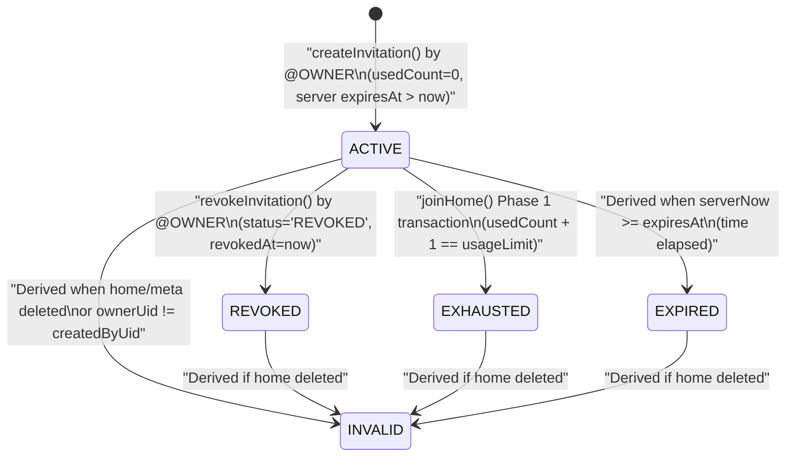

# P1.1-B4 — Invitation, Join Home & QR Contract Design Report

- **Timestamp (Local):** 2026-11-21 08:40:00 +07:00
- **Repository:** `d:\MMO\DoAn2\app-nha-thong-minh`
- **Git Baseline Checkpoint:** `e7a805c` (`checkpoint task  b3`, clean working tree)
- **Phase Type:** **DESIGN-ONLY (Branch A — Execution Model)**
- **Architecture Baseline:** `docs/P1.1-B0_Cloud_Database_Architecture_Decision.md` (RTDB-only rev.2), `docs/P1.1-B1_RTDB_Cloud_Foundation_Plan.md`, `docs/p1-1-b1/b1-real-world-verification-report.md` (`B1 CONDITIONAL PASS`), `docs/p1-1-b2/b2-firebase-configuration-readiness-report.md` (`B2 PASS`), `docs/p1-1-b3/b3-cloud-session-multi-home-member-report.md` (`B3 PASS`)
- **Production Lock:** **B1-D remains `LOCKED`** — zero Production RTDB, Auth, Rules, or Console access.

> **Source-of-Truth Note:** Theo quy tắc điều phối, mọi dữ kiện về source code, cấu hình, và Rules hiện tại trong tài liệu này được đối chiếu trực tiếp từ repository tại commit `e7a805c`. Mọi hành vi runtime chưa triển khai trong B4 được gắn nhãn thiết kế (`DESIGN PROPOSAL`) và kèm test matrix cho phase triển khai sau.

---

## 1. Executive Summary

Phase **P1.1-B4** thiết kế hoàn chỉnh hợp đồng dữ liệu, quy trình nghiệp vụ, định dạng QR, kiến trúc RTDB, Security Rules, mô hình mối đe dọa (Threat Model), Kotlin API contract và UI/UX contract cho ba nhóm chức năng **Invitation**, **Join Home**, và **QR Onboarding** của **SmartHomeAI** (`com.example.smarthomeai`, Firebase Project `appaintm` / `883290202549`, RTDB `asia-southeast1`).

### Quyết định kiến trúc cốt lõi của B4

1. **Tuân thủ tuyệt đối RTDB-only (`P1.1-B0 rev.2`):** Toàn bộ dữ liệu Cloud của Invitation và Join lưu trên **Firebase Realtime Database** (`https://appaintm-default-rtdb.asia-southeast1.firebasedatabase.app`). **Không** dùng Firestore, **không** dùng dual database, **không** thay đổi luồng LAN-first (`Esp32Client` → HTTP LAN → ESP32), và **không** đưa `deviceKey` hay dữ liệu nhạy cảm (mật khẩu, Auth token, sinh trắc học) vào RTDB hay QR.
2. **Kết luận về ranh giới bảo mật (Blocker đối với Pure Client + RTDB Rules):**
   Phân tích kỹ thuật chứng minh rằng **mô hình Client-only + Firebase RTDB Security Rules KHÔNG THỂ đáp ứng an toàn** các yêu cầu bắt buộc của B4 (bảo mật token chống brute-force/enumeration khi giữ bí mật `homeId`, băm token bằng pepper/HMAC-SHA256, rate limiting, xem trước tên nhà từ `homes/{homeId}/meta` trước khi trở thành Member mà không mở `.read` toàn cục, chống race condition + idempotency khi vừa ghi `usedCount` vừa ghi kép `members` + `userHomes`, và giữ nguyên quy tắc `@OWNER` trong `members` / `userHomes` hiện tại).
   Do đó, thiết kế B4 chốt mô hình **RTDB-only Database + Trusted Backend Boundary** (Triển khai bằng **Option T1: Firebase Cloud Functions v2 HTTPS Callable tại `asia-southeast1`** [khuyến nghị, yêu cầu Blaze] hoặc **Option T2: Self-hosted HTTPS Backend với Firebase Admin SDK** [tương thích Spark]) kết hợp **RTDB Security Rules deny-by-default** cho các nhánh nhạy cảm.
3. **Mô hình dữ liệu tách đôi (Split Dual-Node Schema):**
   - `homes/{homeId}/invitations/{invitationId}`: chỉ lưu metadata & sổ ghi nhận đổi mã `redemptions/{uid}` (`.read: "@AUTH && @OWNER"`, `.write: false` với mọi client). **Tuyệt đối không lưu `token` plaintext và không lưu `tokenHash` tại đây.**
   - `invitationTokens/{tokenHash}`: nhánh tra cứu $O(1)$ thuần server với khóa là `HMAC-SHA256(serverPepper, rawToken)` (`.read: false`, `.write: false`).
   - `invitationRateLimits/{uid}`: nhánh đếm giới hạn tốc độ thuần server (`.read: false`, `.write: false`).
4. **QR Contract v1 (Compact Opaque Capability Payload):**
   - Schema JSON phiên bản hóa `{"v":1,"type":"home_invite","token":"<43-char-base64url-256bit-csprng>"}` được quét trực tiếp trong ứng dụng (không dùng HTTPS deep link / custom URI scheme ở v1 để tránh rò rỉ token qua URL/browser/intent và giữ nguyên `MainActivity.kt` / `AndroidManifest.xml`).
5. **Tương thích hoàn toàn với B3:**
   - Mở rộng thuần Kotlin thông qua `CloudInvitationRepository` (tách khỏi `CloudRepository` hiện có để không phá vỡ test/API B1–B3), tích hợp vào `CloudComponents`, `CloudHomeManager`, `CloudUiBridge` và `CloudError`, giữ `SmartHomeViewModel.kt` **0 import Firebase SDK** và giữ tách biệt hoàn toàn với `SmartHomeState` (`Storage.kt` / SharedPreferences).

---

## 2. Current State Inspection

Kiểm tra trực tiếp repository tại commit `e7a805c` (`git status --short` sạch trước khi tạo tài liệu B4):

### 2.1 Thành phần Android Cloud (`app/src/main/java/com/example/smarthomeai/cloud/`)

| File | Trạng thái & Symbol thực tế `[REPO]` | Ràng buộc & Điểm tái sử dụng cho B4 |
|---|---|---|
| `CloudModels.kt` | `CLOUD_OPERATION_TIMEOUT_MS = 10_000L`; `CloudRole` (`OWNER("owner")`, `MEMBER("member")`); `CloudHome(id, name, role)`; `CloudMember(uid, role, addedAt, addedBy)`; `CloudError` (8 giá trị: `Unauthenticated`, `PermissionDenied`, `NotFound`, `Conflict`, `Offline`, `Timeout`, `InvalidData`, `Unknown`); `CloudResult<T>` (`Ok`, `Err`, `Unavailable`) | Mở rộng `CloudError` backward-compatible; bổ sung model thuần Kotlin cho Invitation/Join/QR |
| `CloudRepository.kt` | Interface thuần Kotlin 5 hàm: `observeHomes()`, `createHome(name)`, `observeMembers(homeId)`, `leaveHome(homeId)`, `removeMember(homeId, memberUid)` | Giữ nguyên 5 hàm B1–B3; tách `CloudInvitationRepository` để tránh breaking change |
| `CloudSession.kt` | `CloudSessionState` (`Unavailable`, `SignedOut`, `SignedIn(uid)`); `CloudSession`; `CloudComponents(session, repository)` | Mở rộng `CloudComponents` thêm `invitations: CloudInvitationRepository` (hoặc default/optional khi chuyển tiếp) |
| `FirebaseProvider.kt` | Lazy init `FirebaseApp`/`FirebaseDatabase`, đọc `app.options.databaseUrl`, giữ `applicationContext`, `uid`, `observeAuthUid()`, `FirebaseCloudSession`, `CloudFoundationFactory`; **0 lệnh `setPersistenceEnabled(...)`** | Tái sử dụng `FirebaseProvider` cho `uid`, `isConfigured`, và lấy ID Token khi gọi Trusted Backend |
| `RtdbPaths.kt` | `ENTITY_ID_REGEX = ^[A-Za-z0-9_-]{8,64}$`, `FORBIDDEN_RTDB_CHARS = / . # $ [ ]`, `MAX_UID_LENGTH = 128`, `isValidEntityId`, `isValidUid`, path builders cho `userHomes`, `homes/{h}/meta`, `homes/{h}/members` | Tái sử dụng `isValidEntityId` / `isValidUid`; thêm `homeInvitationsPath` / `homeInvitationPath` |
| `RtdbPayloadBuilder.kt` | `SCHEMA_VERSION = 1`, `MAX_HOME_NAME_LENGTH = 60`, `FORBIDDEN_NAME_SUBSTRING = "deviceKey"`, `validateAndNormalizeHomeName`, `buildHomeMetaPayload`, `buildOwnerMemberPayload`, `buildRemoveMembershipUpdates` | Tái sử dụng quy tắc `deviceKey` guard và pattern nhận `timestampValue: Any` |
| `CloudErrorMapper.kt` | `mapDatabaseErrorCode(Int)`, `mapDatabaseError`, `mapException(Throwable)` — chỉ chuyển `TimeoutCancellationException` thành `CloudError.Timeout`, rethrow mọi `CancellationException` khác | Mở rộng mapping mã lỗi HTTP/Backend Functions sang các mã lỗi B4 |
| `RtdbHomeMerger.kt` | `MAX_CONCURRENT_META_FETCHES = 4`, `RtdbHomeMetaFetcher.fetchAllBounded`, `RtdbHomeMerger.mergeHomesDetailed` | Tham khảo pattern bounded concurrency & cô lập `PermissionDenied` |
| `RtdbCloudRepository.kt` | Triển khai `CloudRepository`; kiểm tra `!provider.isConfigured` và `!RtdbPaths.isValidUid(currentUid)` trước mọi thao tác; `createHome` ghi tuần tự `meta -> members -> userHomes`; `leaveHome`/`removeMember` dùng root multi-path atomic `updateChildren` | Làm chuẩn đối chiếu cho `RtdbCloudInvitationRepository` (hoặc `BackendCloudInvitationRepository`) |
| `CloudHomeManager.kt` | `CloudStatus` (7 trạng thái), `MembersStatus` (5 trạng thái), `CloudUiState`, `CloudUiBridge`, `CloudUiBridgeRegistry` (`WeakReference`), `lifecycleMutex`, `sessionGen` (`AtomicLong`), `cancelAndJoin()` khi đổi UID, `pendingCreatedHomeId`, `describeLoadError`, `describeActionError` (exhaustive `when`) | Tích hợp `observeInvitations`, thao tác tạo/thu hồi/kiểm tra/tham gia và `pendingJoinedHomeId`; cập nhật exhaustive `when` trong `describeActionError` |

### 2.2 ViewModel, UI, Auth, Manifest & Dependencies `[REPO]`

- `SmartHomeViewModel.kt`: 0 import `com.google.firebase.*`; khởi tạo `CloudHomeManager(viewModelScope, cloudComponents.session, cloudComponents.repository)`, đăng ký `CloudUiBridgeRegistry`, gọi `cloudManager.onSignedOut()` đồng bộ trong `logout()`.
- `CloudHomeSection.kt`: Đã có `CloudHomeBannerCard` (trên `HomeScreen.kt`) và `CloudHomeManagementCard` (trên `SettingsScreen.kt`). Dòng 437–444 hiện hiển thị ghi chú chờ B4: `"Mời thành viên mới (Invitation / Join / QR) thuộc giai đoạn thiết kế hợp đồng riêng."`
- `AuthRepository.kt` (LOCKED): Hỗ trợ Email/Password và Google Sign-In qua `FirebaseAuth.getInstance()`.
- `MainActivity.kt` (LOCKED): Điều hướng `NavHost` (`login`, `home`, `env`, `system`, `camera`, `register`, `alerts`, `settings`); chỉ xử lý `Notifier.EXTRA_ALERT_ID`, **chưa** có xử lý deep-link URI.
- `AndroidManifest.xml`: Đã khai báo `INTERNET`, `CAMERA`, `POST_NOTIFICATIONS`; `allowBackup="false"`, `fullBackupContent="false"`, `usesCleartextTraffic="true"` (cho HTTP LAN ESP32 & local Emulator `10.0.2.2:9000`); **chưa** có `<intent-filter>` deep link.
- `app/build.gradle.kts`:
  - `compileSdk = 34`, `minSdk = 24`, `targetSdk = 34`, Kotlin `1.9.24`, AGP `8.5.2`, `firebase-bom:33.1.2`, Coroutines `1.8.1`.
  - Đã có CameraX `1.3.4` (`camera-core`, `camera-camera2`, `camera-lifecycle`, `camera-view`) và `mlkit:face-detection:16.1.6`.
  - **Chưa có** thư viện quét QR (`mlkit:barcode-scanning` / ZXing), **chưa có** thư viện sinh bitmap QR (`zxing:core`), **chưa có** `firebase-functions` (nếu chọn Option T1). Ghi nhận làm dependency cần phê duyệt ở phase triển khai sau.
- `Theme.kt`: Đã định nghĩa đầy đủ token màu sắc Material 3 (`Blue700`, `Blue600`, `Blue50`, `Bg`, `CardWhite`, `TextDark`, `TextGray`, `GreenOk`, `GreenSoft`, `RedAlert`, `RedSoft`, `OrangeWarn`, `YellowSoft`, `Outline`).

### 2.3 RTDB Security Rules hiện hành (`cloud-rules/database.rules.src.json`) `[REPO]`

- Root `.read: false`, `.write: false`.
- Các node hiện có: `users/$uid`, `userHomes/$uid/$homeId`, `homes/$homeId/{meta, members, devices, deviceData}`.
- `homes/$homeId/members/$uid/.write`: chỉ cho phép tạo mới bởi `@OWNER` (`addedBy === auth.uid`, `role === 'member'`) hoặc tự xóa bởi `@OWNER` / chính `auth.uid` khi `role === 'member'`. Không cho phép update.
- `userHomes/$uid/$homeId/.write`: chỉ cho phép `@OWNER` tạo entry `'member'` sau khi `homes/$homeId/members/$uid/role === 'member'` đã tồn tại; cho phép xóa bởi `auth.uid === $uid || @OWNER`.
- `homes/$homeId/meta/ownerUid`: chỉ gán lúc tạo Home (`auth.uid`) và **bất biến**. Không có rule cho phép client xóa `homes/$homeId` hay `meta`.
- **Chưa có** nhánh `invitations` hoặc `invitationTokens` trong Rules hoặc `RtdbPaths`.
- Token expansion (`cloud-rules/build-rules.mjs`): `@MEMBER`, `@DEVICE`, `@OWNER`, `@ACTIVE`, `@AUTH`.

### 2.4 Trạng thái các phase trước & khác biệt tài liệu cũ `[REPO]`

| Phase | Trạng thái | Ghi chú đối chiếu |
|---|---|---|
| P1.1-A | `CONDITIONAL GO` | Baseline audit ban đầu |
| P1.1-B0 rev.2 | `APPROVED` | Chốt RTDB-only. Lưu ý sai khác tiến độ: B0 §10 ban đầu đánh số B2=Gateway Sync, B3=Đa Home + Invite + QR `deviceKey` ngoài băng, B4=Remote Command. Thực tế triển khai đã tách thành B2 (Config/Readiness), B3 (Session/Multi-Home/Member, hoãn Invite/Join/QR), và B4 hiện tại (Thiết kế Invite/Join/QR). **Cập nhật quan trọng:** B0 §10 dòng 744 từng nhắc "QR chia sẻ `deviceKey` ngoài băng", nhưng theo yêu cầu B4.3 và nguyên tắc B0 §2/§6.1/§8.5 (`deviceKey` không bao giờ lên Cloud), **QR Invitation B4 tuyệt đối KHÔNG chứa `deviceKey`**. |
| P1.1-B1 | `CONDITIONAL PASS` | Rules 76/76, JVM 127/127, Instrumented 62/62; còn `A2` physical phone + ESP32 LAN offline regression (`PENDING USER VERIFICATION`) |
| P1.1-B2 | `PASS` | Config & Auth readiness; fixed `B2-F4`; Rules 76/76, JVM 133/133, Instrumented 64/64 |
| P1.1-B3 | `PASS` | Auth lifecycle (`B2-F5`), `MIN-04` bounded fetch, Multi-Home, Leave/Remove atomic delete; Rules 80/80, JVM 151/151, Instrumented 69/69, 19/19 LOCKED SHA-256 MATCH |
| B1-D | `LOCKED` | Production RTDB audit & deploy Rules chưa thực hiện và vẫn bị khóa |

---

## 3. Architecture Compatibility

Thiết kế B4 tuân thủ nguyên vẹn ranh giới kiến trúc của `P1.1-B0 rev.2` và `P1.1-B3`:

```text
UI (CloudHomeSection + Invitation/QR Dialogs)
  └─► CloudUiBridge (pure Kotlin StateFlow<CloudUiState> + actions)
        └─► SmartHomeViewModel (0 Firebase SDK imports)
              └─► CloudHomeManager (pure Kotlin coordinator, sessionGen + lifecycleMutex)
                    ├─► CloudSession ◄── FirebaseCloudSession (cloud/)
                    ├─► CloudRepository ◄── RtdbCloudRepository (cloud/)
                    └─► CloudInvitationRepository ◄── BackendCloudInvitationRepository (cloud/)
                                                          ├─► RTDB Listener: homes/{h}/invitations (Owner only)
                                                          └─► Trusted Backend HTTPS (Firebase ID Token) ──► Firebase Admin SDK ──► RTDB

LAN Control (100% TÁCH BIỆT, KHÔNG ĐỔI):
UI ─► SmartHomeViewModel ─► Esp32Client ─► HTTP LAN ─► ESP32 (NVS)
```

1. **RTDB-only Database:** Không thêm Firestore, không thêm SQL Cloud, không lưu state Cloud vào `Storage.kt` (`SharedPreferences`) hay `SmartHomeState`.
2. **SDK Isolation:** `CloudInvitationRepository`, `QrInvitationParser`, mọi data class/enum B4 và `CloudHomeManager` không import bất kỳ package `com.google.firebase.*` nào.
3. **Persistence & Auth:** Tiếp tục dùng chung `FirebaseAuth` qua `FirebaseProvider` (`AuthRepository.kt` không sửa); tiếp tục giữ RTDB persistence mặc định `false` (không gọi `setPersistenceEnabled(...)`).
4. **LAN Isolation:** Mọi lỗi mạng/timeout/permission của Invitation hoặc Join không bao giờ thay đổi `esp32Online`, không khóa `network: Mutex`, và không cản trở điều khiển thiết bị `VERIFIED-HW` qua HTTP LAN.

---

## 4. Invitation Data Model (B4.1)

### 4.1 Đánh giá chi tiết từng thuộc tính ứng viên

| Trường | Nơi lưu / Trạng thái | Kiểu & Định dạng | Bất biến / Ghi bởi | Đánh giá thiết kế & Rủi ro nếu dùng sai |
|---|---|---|---|---|
| `invitationId` | **Khóa RTDB** của `homes/{homeId}/invitations/{invitationId}` (và field tham chiếu trong `invitationTokens/{tokenHash}`) | String `^[A-Za-z0-9_-]{8,64}$` (`push().key` hoặc UUID v4) | Bất biến; Backend sinh | **Cần thiết.** Khớp `RtdbPaths.ENTITY_ID_REGEX`. Không cần lặp lại làm field con trong `homes/{h}/invitations/{id}` (tránh lệch key/value; Kotlin mapper đọc từ `snapshot.key`, nhất quán với `CloudHome.id` và `CloudMember.uid`). |
| `homeId` | **Khóa cha RTDB** (`homes/{homeId}/...`) và field bắt buộc trong `invitationTokens/{tokenHash}` | String `^[A-Za-z0-9_-]{8,64}$` | Bất biến; Backend xác thực từ request của Owner | **Cần thiết.** Trong `homes/{homeId}/invitations/{id}`, `homeId` là nhánh cha nên không cần lặp làm child; trong `invitationTokens/{tokenHash}`, `homeId` bắt buộc có để tra cứu $O(1)$ từ token sang Home. |
| `createdByUid` | `homes/{h}/invitations/{id}/createdByUid` | Firebase Auth UID (`1..128` ký tự, không ký tự cấm RTDB) | Bất biến; Backend gán = `callerUid` (đã xác minh là `@OWNER`) | **Cần thiết.** Dùng để kiểm tra Owner tại thời điểm tạo và đối chiếu `meta/ownerUid === createdByUid` lúc validate/redeem (chống invite mồ côi quyền nếu đổi chủ trong tương lai) và ghi vào `members/{uid}/addedBy`. |
| `createdAt` | `homes/{h}/invitations/{id}/createdAt` & `invitationTokens/{tokenHash}/createdAt` | Server Epoch ms (`ServerValue.TIMESTAMP`) | Bất biến; Server time | **Cần thiết.** Dùng làm mốc audit, sắp xếp `orderByChild("createdAt")`, và làm căn cứ tính `expiresAt`. Không tin đồng hồ client. |
| `expiresAt` | `homes/{h}/invitations/{id}/expiresAt` & `invitationTokens/{tokenHash}/expiresAt` | Long (Epoch ms = `serverCreatedAt + ttlMs`) | Bất biến; Backend tính từ `ServerValue.TIMESTAMP` + `ttlMs` | **Cần thiết.** Bắt buộc có thời hạn hết hạn để giới hạn cửa sổ rủi ro khi token/QR bị rò rỉ. |
| `status` | `homes/{h}/invitations/{id}/status` | Enum string: `"ACTIVE"` \| `"REVOKED"` \| `"EXHAUSTED"` | Backend ghi (`ACTIVE` → `REVOKED` hoặc `ACTIVE` → `EXHAUSTED`) | **Cần thiết.** Chỉ lưu các chuyển trạng thái tường minh do sự kiện ghi tạo ra. Trạng thái `EXPIRED` và `INVALID` **không lưu cứng** làm điều kiện duy nhất mà được suy ra động theo `serverNow` và trạng thái Home/Owner (xem §4.2 & §5). |
| `role` | `homes/{h}/invitations/{id}/role` | String cố định `"member"` trong v1 | Bất biến; Backend ép `"member"` (bỏ qua hoặc reject nếu client truyền `"owner"`) | **Cần thiết.** Khóa cứng `"member"` phù hợp bất biến single-owner của `B0 §8.2` & `database.rules.src.json`. Cấm cấp `"owner"` qua Invitation để chặn leo quyền và ghi đè `meta/ownerUid`. |
| `token` (plaintext) | **KHÔNG LƯU TRONG RTDB** | String 43 ký tự Base64URL (`[A-Za-z0-9_-]{43}`, 256-bit CSPRNG) | Chỉ sinh in-memory trên Backend, trả **1 lần duy nhất** cho Owner khi `createInvitation` | **Cấm lưu trữ.** Nếu lưu plaintext trong RTDB, bất kỳ ai đọc được node hoặc bản backup JSON đều chiếm đoạt toàn bộ lời mời đang hoạt động. |
| `tokenHash` | **Khóa của** `invitationTokens/{tokenHash}` (và optional trong nhánh ẩn server-only `invitationTokenIndex/{h}/{id}`) | String 64 ký tự hex (`HMAC-SHA256(serverPepper, rawToken)`) | Bất biến; Backend tính bằng secret pepper | **Cần thiết nhưng phải cách ly.** Không đặt `tokenHash` trong `homes/{h}/invitations/{id}` (dù Owner đọc được) để giảm bề mặt lộ hash / phân tích ngoại tuyến nếu có công cụ debug đọc node Home. |
| `usageLimit` | `homes/{h}/invitations/{id}/usageLimit` | Integer `1..10` (mặc định `1`) | Bất biến; Backend validate | **Cần thiết.** Mặc định `1` (single-use cho QR), cho phép Owner cấu hình tối đa `10` cho trường hợp gửi mã mời gia đình ngắn hạn mà vẫn kiểm soát bán kính nổ. |
| `usedCount` | `homes/{h}/invitations/{id}/usedCount` | Integer `0..usageLimit` | Backend chỉ tăng đơn điệu trong RTDB `transaction()` | **Cần thiết.** Đếm số lượt redeem thành công/đã giữ chỗ (`CLAIMED`/`COMPLETED`). Client tuyệt đối không được phép ghi hoặc sửa trường này. |
| `revokedAt` | `homes/{h}/invitations/{id}/revokedAt` (optional, chỉ có khi `status == "REVOKED"`) | Long (`ServerValue.TIMESTAMP`) | Write-once khi thu hồi | **Cần thiết** cho audit & hiển thị lịch sử thu hồi trên UI của Owner. |
| `revokedByUid` | `homes/{h}/invitations/{id}/revokedByUid` (optional, chỉ có khi `status == "REVOKED"`) | Firebase Auth UID | Write-once khi thu hồi (phải là `@OWNER`) | **Cần thiết** cho truy vết bảo mật khi thu hồi. |
| `redemptions/{uid}` | `homes/{h}/invitations/{id}/redemptions/{uid}` | Object `{ state: "CLAIMED" \| "COMPLETED", attemptId: String, claimedAt: Long, completedAt?: Long }` | Backend ghi trong `transaction()` (`CLAIMED`) và multi-path update (`COMPLETED`) | **Cần thiết (Metadata bổ sung có cơ sở).** Giải quyết 3 bài toán cốt lõi: (1) chặn 1 UID redeem lặp lại cùng một mã mời nhiều lượt; (2) chặn thành viên đã bị kick dùng lại mã mời đa-lượt cũ để quay lại nhà; (3) hỗ trợ khôi phục/idempotency 2 pha khi rớt mạng giữa chừng. |
| `schemaVersion` | `homes/{h}/invitations/{id}/schemaVersion` | Integer `1` | Bất biến | **Cần thiết.** Tương thích pattern `homes/{h}/meta/schemaVersion = 1` để tiến hóa schema về sau. |
| `homeName` (denormalized) | **LOẠI BỎ** | — | — | **Dư thừa & Gây sai lệch.** Owner có thể đổi `homes/{h}/meta/name` bất kỳ lúc nào; lưu bản sao trên Invitation sẽ hiển thị tên nhà cũ khi Join. Tên nhà phải đọc trực tiếp từ `homes/{h}/meta/name` khi validate. |
| `invitedEmail` / PII | **LOẠI BỎ** | — | — | **Dư thừa & Rủi ro quyền riêng tư.** Khớp B0 §7 (không lưu email/PII thừa trên RTDB); QR có thể được dùng trên tài khoản Google khác với email dự kiến, gây nhầm lẫn UX. |
| `deviceKey` / LAN info | **TUYỆT ĐỐI CẤM** | — | — | **Rủi ro CRITICAL.** Vi phạm B0 §2/§6.1/§8.5 và B4.3. Bí mật LAN tuyệt đối không lên Cloud. |

### 4.2 Phân biệt trạng thái lưu trữ (Persisted) và trạng thái suy diễn (Derived)

Vì RTDB không có cron/TTL tự động cập nhật bản ghi khi đồng hồ vượt quá `expiresAt` và không có trigger đồng bộ tức thì khi `homes/{h}/meta` thay đổi, thiết kế phân tách rõ hai khái niệm:

| Nhóm | Trạng thái | Nguồn xác định | Ý nghĩa |
|---|---|---|---|
| **Persisted (`storedStatus`)** | `ACTIVE` | Ghi trực tiếp trong RTDB `status` | Lời mời đã phát hành, chưa bị thu hồi và chưa chạm `usageLimit`. |
| **Persisted (`storedStatus`)** | `REVOKED` | Ghi trực tiếp trong RTDB `status` | Owner đã thu hồi tường minh (terminal). |
| **Persisted (`storedStatus`)** | `EXHAUSTED` | Ghi trực tiếp trong RTDB `status` | `usedCount >= usageLimit` sau lần redeem đạt ngưỡng cuối (terminal). |
| **Derived (`effectiveStatus`)** | `EXPIRED` | Suy diễn khi `storedStatus == ACTIVE` và `serverNow >= expiresAt` | Hết hạn theo thời gian server (`now`), không phụ thuộc vào việc đã chạy job dọn hay chưa. |
| **Derived (`effectiveStatus`)** | `INVALID` | Suy diễn khi token không khớp hash, node bị xóa, `homes/{h}/meta` không tồn tại, `meta/ownerUid != createdByUid`, hoặc dữ liệu sai schema (`role != "member"`, `usageLimit < 1`, v.v.) | Không hợp lệ về cấu trúc hoặc mất hiệu lực gốc từ Home/Owner. |

### 4.3 Giải đáp dứt điểm 12 câu hỏi thiết kế bắt buộc (B4.1)

1. **Invitation dùng một lần hay nhiều lần?**
   - **Mặc định dùng một lần (`usageLimit = 1`)** cho tất cả QR/mã mời nhanh để tối thiểu hóa rủi ro chụp ảnh hoặc phát tán lại. Hỗ trợ cấu hình **tối đa `usageLimit <= 10`** khi Owner chủ động chọn lời mời nhóm gia đình (cùng quy tắc 1 UID chỉ được redeem 1 lượt trên cùng `invitationId`).
2. **Có giới hạn số lượt sử dụng không?**
   - **Có, bắt buộc.** `usageLimit` là số nguyên trong đoạn `[1, 10]`. Không hỗ trợ lời mời không giới hạn (`unlimited` / `0` / `-1`) vì vi phạm nguyên tắc kiểm soát lạm dụng và chống rò rỉ QR.
3. **Có thời hạn hết hạn không?**
   - **Có, bắt buộc.** `ttlMs` nằm trong đoạn `[300_000 ms (5 phút), 604_800_000 ms (7 ngày)]`. Mặc định UI QR là **`900_000 ms` (15 phút)**; tùy chọn chia sẻ mã/nhắn tin là 1 giờ hoặc 24 giờ. `expiresAt = createdAt + ttlMs` tính bằng thời gian server.
4. **Owner có thể thu hồi Invitation không?**
   - **Có.** Chỉ Owner hiện tại của Home (`meta.ownerUid == callerUid`) mới có quyền gọi `revokeInvitation(homeId, invitationId)`. Nếu `storedStatus == ACTIVE`, backend chuyển trạng thái sang `REVOKED` (kèm `revokedAt`, `revokedByUid`) trong một RTDB `transaction()`. Nếu `storedStatus == REVOKED` sẵn, thao tác là idempotent (`Ok`). Nếu đã `EXHAUSTED`, không chuyển thành `REVOKED` mà giữ nguyên sự thật lịch sử `EXHAUSTED` (hoặc trả về thông tin đã hết lượt).
5. **Invitation hết hạn được xử lý như thế nào?**
   - Không cần tin trường trạng thái tĩnh trong DB: mọi hàm backend (`validateInvitation`, `joinHome`, `getInvitationStatus`) đều so sánh `serverNow >= expiresAt` để kết luận `EXPIRED` và từ chối Join (`InvitationExpired`). Trên UI Owner, client hiển thị badge "Hết hạn" dựa trên thời gian tham chiếu, nhưng mọi quyết định từ chối chính thức thuộc về server. Dữ liệu hết hạn được giữ tối thiểu để hiển thị audit hoặc `InvitationExpired` chính xác trước khi dọn theo chính sách lưu trữ (§16 `UD-3`).
6. **Khi Home bị xóa thì Invitation có hiệu lực không?**
   - **Không bao giờ có hiệu lực.** Tại thời điểm `validateInvitation` và cả hai pha của `joinHome`, backend bắt buộc kiểm tra `homes/{homeId}/meta` còn tồn tại. Nếu `meta` không tồn tại, lời mời được đánh giá là `INVALID` và trả về `HomeNotFound`. (Ghi chú: trong Rules B1–B3 hiện tại chưa có API/Rule cho client tự xóa Home, nhưng bất biến này bắt buộc cho xóa từ Console/Admin hoặc phase sau).
7. **Khi Owner rời Home hoặc mất quyền Owner thì Invitation được xử lý thế nào?**
   - Hiện tại theo `database.rules.src.json` và B0 §8.2, `meta/ownerUid` là bất biến và Owner không được phép tự rời nhà. Tuy nhiên, để phòng thủ theo chiều sâu (defense-in-depth) nếu chuyển quyền Owner được bổ sung ở tương lai: backend **bắt buộc** kiểm tra `homes/{homeId}/meta/ownerUid === invitation.createdByUid` **và** `homes/{homeId}/members/{invitation.createdByUid}/role === "owner"`. Nếu điều kiện này sai, mọi lời mời của Owner cũ lập tức trở thành `INVALID` và không thể validate hay redeem.
8. **Có cho phép một UID tạo nhiều Invitation cùng lúc không?**
   - **Có, có giới hạn nghiêm ngặt.** Một Owner có thể có nhiều lời mời đang hoạt động cho nhiều người khác nhau, nhưng bị chặn bởi hai ngưỡng bảo vệ: (a) **tối đa 10 Invitation còn hiệu lực (`ACTIVE` chưa hết hạn)** trên mỗi `homeId`, và (b) **rate limit tạo mới** tối đa 20 lời mời / giờ / UID và 5 lời mời / phút / UID tại `invitationRateLimits/{uid}`. Vượt ngưỡng trả `RateLimited` / `Conflict`.
9. **Cách xử lý duplicate redemption?**
   - Nếu UID đã tồn tại trong `homes/{homeId}/members/{uid}` (hoặc là Owner) → trả `AlreadyMember` **trước khi** tăng `usedCount`.
   - Nếu UID đã tồn tại trong `homes/{homeId}/invitations/{invitationId}/redemptions/{uid}` với `state == "COMPLETED"`:
     - Nếu `attemptId` trùng với lần gọi trước **và** `members/{uid}` vẫn tồn tại → xử lý như **retry idempotent** (đảm bảo `userHomes/{uid}/{homeId} == "member"` rồi trả `Ok` kèm `alreadyJoined = true`, không tăng `usedCount`).
     - Nếu `attemptId` khác hoặc `members/{uid}` không còn tồn tại (tức thành viên đã rời/bị kick trước đó) → từ chối **chống replay** (`PermissionDenied` / `AlreadyRedeemed`), không tăng `usedCount`, không cho dùng lại mã cũ.
10. **Cách xử lý hai người cùng redeem một Invitation tại cùng thời điểm?**
    - Backend thực thi **Firebase RTDB `transaction()`** trực tiếp trên node `homes/{homeId}/invitations/{invitationId}`. RTDB tuần tự hóa các thay đổi bằng so sánh hash nguyên tử trên server: chỉ **1** request thắng nếu `usageLimit = 1` (tăng `usedCount` 0 → 1, chuyển `status = "EXHAUSTED"`, ghi `redemptions[uidA].state = "CLAIMED"`). Request của `uidB` sẽ chạy lại callback trên state mới thấy `EXHAUSTED` → abort transaction sạch sẽ và nhận `InvitationExhausted` mà không bao giờ ghi `members/{uidB}` hay `userHomes/{uidB}`.
11. **Cách xử lý retry khi client mất kết nối sau khi gửi yêu cầu Join nhưng chưa biết kết quả?**
    - Mỗi thao tác xác nhận tham gia trên UI sinh ra một `attemptId` (UUID v4) gắn với lần thử đó (được giữ cố định qua các lần retry tự động hoặc người dùng bấm "Thử lại" trên cùng dialog).
    - Nếu request đầu đã hoàn tất cả Phase 1 (`CLAIMED`) và Phase 2 (`COMPLETED` + `members` + `userHomes`) trước khi rớt mạng → retry với cùng `attemptId` khớp `redemptions/{uid}.attemptId == attemptId` và `members/{uid}` đang tồn tại → backend không tăng `usedCount`, trả `Ok(JoinHomeResult)` idempotent.
    - Nếu request đầu chỉ kịp xong Phase 1 (`CLAIMED`) rồi crash trước Phase 2 → retry thấy `redemptions/{uid}.state == "CLAIMED"` → backend bỏ qua bước tăng `usedCount` và chạy thẳng Phase 2 ghi nguyên tử `members` + `userHomes` + `COMPLETED`!
12. **Cách ngăn việc sử dụng lại Invitation đã hết lượt hoặc đã bị thu hồi?**
    - Vì mọi ghi nhận tạo/thu hồi/đổi mã đều đi qua Trusted Backend (`write: false` ở client) và cả `revokeInvitation` lẫn `joinHome` (Phase 1) đều chạy `transaction()` trên **cùng một node** `homes/{homeId}/invitations/{invitationId}`:
      - Một khi `status` đã là `"REVOKED"` hoặc `"EXHAUSTED"` (hoặc `usedCount >= usageLimit`), hàm kiểm tra trong `transaction()` luôn từ chối chuyển trạng thái ngược về `"ACTIVE"` và abort tức thì.
      - Ngay cả khi Owner thu hồi 1 mili-giây trước lúc người được mời bấm Join, nếu `revoke` commit trước thì `join` thấy `"REVOKED"`; nếu `join` commit `CLAIMED` trước thì `revoke` thấy `"EXHAUSTED"` (nếu `usageLimit=1`), hoặc nếu muốn hủy quyền thành viên vừa vào kịp thì Owner thấy ngay thành viên mới trên `observeMembers()` để thực hiện `removeMember()`.

---

## 5. Invitation State Machine

### 5.1 Sơ đồ trạng thái (`stateDiagram-v2`)



### 5.2 Thứ tự đánh giá tất định (Deterministic Precedence)

Mỗi khi backend (`validateInvitation`, `getInvitationStatus`, `joinHome`) đánh giá một lời mời tại thời điểm `serverNow`, **bắt buộc kiểm tra theo đúng thứ tự ưu tiên từ trên xuống**:

1. Token sai định dạng hoặc không tồn tại `invitationTokens/{tokenHash}` → **`INVALID`** (`InvalidInvitation`).
2. Bản ghi `homes/{homeId}/invitations/{invitationId}` không tồn tại hoặc thiếu field bắt buộc / `role != "member"` / `usageLimit < 1` → **`INVALID`** (`InvalidInvitation`).
3. `homes/{homeId}/meta` không tồn tại → **`INVALID`** (`HomeNotFound`).
4. `homes/{homeId}/meta/ownerUid != invitation.createdByUid` hoặc `homes/{homeId}/members/{createdByUid}/role != "owner"` → **`INVALID`** (`InvalidInvitation`).
5. `stored.status == "REVOKED"` → **`REVOKED`** (`InvitationRevoked`).
6. `stored.status == "EXHAUSTED"` hoặc `stored.usedCount >= stored.usageLimit` → **`EXHAUSTED`** (`InvitationExhausted`).
7. `serverNow >= stored.expiresAt` → **`EXPIRED`** (`InvitationExpired`).
8. Ngược lại → **`ACTIVE`**.

### 5.3 Chuyển trạng thái bị cấm

- Cấm tuyệt đối mọi chuyển đổi phục hồi từ `REVOKED`, `EXHAUSTED`, `EXPIRED`, hoặc `INVALID` quay lại `ACTIVE`.
- Cấm chuyển `EXHAUSTED` → `REVOKED` (tránh làm sai lịch sử sử dụng; nếu `usedCount >= usageLimit`, revoke trả lỗi `InvitationExhausted` hoặc trạng thái hiện tại là `EXHAUSTED`).
- Cấm client thay đổi trực tiếp bất kỳ field trạng thái nào của Invitation trên RTDB.

---

## 6. Join Home Flow (B4.2)

### 6.1 Sequence Diagram tổng quát

```mermaid
sequenceDiagram
    actor U as "Invitee (Android Client)"
    participant QR as "QrInvitationParser / UI"
    participant VM as "CloudHomeManager (Repo)"
    participant BE as "Trusted Backend (Admin SDK)"
    participant DB as "RTDB (asia-southeast1)"

    Note over U,DB: "Bước 1-4: Xác thực phiên & Kiểm tra lời mời (Preview)"
    U->>QR: "Quét QR / Nhập mã mời"
    QR-->>U: "Trích xuất rawToken (256-bit)"
    U->>VM: "validateInvitation(rawToken)"
    VM->>VM: "Kiểm tra SignedIn(uid) + sessionGen"
    VM->>BE: "HTTPS validateInvitation(rawToken) + Firebase ID Token"
    BE->>BE: "Verify ID Token -> callerUid; rate limit check; HMAC-SHA256(pepper, rawToken)"
    BE->>DB: "Đọc invitationTokens/{tokenHash} -> (homeId, invitationId)"
    BE->>DB: "Đọc homes/{homeId}/{meta, invitations/{id}, members/{callerUid}}"
    BE->>BE: "Đánh giá State Machine (§5.2) + Kiểm tra chưa là Member/Owner + Chống replay"
    BE-->>VM: "InvitationPreview(homeId, homeName, role=MEMBER, expiresAt, alreadyMember=false)"
    VM-->>U: "Hiển thị hộp thoại xác nhận tham gia nhà"

    Note over U,DB: "Bước 5-12: Xác nhận tham gia (2-Phase Atomic Commit)"
    U->>VM: "confirmJoin(rawToken, attemptId)"
    VM->>BE: "HTTPS joinHome(rawToken, attemptId) + Firebase ID Token"
    BE->>BE: "Verify ID Token -> callerUid (khớp phiên mới nhất)"
    BE->>DB: "Đọc tokenHash, meta, members/{callerUid}"
    BE->>DB: "Phase 1: transaction() trên homes/{homeId}/invitations/{invitationId}"
    Note right of DB: "Kiểm tra ACTIVE, chưa hết hạn, usedCount < limit, redemptions[uid]==null -> ghi CLAIMED + tăng usedCount"
    BE->>DB: "Xác nhận lại meta tồn tại & ownerUid == createdByUid"
    BE->>DB: "Phase 2: Root multi-path update() nguyên tử:\n1. homes/{h}/members/{uid} = {role:'member', addedAt:now, addedBy:owner}\n2. userHomes/{uid}/{h} = 'member'\n3. invitations/{id}/redemptions/{uid}/state = 'COMPLETED'"
    BE-->>VM: "JoinHomeResult(homeId, homeName, role=MEMBER)"
    VM->>VM: "Đặt pendingJoinedHomeId = homeId; observeHomes() tự đồng bộ & chọn Home mới"
    VM-->>U: "Hiển thị thành công & chuyển sang Nhà vừa tham gia"
```

### 6.2 Mô tả chi tiết 12 bước chuẩn (B4.2)

1. **Người dùng đã đăng nhập Firebase Auth:** `CloudSession` đang ở trạng thái `CloudSessionState.SignedIn(uid)`. Nếu `SignedOut` hoặc `Unavailable`, UI không cho gọi mạng và thông báo cần đăng nhập Firebase.
2. **Client nhận Invitation token hoặc quét QR:** CameraX + scanner đọc payload QR hoặc người dùng dán mã mời; `QrInvitationParser` kiểm tra JSON schema v1 (`v == 1`, `type == "home_invite"`, `token` khớp `^[A-Za-z0-9_-]{43}$`).
3. **Client gửi yêu cầu kiểm tra Invitation:** `CloudHomeManager` ghi nhận `sessionGen` và `uid` hiện tại, gọi `validateInvitation(rawToken)` kèm Firebase ID Token hiện hành (tự động refresh nếu gần hết hạn).
4. **Xác minh Invitation hợp lệ (Server-side):** Backend kiểm tra rate limit trên `callerUid`, băm `rawToken` bằng HMAC-SHA256, tra cứu `invitationTokens/{tokenHash}`, đọc `homes/{homeId}/invitations/{invitationId}` và chạy bảng thứ tự đánh giá §5.2 (`ACTIVE`, chưa hết hạn theo `serverNow`, chưa hết lượt, chưa bị `callerUid` redeem trước đó).
5. **Xác minh Home còn tồn tại:** Backend đọc `homes/{homeId}/meta`, xác minh node tồn tại, `schemaVersion == 1`, `meta.ownerUid == invitation.createdByUid` và `members/{createdByUid}/role == "owner"`.
6. **Xác minh UID hiện tại:** `callerUid` **luôn luôn** được trích xuất từ chữ ký Firebase ID Token đã được Firebase Admin SDK xác thực (`admin.auth().verifyIdToken(idToken, checkRevoked = true)`). Client không truyền `uid` trong payload, hoặc nếu có thì backend từ chối nếu khác `callerUid`.
7. **Kiểm tra người dùng đã là Member hay chưa:** Backend đọc `homes/{homeId}/members/{callerUid}` và kiểm tra `callerUid == meta.ownerUid`. Nếu đã tồn tại quyền hợp lệ (`OWNER` hoặc `MEMBER`) → trả `AlreadyMember` ngay ở bước `validate` (hoặc `join`) mà **không** tiêu tốn lượt của lời mời.
8. **Kiểm tra quyền được cấp:** Backend xác minh `invitation.role == "member"` (chỉ cho phép `MEMBER` ở v1). Bất kỳ giá trị nào khác → `InvalidRole`.
9. **Phase 1 — Giữ chỗ nguyên tử (`transaction`):** Backend chạy RTDB `transaction()` trên `homes/{homeId}/invitations/{invitationId}` để tăng `usedCount`, chuyển `status = "EXHAUSTED"` nếu chạm ngưỡng, và ghi `redemptions/{callerUid} = { state: "CLAIMED", attemptId, claimedAt: ServerValue.TIMESTAMP }`. (Lưu ý kỹ thuật RTDB: callback `transaction()` không được abort khi SDK truyền `currentData == null` ở lượt lạc quan đầu tiên; xem §10.2).
10. **Phase 2 — Ghi membership & đồng bộ `userHomes/{uid}/{homeId}` nguyên tử:** Ngay sau khi Phase 1 commit và xác nhận lại `homes/{homeId}/meta` vẫn tồn tại, backend gọi **một lệnh root multi-path `update()` duy nhất**:
    - `homes/{homeId}/members/{callerUid}` = `{ role: "member", addedAt: ServerValue.TIMESTAMP, addedBy: invitation.createdByUid }`
    - `userHomes/{callerUid}/{homeId}` = `"member"`
    - `homes/{homeId}/invitations/{invitationId}/redemptions/{callerUid}/state` = `"COMPLETED"`
    - `homes/{homeId}/invitations/{invitationId}/redemptions/{callerUid}/completedAt` = `ServerValue.TIMESTAMP`
11. **Trả về kết quả Join:** Backend trả về `JoinHomeResult(homeId, homeName, role = CloudRole.MEMBER, joinedAt)`. Nếu thất bại sau Phase 1 (ví dụ Home bị xóa tức thời giữa Phase 1 và Phase 2), backend thực hiện compensating rollback cho `CLAIMED` nếu có thể và trả lỗi chính xác.
12. **Cập nhật danh sách Home trên client:** `CloudHomeManager` kiểm tra lại `sessionGen.get() == gen && currentUid == uidBeforeCall`. Nếu khớp, đặt `pendingJoinedHomeId = result.homeId`; listener `observeHomes()` đang lắng nghe `userHomes/{uid}` tự động nhận `homeId` mới, gọi `fetchHomeMeta`, cập nhật `homes` và tự động chọn Home vừa tham gia (giống hệt cơ chế `pendingCreatedHomeId` đã có ở B3). Client xóa `rawToken` khỏi biến state UI ngay sau khi xong.

### 6.3 Ma trận xử lý mọi tình huống biên & lỗi (B4.2 — 15/15 ca bắt buộc)

| # | Tình huống | Điểm phát hiện | Hành vi & Kết quả hệ thống | Trạng thái RTDB sau xử lý |
|---|---|---|---|---|
| 1 | Người dùng chưa đăng nhập | Client (`CloudHomeManager` / `Repository`) + Backend (`verifyIdToken`) | Chặn trước khi gọi backend hoặc trả HTTP 401 → `CloudError.Unauthenticated` | Không thay đổi |
| 2 | Auth session thay đổi giữa `validate` và `redeem` | Client (`sessionGen` mismatch + `onSignedOut()` hủy `activeMutationJob`) & Backend (`verifyIdToken` giải mã UID mới) | Job cũ bị `cancelAndJoin()`. Nếu user mới bấm xác nhận, UI bắt buộc hiển thị lại bước validate cho UID mới; mọi check quyền/member chạy theo UID mới | Chỉ áp dụng cho UID đang ký token hợp lệ tại thời điểm gọi |
| 3 | Invitation hết hạn giữa `validate` và `redeem` | Backend Phase 1 (`serverNow >= expiresAt` bên trong `transaction()`) | Transaction abort, **không** tăng `usedCount`, trả `InvitationExpired` | Không đổi `usedCount`, không ghi `members` |
| 4 | Invitation bị thu hồi giữa `validate` và `redeem` | Backend Phase 1 (`stored.status == "REVOKED"` bên trong `transaction()`) | Transaction tuần tự hóa với `revokeInvitation` trên cùng node. Nếu revoke thắng trước → abort trả `InvitationRevoked` | Không đổi `usedCount`, không ghi `members` |
| 5 | Home bị xóa trong lúc Join | Backend check `homes/{homeId}/meta` trước Phase 1 & xác minh lại trước Phase 2 | Nếu mất trước Phase 1 → `HomeNotFound`. Nếu mất giữa Phase 1–2 → không ghi `members` / `userHomes` mồ côi, rollback `CLAIMED` (nếu invitation còn) và trả `HomeNotFound` | Không tạo `members` hoặc `userHomes` mồ côi |
| 6 | Người dùng đã là Member | Backend check `homes/{homeId}/members/{callerUid}` trước khi tăng `usedCount` | Trả `AlreadyMember` | `usedCount` giữ nguyên (không bị trừ lượt) |
| 7 | Người dùng đang là Owner | Backend check `callerUid == meta.ownerUid` và `members/{uid}/role == "owner"` | Trả `AlreadyMember` (thông báo: bạn đang là Chủ nhà). Cấm tuyệt đối ghi đè `"owner"` thành `"member"` | `ownerUid` & `members/{owner}` an toàn 100% |
| 8 | Người dùng từng bị remove khỏi Home trước đó | Backend check `redemptions/{callerUid}` trong Phase 1 | **Với mã mời cũ đã từng redeem (`redemptions/{uid}` đã tồn tại):** TỪ CHỐI chống replay (`PermissionDenied` — không cho tự quay lại nhà bằng QR đa-lượt cũ). **Với mã mời mới do Owner chủ động tạo:** CHO PHÉP tham gia lại bình thường vì `redemptions/{uid}` trên mã mới chưa tồn tại. | Phù hợp chính xác ý định bảo mật của Owner |
| 9 | Invitation cấp role không hợp lệ (ví dụ bị sửa tay thành `"owner"` trên DB) | Backend check `invitation.role === "member"` | Abort trước khi ghi `members`, trả `InvalidRole` | Không ghi `members` |
| 10 | UID bị giả mạo trong request | Backend (`verifyIdToken`) | Bỏ qua/từ chối mọi UID do client tự khai; chỉ dùng `decodedToken.uid`. Nếu client gửi field `expectedUid != decodedToken.uid` → `PermissionDenied` | Không ghi cho UID giả mạo |
| 11 | Client gửi lại request nhiều lần (double-tap / network retry) | Client (`busy` guard + cố định `attemptId`) & Backend (`redemptions/{uid}.attemptId`) | Lần 1 chưa xong thì UI khóa nút. Retry mạng cùng `attemptId` sau khi đã `COMPLETED` và vẫn là Member → trả `Ok` idempotent (`usedCount` không tăng thêm) | Chỉ tăng `usedCount` đúng 1 lần |
| 12 | Hai request Join đồng thời (từ 2 user khác nhau hoặc từ 1 user dùng 2 thiết bị/2 mã) | Backend RTDB `transaction()` trên node invitation | (a) 2 user trên `usageLimit=1`: 1 thắng (`EXHAUSTED`), 1 thua (`InvitationExhausted`). (b) Cùng 1 user 2 thiết bị dùng cùng mã: `redemptions/{uid}` bảo đảm chỉ tính 1 lần. (c) Cùng 1 user dùng 2 mã *khác nhau* song song: thêm bước kiểm tra tồn tại `members/{uid}` trước khi commit Phase 2 hoặc khóa nhẹ `joinLocks/{homeId}_{uid}`? **Quyết định:** Trong Phase 2, kiểm tra `members/{uid}` trước ghi; nếu cần chống tốn lượt kép giữa 2 mã khác nhau cho cùng 1 UID, kiểm tra `members/{uid}` trước Phase 1 đã chặn 99.9% ca bình thường, còn ca micro-race 2 mã khác nhau cùng mili-giây được ghi nhận rõ và có thể đặt lock node `homeJoinLocks/{homeId}/{uid}` nếu muốn khử tuyệt đối, nhưng ưu tiên giữ `members` đúng và không ghi đè OWNER. | Không vượt `usageLimit`, không hỏng `members` |
| 13 | Lỗi mạng sau khi RTDB ghi thành công nhưng client chưa nhận response | Client giữ `attemptId` để retry + listener `observeHomes()` đang chạy | Hoặc `observeHomes()` nhận ngay Home mới qua SSE/socket, hoặc client retry với cùng `attemptId` và nhận kết quả idempotent từ `redemptions/{uid}` | Nhất quán 100% |
| 14 | Ghi membership thành công nhưng đồng bộ `userHomes` thất bại | **Loại bỏ nguyên nhân gốc ở Phase 2** bằng **1 lệnh root multi-path `update()` duy nhất** (`members` + `userHomes` + `COMPLETED`) | Trong RTDB, một root `update()` ghi đồng thời tất cả đường dẫn hoặc thành công cùng lúc hoặc thất bại cùng lúc (atomic). Nếu rớt trước Phase 2 (trạng thái còn `CLAIMED`), lần retry kế tiếp khôi phục hoàn tất cả 3 path cùng lúc. Thêm nữa, nếu vì lý do ngoài luồng nào đó `userHomes` thiếu dù `members` đã có, idempotent repair vẫn đồng bộ lại `userHomes/{uid}/{homeId} = "member"`. | `members/{uid}` và `userHomes/{uid}/{homeId}` luôn đồng bộ |
| 15 | Người dùng đổi tài khoản (`uA -> uB`) trong lúc thao tác | `CloudHomeManager` (`sessionGen`, `lifecycleMutex`, `cancelAndJoin()`) + `RtdbCloudInvitationRepository` (`uid` check) | `applySessionState` hủy ngay `activeMutationJob` & xóa `pendingJoinedHomeId`; mọi phản hồi mạng muộn của `uA` bị `sessionGen` loại bỏ hoàn toàn, không bao giờ làm sai state của `uB` | Zero cross-UID leakage |

> **Chứng minh tại sao multi-path update đơn thuần không tự giải quyết hết bài toán:** Một lệnh `db.ref().update(...)` nguyên tử hóa việc ghi nhiều đường dẫn **nếu đã biết trước giá trị mới**, nhưng `update()` **không thể** tự đọc điều kiện hiện tại để tăng `usedCount = old + 1`, **không thể** tự kiểm tra `usedCount < usageLimit`, và **không thể** ngăn 2 client cùng chuẩn bị payload `usedCount: 1` ghi đè lên nhau. Vì vậy, bắt buộc phải tách **Phase 1: RTDB `transaction()`** (đọc-kiểm-tăng nguyên tử trên 1 node `invitations/{id}`) rồi mới sang **Phase 2: Root multi-path `update()`** (ghi nguyên tử `members` + `userHomes` + `COMPLETED`). Không thể gộp `transaction()` trên toàn bộ root RTDB vì khóa toàn bộ database gây tắc nghẽn nghiêm trọng.

---

## 7. QR Contract (B4.3)

### 7.1 So sánh hình thức truyền tải QR và Quyết định Schema

| Phương án | Phân tích ưu / nhược điểm | Quyết định |
|---|---|---|
| **1. HTTPS Deep Link** (`https://app.domain/invite?t=...`) | Cần sở hữu domain thật, cấu hình `assetlinks.json`, sửa `AndroidManifest.xml` và `MainActivity.kt` (`LOCKED`), rủi ro token rơi vào URL query / browser history / server access log / Referer header | **LOẠI BỎ ở v1** |
| **2. Custom URI Scheme** (`smarthomeai://invite?token=...`) | Không cần domain, nhưng bất kỳ app Android nào khác có thể đăng ký trùng `scheme://` để đánh cắp Intent (scheme hijacking), và vẫn phải sửa `MainActivity.kt` / `AndroidManifest.xml` | **LOẠI BỎ ở v1** |
| **3. Compact JSON Payload trực tiếp** (In-app QR Scanner) | Không phụ thuộc domain, không sửa `MainActivity.kt` hay `AndroidManifest.xml`, token không bao giờ đi qua trình duyệt hay hệ thống Intent công cộng, dễ versioning & phân biệt lỗi định dạng | **CHỌN LÀM CHUẨN v1** |

### 7.2 Đặc tả Schema QR v1

```json
{
  "v": 1,
  "type": "home_invite",
  "token": "K7x9mQp2vN4rT8wZ1cF6hJ3sL5yB0dG8nM2pQ4rS6tU"
}
```

| Trường | Kiểu | Bắt buộc | Quy tắc kiểm tra | Lý do |
|---|---|---|---|---|
| `v` | Integer | Có | Phải là số nguyên (`== 1` ở v1). Nếu `v > 1` → trả `QrParseResult.UnsupportedVersion(v)` | Versioning rõ ràng để nâng cấp schema tương lai mà app cũ không parse sai |
| `type` | String | Có | Khớp chính xác `"home_invite"` | Phân biệt với các loại QR khác (Wi-Fi, thanh toán, URL lạ) |
| `token` | String | Có | Khớp `^[A-Za-z0-9_-]{43}$` (256-bit CSPRNG Base64URL không padding) | Capability token mờ (opaque), không chứa `homeId` hay thông tin nội bộ |
| Trường thừa | Bất kỳ | Không | Từ chối strict (`QrParseResult.InvalidFormat`) hoặc bỏ qua? **Quyết định: Từ chối strict nếu tổng dung lượng > 256 byte hoặc chứa key lạ** để chặn payload nhồi dữ liệu độc hại | Giữ QR tối giản, mật độ điểm thấp, dễ quét camera giá rẻ |

- **Thông số hiển thị QR:** Mã hóa UTF-8, **Error Correction Level `M` (15%)**, vùng trắng biên (quiet zone) tối thiểu **4 modules**, nền trắng tuyệt đối (`#FFFFFF`) và module đen (`#000000`) bất kể theme sáng/tối.
- **Checksum & Chữ ký payload:** **Không cần checksum riêng và không cần ký bất đối xứng (HMAC/Ed25519) trong QR** vì: (a) chuẩn ISO/IEC 18004 QR Code đã tích hợp sửa lỗi Reed-Solomon (ECL `M`); (b) `token` 256-bit bản thân nó là một capability token mờ ngẫu nhiên được xác thực bằng HMAC-SHA256 phía server; (c) QR không chứa bất kỳ claim tin cậy nào như `homeId`, `role` hay `expiresAt` nên kẻ tấn công không có trường nào để sửa mà qua mặt được server.

### 7.3 Dữ liệu TUYỆT ĐỐI CẤM trong QR & Phân biệt Token

- **Danh sách cấm tuyệt đối đưa vào QR / URL / Clipboard share text:**
  - Mật khẩu Firebase / tài khoản email.
  - Firebase Auth **ID token**, **access token**, **refresh token**.
  - **`deviceKey`** (bí mật HTTP LAN của ESP32).
  - Wi-Fi SSID/password hoặc thông tin bí mật của ESP32 (`SmartHomeESP32.ino`).
  - Vector khuôn mặt (`FaceMath` embeddings), ảnh khuôn mặt.
  - Thông tin nội bộ của Home: `homeId`, `ownerUid`, `deviceId`, `deviceAuthUid`, tên thành viên khác, địa chỉ IP LAN ESP32, RTDB URL.
- **Phân biệt hai loại Token:**
  - **Invitation Token** (nằm trong QR): chỉ cấp quyền *xem trước và xin tham gia vào một Home cụ thể với vai trò `MEMBER`* **khi và chỉ khi** đi kèm xác thực danh tính hợp lệ. Không đại diện cho danh tính người dùng.
  - **Firebase Auth ID Token** (nằm trong header `Authorization` / Firebase SDK): chứng minh *danh tính `auth.uid` của người gọi* với thời hạn ngắn (~1 giờ). **Tuyệt đối không bao giờ hoán đổi hoặc dùng thay thế lẫn nhau.**

### 7.4 Quy tắc xử lý QR bị chụp ảnh / chia sẻ lại & Phân loại lỗi đọc QR

- **Giảm thiểu rủi ro QR bị chụp ảnh / chia sẻ lại:**
  1. Mặc định tạo QR với `usageLimit = 1` và TTL ngắn **`15 phút` (`900_000 ms`)** — ngay khi người nhận hợp lệ quét xong, bản sao ảnh chụp màn hình lập tức vô dụng (`EXHAUSTED`).
  2. Màn hình hiển thị mã QR trên Android bật `WindowManager.LayoutParams.FLAG_SECURE` để chặn chụp màn hình / quay màn hình ở mức OS (ghi nhận giới hạn vật lý: không thể chặn camera điện thoại thứ hai chụp trực tiếp màn hình → xử lý bằng `usageLimit = 1`, TTL ngắn, và nút **Thu hồi ngay (1 chạm)**).
  3. Khi sao chép mã mời vào Clipboard trên Android 13+ (API 33+), gắn cờ `ClipDescription.EXTRA_IS_SENSITIVE = true`.
  4. Không ghi `rawToken` vào `Logcat`, crash report, `Storage.kt`, hoặc analytics.
- **Phân loại kết quả `QrInvitationParser.parse(rawText: String)`:**
  - `QrParseResult.Valid(version = 1, token)`: JSON hợp lệ, `v == 1`, `type == "home_invite"`, `token` khớp regex, không có trường lạ.
  - `QrParseResult.UnsupportedVersion(version)`: JSON hợp lệ, `type == "home_invite"`, `v` là số nguyên `!= 1` → UI thông báo: *"Mã QR thuộc phiên bản mới/cũ chưa được hỗ trợ. Vui lòng cập nhật ứng dụng."*
  - `QrParseResult.InvalidFormat(reason)`: Không phải JSON, vượt quá 256 byte, thiếu trường, sai `type`, sai định dạng `token`, hoặc chứa trường cấm → UI thông báo: *"Mã QR không phải lời mời SmartHome hợp lệ."*

---

## 8. RTDB Schema Decision (B4.4)

### 8.1 So sánh 3 phương án cấu trúc cây RTDB

| Tiêu chí đánh giá | Phương án 1: Chỉ lưu dưới `homes/{homeId}/invitations/{invitationId}` | Phương án 2: Chỉ lưu ở nhánh toàn cục `invitations/{invitationId}` | Phương án 3 (**CHỌN**): Tách đôi `homes/{h}/invitations/{id}` + `invitationTokens/{tokenHash}` |
|---|---|---|---|
| **Quyền đọc** | `@OWNER` đọc danh sách mời của nhà rất gọn; nhưng invitee không biết `homeId` nên không đọc trực tiếp được | Client phải đọc nhánh toàn cục → nếu mở `.read` sẽ lộ chéo nhà; RTDB Rules không lọc theo query | `@OWNER` đọc `homes/{h}/invitations` qua `.read: "@AUTH && @OWNER"`; nhánh `invitationTokens` khóa `.read: false` hoàn toàn |
| **Quyền ghi** | Client không được tự ghi an toàn | Client không được tự ghi an toàn | Khóa `.write: false` ở cả 2 nhánh; mọi ghi đi qua Trusted Backend |
| **Quyền thu hồi** | Nhanh tại nhánh của Home | Phải kiểm tra chéo `homes/{h}/meta/ownerUid` | Backend kiểm tra `meta/ownerUid`, cập nhật ngay tại `homes/{h}/invitations/{id}` |
| **Khả năng truy vấn** | Owner list `observeInvitations` $O(1)$ theo path; **nhưng** tìm theo token phải quét toàn bộ mọi Home → bất khả thi | Tìm theo token được nếu key là `tokenHash`, **nhưng** Owner list phải query `orderByChild("homeId")` (không an toàn với Rules RTDB L4) | **Tối ưu cả hai chiều:** Owner list $O(1)$ theo `homes/{h}/invitations`; Join/Validate tra cứu $O(1)$ theo `invitationTokens/{tokenHash}` |
| **Chống enumeration** | Nếu token nằm trong QR có `homeId`, dễ lộ `homeId`; không có index tra cứu an toàn | Khóa bằng `tokenHash` chống đoán ID | `invitationTokens` khóa bằng `HMAC-SHA256(pepper, 256-bit token)` và `.read: false` → **chống enumeration tuyệt đối** |
| **Khả năng mở rộng** | Dữ liệu phân tán đều theo từng Home | Một node khổng lồ chứa mọi lời mời của toàn hệ thống | Metadata chia theo từng Home; nhánh tra cứu phẳng $O(1)$ gọn nhẹ (`~120 bytes/record`) |
| **Tính nhất quán dữ liệu** | Không đủ chỗ chứa index tra cứu token | Trạng thái lời mời tách rời khỏi `homes/{h}` | Metadata & `redemptions` nằm ngay trong `homes/{h}`; `invitationTokens/{tokenHash}` là con trỏ bất biến `(homeId, invitationId)` không bao giờ trôi |
| **Triển khai Security Rules** | Khó bảo vệ nếu cho client tự validate/redeem | Bất khả thi để cho Owner `observe` danh sách mời bằng Rules RTDB (L4) | **Cực kỳ đơn giản & an toàn:** `invitations` chỉ `@AUTH && @OWNER`; `invitationTokens` & `invitationRateLimits` đóng băng `.read: false, .write: false` |
| **Rủi ro lộ token** | Nếu lưu `tokenHash` dưới `homes/{h}/invitations`, Owner đọc được hash | Lộ metadata chéo nếu Rules hở | `homes/{h}/invitations` chứa **0 token, 0 tokenHash**. `invitationTokens` đóng băng hoàn toàn |
| **Xử lý đồng thời** | Tốt trên từng `invitationId` | Tốt nhưng bottleneck khi query | RTDB `transaction()` chạy trực tiếp trên `homes/{h}/invitations/{id}` — không khóa các lời mời khác hoặc các Home khác |

### 8.2 Cây RTDB chốt cuối cùng (tương thích 100% B0 rev.2)

```text
users/{uid}                                     (Giữ nguyên B1–B3)
userHomes/{uid}/{homeId}                        (Giữ nguyên B1–B3: "owner" | "member")
homes/{homeId}
  ├─ meta                                       (Giữ nguyên B1–B3)
  ├─ members/{uid}                              (Giữ nguyên B1–B3)
  ├─ devices/{deviceId}                         (Giữ nguyên B1–B3)
  ├─ deviceData/{deviceId}/...                  (Giữ nguyên B1–B3)
  └─ invitations/{invitationId}                 [MỚI - B4, .read: "@AUTH && @OWNER", .write: false]
       ├─ createdByUid                          (String: UID của Owner tạo)
       ├─ createdAt                             (Long: ServerValue.TIMESTAMP)
       ├─ expiresAt                             (Long: createdAt + ttlMs)
       ├─ status                                (String: "ACTIVE" | "REVOKED" | "EXHAUSTED")
       ├─ role                                  (String: "member")
       ├─ usageLimit                            (Int: 1..10)
       ├─ usedCount                             (Int: 0..usageLimit)
       ├─ schemaVersion                         (Int: 1)
       ├─ revokedAt                             (Long?, chỉ có khi REVOKED)
       ├─ revokedByUid                          (String?, chỉ có khi REVOKED)
       └─ redemptions/{uid}                     (Map theo UID đã giữ chỗ/tham gia)
            ├─ state                            (String: "CLAIMED" | "COMPLETED")
            ├─ attemptId                        (String: UUID v4 chống trùng retry)
            ├─ claimedAt                        (Long: ServerValue.TIMESTAMP)
            └─ completedAt                      (Long?: ServerValue.TIMESTAMP)

invitationTokens/{tokenHash}                    [MỚI - B4, .read: false, .write: false]
  ├─ homeId                                     (String)
  ├─ invitationId                               (String)
  ├─ createdAt                                  (Long)
  └─ expiresAt                                  (Long)

invitationRateLimits/{uid}                      [MỚI - B4, .read: false, .write: false]
  ├─ windowStartMs                              (Long)
  ├─ createCount                                (Int)
  └─ validateAttemptCount                       (Int)
```

*(Tùy chọn cho công cụ dọn rác định kỳ ở phase sau: có thể thêm nhánh server-only `invitationTokenIndex/{homeId}/{invitationId} = { tokenHash }` với `.read: false, .write: false` để xóa đồng bộ `invitationTokens/{tokenHash}` khi hết thời hạn lưu trữ mà không cần lưu `tokenHash` trong nhánh Owner đọc được).*

### 8.3 Ví dụ JSON minh họa

```json
{
  "homes": {
    "-OK9HomeAbcd1234": {
      "invitations": {
        "-OK9InvXyz987654": {
          "createdByUid": "uid_owner_A",
          "createdAt": 1763690000000,
          "expiresAt": 1763690900000,
          "status": "ACTIVE",
          "role": "member",
          "usageLimit": 1,
          "usedCount": 0,
          "schemaVersion": 1
        }
      }
    }
  },
  "invitationTokens": {
    "a3f9c2e8b104...64_hex_chars_hmac_sha256...91d0": {
      "homeId": "-OK9HomeAbcd1234",
      "invitationId": "-OK9InvXyz987654",
      "createdAt": 1763690000000,
      "expiresAt": 1763690900000
    }
  }
}
```

---

## 9. Security Rules Design (B4.5)

### 9.1 Trả lời dứt khoát 12 câu hỏi phân quyền (B4.5)

| Câu hỏi | Quyết định thiết kế | Cơ chế thực thi |
|---|---|---|
| Ai được tạo Invitation? | Chỉ **OWNER** hiện tại của Home (`meta.ownerUid == auth.uid` & `members/{uid}/role == "owner"`) | Trusted Backend + Rules khóa `.write: false` ở client |
| Ai được đọc danh sách Invitation? | Chỉ **OWNER** của Home đó | RTDB Rules `.read: "@AUTH && @OWNER"` trên `homes/$homeId/invitations` |
| Ai được thu hồi Invitation? | Chỉ **OWNER** của Home đó | Trusted Backend xác minh `@OWNER` |
| Ai được validate Invitation? | Bất kỳ **người dùng đã đăng nhập Firebase Auth** có `rawToken` hợp lệ (bị giới hạn tốc độ) | Trusted Backend (khóa `.read: false` trực tiếp trên DB cho non-owner) |
| Ai được redeem Invitation? | Chỉ **người dùng đã đăng nhập Firebase Auth** (không phải Member/Owner sẵn, chưa từng redeem chính `invitationId` đó) | Trusted Backend xác minh ID Token + Transaction + Multi-path commit |
| Member thường có được tạo Invitation không? | **Không** | Backend trả `PermissionDenied`; Rules khóa client `.write: false` |
| Có cho phép Member mời người khác không? | **Không** (chỉ Owner mời ở v1) | Tương thích B0 §8.3: quyền thêm thành viên chỉ thuộc Owner |
| Owner có quyền cấp role nào? | Chỉ **`MEMBER` (`"member"`)** ở v1. **Cấm** cấp `OWNER` | Backend từ chối mọi role khác `"member"` (`InvalidRole`) |
| Client có thể tự ghi `usedCount` không? | **Không** | Rules `.write: false` |
| Client có thể tự thay đổi `createdByUid` không? | **Không** | Rules `.write: false` |
| Client có thể tự sửa `expiresAt` không? | **Không** | Rules `.write: false` |
| Client có thể tự đổi `role` trong Invitation không? | **Không** | Rules `.write: false` |

### 9.2 Ma trận phân quyền tầng dữ liệu

(`R` = Đọc trực tiếp từ client SDK, `API` = Chỉ qua Trusted Backend sau khi verify ID Token & kiểm quyền, `—` = Cấm tuyệt đối)

| Node | OWNER | MEMBER | STRANGER (Auth) | DEVICE (Auth) | UNAUTH |
|---|---|---|---|---|---|
| `homes/{h}/invitations` | `R` (list/observe); `API` (create/revoke) | `—` | `—` (chỉ `API` validate/join bằng token) | `—` | `—` |
| `invitationTokens/{hash}` | `—` | `—` | `—` | `—` | `—` |
| `invitationRateLimits/{uid}` | `—` | `—` | `—` | `—` | `—` |
| `homes/{h}/members/{uid}` | `R`, `C/D(member)` (giữ nguyên B3) | `R`, `D(self)` (giữ nguyên B3) | `API` (chỉ được ghi qua `joinHome`) | `—` | `—` |
| `userHomes/{uid}/{h}` | `R`, `C/D(member)` (giữ nguyên B3) | `R`, `D(self)` (giữ nguyên B3) | `API` (chỉ được ghi qua `joinHome`) | `—` | `—` |

### 9.3 Đề xuất RTDB Security Rules (`DESIGN PROPOSAL — KHÔNG ÁP DỤNG TRONG B4`)

> **Cảnh báo:** Khối JSON dưới đây là **tài liệu thiết kế đề xuất cho phase triển khai sau**. Tuyệt đối **không** sửa `cloud-rules/database.rules.src.json` hoặc `cloud-rules/database.rules.json` trong B4. Các rule hiện có cho `users`, `userHomes`, `homes/{h}/{meta, members, devices, deviceData}` **giữ nguyên 100% không nới lỏng**.

```json
{
  "_comment_design_only": "Delta đề xuất thêm vào cloud-rules/database.rules.src.json ở phase implementation sau",
  "homes_invitations_delta": {
    "invitations": {
      ".read": "@AUTH && @OWNER",
      ".write": false,
      ".indexOn": ["createdAt"],
      "$invitationId": {
        ".validate": "$invitationId.matches(/^[A-Za-z0-9_-]{8,64}$/) && newData.hasChildren(['createdByUid','createdAt','expiresAt','status','role','usageLimit','usedCount','schemaVersion']) && newData.child('role').val() === 'member' && newData.child('schemaVersion').val() === 1 && newData.child('usageLimit').isNumber() && newData.child('usageLimit').val() >= 1 && newData.child('usageLimit').val() <= 10 && newData.child('usedCount').isNumber() && newData.child('usedCount').val() >= 0 && newData.child('usedCount').val() <= newData.child('usageLimit').val()",
        "createdByUid": { ".validate": "newData.isString() && newData.val().length >= 1 && newData.val().length <= 128" },
        "createdAt": { ".validate": "newData.isNumber()" },
        "expiresAt": { ".validate": "newData.isNumber() && newData.val() > newData.parent().child('createdAt').val()" },
        "status": { ".validate": "newData.val() === 'ACTIVE' || newData.val() === 'REVOKED' || newData.val() === 'EXHAUSTED'" },
        "role": { ".validate": "newData.val() === 'member'" },
        "usageLimit": { ".validate": "newData.isNumber() && (newData.val() % 1 === 0) && newData.val() >= 1 && newData.val() <= 10" },
        "usedCount": { ".validate": "newData.isNumber() && (newData.val() % 1 === 0) && newData.val() >= 0 && newData.val() <= 10" },
        "schemaVersion": { ".validate": "newData.val() === 1" },
        "revokedAt": { ".validate": "newData.isNumber()" },
        "revokedByUid": { ".validate": "newData.isString() && newData.val().length >= 1 && newData.val().length <= 128" },
        "redemptions": {
          "$uid": {
            ".validate": "newData.hasChildren(['state','attemptId','claimedAt'])",
            "state": { ".validate": "newData.val() === 'CLAIMED' || newData.val() === 'COMPLETED'" },
            "attemptId": { ".validate": "newData.isString() && newData.val().length >= 8 && newData.val().length <= 64" },
            "claimedAt": { ".validate": "newData.isNumber()" },
            "completedAt": { ".validate": "newData.isNumber()" },
            "$other": { ".validate": false }
          }
        },
        "$other": { ".validate": false }
      }
    }
  },
  "root_deltas": {
    "invitationTokens": {
      ".read": false,
      ".write": false
    },
    "invitationRateLimits": {
      ".read": false,
      ".write": false
    }
  }
}
```

### 9.4 Lưu ý sống còn về RTDB Rules và Admin SDK

1. **Client SDK bị chặn toàn phần ở lớp ghi (`write: false`):** Mọi thao tác ghi giả mạo từ client SDK vào `homes/{h}/invitations`, `invitationTokens`, `invitationRateLimits`, hoặc cố tình tự ghi `homes/{h}/members/{myUid}` từ Stranger đều bị RTDB Security Rules từ chối tức thì (được chứng minh bằng Emulator tests).
2. **Firebase Admin SDK bỏ qua toàn bộ Security Rules (kể cả `.validate`):** Do Trusted Backend dùng quyền quản trị (Admin SDK), các rule `.validate` phía trên **không** chặn được bug từ phía backend code! Mọi kiểm tra schema, ràng buộc kiểu dữ liệu, kiểm tra `@OWNER`, kiểm tra `role === 'member'`, và máy trạng thái **bắt buộc phải viết đầy đủ trong code backend** và kiểm thử bằng unit test + backend integration test trên Emulator. Các `.validate` trên node `invitations` vẫn được khai báo để tài liệu hóa schema và bảo vệ nếu sau này bất kỳ đường ghi non-admin nào vô tình chạm tới.

---

## 10. Transaction / Backend Boundary

### 10.1 Phân định 3 lớp bảo vệ và giới hạn của từng lớp

| Lớp | Khả năng đảm bảo | Giới hạn thực tế (Không được gán sai năng lực) |
|---|---|---|
| **1. Firebase RTDB Security Rules** | Khóa `.read`/`.write` theo `auth.uid` và `@OWNER`; giữ nguyên bất biến `members` & `userHomes` của B1–B3; chặn hoàn toàn client ghi lén | **Không** có hàm SHA-256/HMAC để băm token; **không** có rate limiting; **không** lọc được query toàn cục (Rules L4); **không** có `getAfter`/`affectedKeys` (Rules L3) để kiểm tra đồng thời việc vừa tăng `usedCount` bên `invitations` vừa ghi `members` + `userHomes`; **không** thể cho Stranger đọc `homes/{h}/meta/name` trước khi Join mà không làm lộ tên mọi Home cho mọi người dùng; khi từ chối luôn chỉ trả `PERMISSION_DENIED` chung chung khiến client không phân biệt được `EXPIRED`/`REVOKED`/`EXHAUSTED`/`AlreadyMember`. |
| **2. RTDB `transaction()` & Root Multi-Path `update()`** | `transaction()` tuần tự hóa đọc-kiểm-tăng nguyên tử trên **1 node** `homes/{h}/invitations/{id}` (chặn race condition `usedCount` và `revoke` vs `redeem`). Root `update()` ghi đồng thời **nhiều node** (`members` + `userHomes` + `COMPLETED`) hoặc hủy đồng thời | `transaction()` chỉ áp dụng an toàn trên phạm vi một nhánh cục bộ (`invitations/{id}`), **không** chạy `transaction()` ở root `/` vì sẽ khóa toàn bộ database. Root `update()` không thực hiện được phép đọc-so sánh-tăng số đếm. |
| **3. Trusted Backend (Admin SDK)** | Xác thực `Firebase ID Token` (`verifyIdToken`); giữ bí mật `serverPepper` cho HMAC-SHA256; thực thi rate limit; đọc `meta` để trả `InvitationPreview` tối giản cho người chưa là Member; phân biệt rành mạch 12+ mã lỗi nghiệp vụ; điều phối Phase 1 (`transaction`) → Phase 2 (root `update`) và tự động khôi phục trạng thái `CLAIMED` | Cần hạ tầng vận hành (Cloud Functions v2 + Blaze hoặc HTTPS server riêng) và bảo vệ secret/IAM; nếu bị xâm nhập có quyền ghi toàn cục RTDB (cần giảm thiểu theo §11). |

### 10.2 Chi tiết giao thức 2 pha trong `joinHome` (Chống race & crash-safe)

- **Lưu ý đặc thù RTDB `transaction(updateFn)` trên Admin SDK:** Trong RTDB SDK, lần gọi đầu tiên của `updateFn` có thể truyền `currentData === null` trước khi nhận dữ liệu thật từ server. **Tuyệt đối không** trả `undefined` (abort) ngay khi `currentData === null` vì SDK sẽ hủy transaction trước khi hỏi server! Cách viết chuẩn:
  1. Pre-fetch node bằng `once('value')`; nếu chắc chắn không tồn tại → trả ngay `InvalidInvitation`.
  2. Trong `ref.transaction(current => { if (current === null) return null; ... }, undefined, false)`: nếu SDK thử với `null`, trả `null` (server sẽ phát hiện lệch hash nếu node thực sự tồn tại trên server và gọi lại `updateFn` với dữ liệu thật; nếu node thực sự vừa bị xóa trên server thì ghi `null` là no-op và `committed` với `snapshot.val() === null` → map thành `InvalidInvitation`).
- **Thứ tự 2 pha:**
  - **Pha 1 (`transaction()` trên `homes/{homeId}/invitations/{invitationId}`):** Kiểm tra `status`, `usedCount < usageLimit`, `serverNow < expiresAt`, `redemptions[callerUid]`. Nếu hợp lệ → tăng `usedCount`, cập nhật `status` (`EXHAUSTED` nếu chạm giới hạn), và ghi `redemptions[callerUid] = { state: "CLAIMED", attemptId, claimedAt: ServerValue.TIMESTAMP }`.
  - **Pha 2 (Root multi-path `update()`):** Kiểm tra lại `homes/{homeId}/meta` tồn tại và `meta.ownerUid === createdByUid`. Nếu còn hợp lệ → thực hiện **1 lệnh root `update()` duy nhất** ghi đồng thời `homes/{homeId}/members/{callerUid}`, `userHomes/{callerUid}/{homeId}`, và `homes/{homeId}/invitations/{invitationId}/redemptions/{callerUid}/state = "COMPLETED"` (+ `completedAt`).
  - **Khôi phục khi đứt giữa Pha 1 & Pha 2:** Nếu server crash sau Pha 1 trước Pha 2, lời mời giữ nguyên chỗ đã đặt ở `CLAIMED` (không mất slot sang người khác), và lần retry kế tiếp của `callerUid` nhìn thấy `redemptions[callerUid].state == "CLAIMED"` sẽ nhảy thẳng vào Pha 2 hoàn tất ghi `members` + `userHomes` mà không tăng `usedCount` lần hai.

### 10.3 Hai phương án triển khai Trusted Backend tương thích RTDB-only

| Tiêu chí | Option T1: Firebase Cloud Functions v2 (Khuyến nghị) | Option T2: Self-hosted HTTPS Service (Spark-compatible) |
|---|---|---|
| Công nghệ | Node.js/TypeScript Cloud Functions v2 (`onCall`), region `asia-southeast1`, `firebase-admin` RTDB | Node.js / Kotlin Ktor / Go HTTPS API chạy trên VPS/Container + `firebase-admin` SDK |
| Chi phí / Gói Firebase | Yêu cầu nâng cấp dự án `appaintm` sang **Blaze** (có free tier cho invocations, cần đặt budget alert) | Hoạt động ngay trên RTDB **Spark**, nhưng cần hạ tầng host HTTPS riêng |
| Xác thực caller | Tự động verify Firebase Auth ID Token + hỗ trợ bật Firebase App Check | Tự gọi `admin.auth().verifyIdToken(bearerToken, true)` |
| Quản lý Secret Pepper | Google Cloud Secret Manager (`INVITE_TOKEN_PEPPER`) | Environment secret (`INVITE_TOKEN_PEPPER` + Service Account key quản lý an toàn) |
| Phù hợp đồ án SmartHomeAI | Rất gọn, serverless, chung hệ sinh thái Firebase, gần region RTDB `asia-southeast1` | Phương án dự phòng nếu người dùng chưa bật Blaze |

---

## 11. Threat Model (B4.6)

Đánh giá đầy đủ 16 mối đe dọa theo thang: `CRITICAL` / `HIGH` / `MEDIUM` / `LOW` / `INFO`.

| # | Threat | Severity | Attack Scenario | Exploit Conditions | Impact | Mitigations | Responsible Component | Residual Risk |
|---|---|---|---|---|---|---|---|---|
| 1 | **Token enumeration** | **HIGH** | Kẻ tấn công thử đoán hàng loạt token hoặc ID để dò ra Home/lời mời hợp lệ | Token ngắn hoặc dự đoán được (UUID v1, timestamp, mã 6 ký tự) | Lộ lời mời hoặc tham gia trái phép vào nhà người khác | Token 256-bit CSPRNG ($2^{256}$ không gian); lưu index qua HMAC-SHA256; `invitationTokens` đóng `.read: false`; không trả chi tiết phân biệt tồn tại khi chưa xác thực | Trusted Backend + RTDB Rules | **LOW** (bị giới hạn hoàn toàn bởi entropy 256-bit) |
| 2 | **Brute force** | **HIGH** | Dùng bot/nhiều tài khoản Auth thử hàng nghìn token/phút qua `validateInvitation` hoặc `joinHome` | Không có rate limiting hoặc App Check | Tốn quota backend/RTDB hoặc tấn công DoS | Rate limit theo UID (`invitationRateLimits/{uid}`: tối đa 15 lần sai/10 phút, khóa tạm) + IP/App Check Play Integrity ở lớp Functions/Gateway + độ dài token 256-bit | Trusted Backend + App Check | **LOW–MEDIUM** (tài khoản spam hàng loạt giảm qua App Check) |
| 3 | **Replay** | **CRITICAL** | (a) Quét lại mã QR dùng 1 lần đã sử dụng; (b) Thành viên từng bị Owner kick quét lại mã QR đa-lượt (`usageLimit > 1`) để tự chui lại vào nhà | Không lưu vết `redemptions/{uid}` hoặc không tăng `usedCount` nguyên tử | Thành viên bị đuổi tự xâm nhập lại trái phép; vượt giới hạn người dùng | `usedCount` + `EXHAUSTED` cho `usageLimit=1`; bản đồ `redemptions/{uid}` chặn 1 UID dùng lại cùng `invitationId` sau khi bị xóa/rời nhà | Trusted Backend + RTDB Transaction | **LOW** (chỉ còn trường hợp Owner cố tình cấp mã mới) |
| 4 | **Token leakage** | **HIGH** | Lộ raw token qua ảnh chụp màn hình QR, URL query/browser history, logcat, SharedPreferences, hoặc clipboard | Đưa token vào HTTPS link/deep link, log debug, không bật `FLAG_SECURE`, lưu cache | Người ngoài nhặt được token và chiếm slot Join nếu còn hạn | QR chứa JSON in-app (không deep link/URL); `FLAG_SECURE` màn hình hiển thị QR; cờ `EXTRA_IS_SENSITIVE` clipboard; mặc định `usageLimit=1` & TTL 15 phút; zero log/storage raw token | Android UI + QR Contract + Backend | **MEDIUM** (camera ngoài chụp màn hình vật lý không chặn được bằng phần mềm; giảm thiểu bằng TTL 15p & revoke 1 chạm) |
| 5 | **Unauthorized creation** | **CRITICAL** | Member hoặc Stranger gọi API hoặc ghi thẳng vào RTDB để tự tạo lời mời cho Home | Client ghi trực tiếp được vào `invitations` hoặc backend không kiểm tra `@OWNER` | Người không có quyền tự mở cửa cho người ngoài vào nhà | RTDB Rules `.write: false` ở `homes/$h/invitations`; Backend xác minh `callerUid === meta.ownerUid` và `members/{uid}/role === 'owner'` | Trusted Backend + RTDB Rules | **LOW** |
| 6 | **Unauthorized read** | **HIGH** | Member hoặc Stranger đọc danh sách lời mời của nhà (`homes/{h}/invitations`) hoặc đọc `invitationTokens` để lấy danh sách/hash | Rules đặt `.read` theo `@MEMBER` hoặc mở ở node cha `homes/$h` | Lộ metadata lời mời, số lượng người được mời hoặc hash token | `homes/$h/invitations` đặt `.read: "@AUTH && @OWNER"`; `invitationTokens` đặt `.read: false`; không lưu `tokenHash` hay raw token trong nhánh của Home | RTDB Rules + Schema Split | **LOW** |
| 7 | **Unauthorized revoke** | **MEDIUM** | Member hoặc Stranger thu hồi lời mời hợp lệ của Owner để phá hoại | Thiếu kiểm tra `@OWNER` trong `revokeInvitation` | Gián đoạn onboarding thành viên mới (DoS nghiệp vụ) | Backend bắt buộc kiểm tra `callerUid === meta.ownerUid` và `members/{uid}/role === 'owner'`; Rules `.write: false` | Trusted Backend + RTDB Rules | **LOW** |
| 8 | **UID spoofing** | **CRITICAL** | Kẻ tấn công gửi request Join kèm tham số `uid = "victim_uid"` hoặc `addedBy = "owner_uid"` nhằm giả mạo danh tính | Backend tin trường `uid` từ JSON body của client thay vì token xác thực | Gắn nhầm người khác vào Home hoặc giả mạo log người thêm | Chỉ lấy `callerUid` từ `verifyIdToken(idToken, true)`; từ chối mọi request truyền UID giả lệch token; ép `addedBy = invitation.createdByUid` từ DB | Trusted Backend + Firebase Auth | **LOW** |
| 9 | **Privilege escalation** | **CRITICAL** | Kẻ tấn công chỉnh lời mời hoặc request Join để nhận `role = "owner"`, hoặc ghi đè `meta/ownerUid` | Không khóa cứng `role == "member"` ở backend/Rules; cho phép ghi vào `members/{ownerUid}` | Chiếm quyền chủ nhà hoàn toàn | Backend ép `role = "member"`; kiểm tra `callerUid != meta.ownerUid` trước cả Phase 1 và Phase 2; Rules `members/$uid/role` hiện tại đã khóa chặt `owner` theo `ownerUid` | Trusted Backend + Existing RTDB Rules | **LOW** |
| 10 | **Membership overwrite** | **HIGH** | Request Join ghi đè bản ghi `members/{uid}` đang tồn tại (ví dụ reset `addedAt`/`addedBy` hoặc hạ quyền Owner nếu lọt qua) | Ghi thẳng `members/{uid}` mà không kiểm tra tồn tại trước | Sai lệch lịch sử thành viên hoặc ghi đè bản ghi Owner | Kiểm tra `callerUid == meta.ownerUid` và `members/{callerUid}` tồn tại → trả `AlreadyMember` ngay, không ghi đè | Trusted Backend | **LOW** |
| 11 | **Concurrent redemption** | **HIGH** | 2+ người dùng gửi request Join gần như đồng thời vào lời mời `usageLimit = 1` để cả hai cùng lọt vào Home | Dùng read-then-write thường thay vì RTDB `transaction()` | Vượt `usageLimit`, 2 người cùng dùng 1 vé | Toàn bộ Phase 1 chạy trong RTDB `transaction()` trên `homes/{h}/invitations/{id}`; chỉ request commit thành công mới sang Phase 2 | RTDB Transaction + Backend | **LOW** |
| 12 | **Expiration race** | **MEDIUM** | Client `validate` lúc còn 1 giây trước hạn, sau đó bấm xác nhận đúng khoảnh khắc hết hạn hoặc đồng hồ client sai lệch | Dùng đồng hồ client (`System.currentTimeMillis()`) hoặc chỉ check hạn ở bước `validate` | Lời mời hết hạn vẫn Join thành công | Kiểm tra `serverNow < expiresAt` ngay bên trong `transaction()` Phase 1 bằng đồng hồ server; không tin đồng hồ client | Trusted Backend + RTDB Server Time | **LOW** |
| 13 | **Revocation race** | **MEDIUM** | Owner bấm Revoke đồng thời lúc người nhận bấm Join | Revoke và Redeem tác động lên các node khác nhau nên không tuần tự hóa được | Người dùng vừa tham gia vào lời mời đã bị thu hồi hoặc trạng thái vừa `REVOKED` vừa tăng `usedCount` | Cả `revokeInvitation` và `joinHome` (Phase 1) đều dùng `transaction()` trên **cùng một node** `homes/{h}/invitations/{id}` → kết quả 100% tất định (ai thắng trước quyết định trạng thái); nếu `join` thắng trước micro-giây, Owner thấy ngay member trên `observeMembers()` và có thể `removeMember()` | RTDB Transaction | **LOW** |
| 14 | **Home deletion** | **MEDIUM** | Home bị xóa trong lúc còn lời mời `ACTIVE`, người nhận bấm Join tạo ra `userHomes` / `members` mồ côi | Không kiểm tra `homes/{h}/meta` lúc redeem hoặc không kiểm trước Phase 2 | Dữ liệu rác mồ côi trong `userHomes` & `homes/{h}` | Kiểm tra `homes/{h}/meta` trước Phase 1 và xác minh lại trước Phase 2; nếu mất Home trả `HomeNotFound` | Trusted Backend + B3 Merger isolation | **LOW** |
| 15 | **Abuse (Spam Invite / Quota)** | **MEDIUM** | Một Owner tạo hàng nghìn lời mời rác làm phình kích thước RTDB hoặc spam notification/quota | Không giới hạn số lời mời `ACTIVE` mỗi nhà và tốc độ gọi API | Tốn chi phí lưu trữ/lượt gọi Functions (Blaze) | Giới hạn tối đa **10 lời mời `ACTIVE`/Home**, rate limit tạo mời (`invitationRateLimits/{uid}`), đặt budget alert nếu dùng Blaze | Trusted Backend + Billing Alert | **LOW–MEDIUM** |
| 16 | **Backend compromise** | **CRITICAL** | Lộ khóa Service Account, lộ `INVITE_TOKEN_PEPPER`, hoặc lỗ hổng code backend (Admin SDK bypasses RTDB Rules!) | Secret lưu trong repo/log, thiếu nguyên tắc đặc quyền tối thiểu IAM, bug logic backend | Kẻ tấn công đọc/ghi toàn bộ RTDB `appaintm` vì Admin SDK vượt qua Security Rules | Pepper & credentials chỉ lưu trong Secret Manager / env bảo mật; áp dụng validation chặt trong backend code; unit test + Emulator test toàn bộ kịch bản backend; không commit secret vào Git | Cloud IAM + Secret Manager + Backend Code | **MEDIUM** (rủi ro cố hữu khi dùng Admin SDK, đòi hỏi review code backend cực chặt) |

---

## 12. Kotlin API Contract (B4.7)

Toàn bộ interface và model đặt trong package `com.example.smarthomeai.cloud`, **thuần Kotlin 100% (0 import `com.google.firebase.*`)**.

### 12.1 Domain Models & Repository Interface (Đề xuất thiết kế)

```kotlin
// DESIGN PROPOSAL — DO NOT CREATE/MODIFY .kt FILES IN B4

enum class InvitationStoredStatus(val wireValue: String) {
    ACTIVE("ACTIVE"),
    REVOKED("REVOKED"),
    EXHAUSTED("EXHAUSTED")
}

enum class InvitationEffectiveStatus {
    ACTIVE,
    REVOKED,
    EXHAUSTED,
    EXPIRED,
    INVALID
}

data class CloudInvitation(
    val invitationId: String,
    val homeId: String,
    val createdByUid: String,
    val createdAt: Long,
    val expiresAt: Long,
    val storedStatus: InvitationStoredStatus,
    val effectiveStatus: InvitationEffectiveStatus,
    val role: CloudRole,
    val usageLimit: Int,
    val usedCount: Int,
    val revokedAt: Long? = null,
    val revokedByUid: String? = null
)

data class CreateInvitationRequest(
    val homeId: String,
    val role: CloudRole = CloudRole.MEMBER,
    val ttlMs: Long = DEFAULT_QR_TTL_MS,
    val usageLimit: Int = 1
) {
    companion object {
        const val MIN_TTL_MS: Long = 300_000L          // 5 phút
        const val DEFAULT_QR_TTL_MS: Long = 900_000L   // 15 phút
        const val DEFAULT_LINK_TTL_MS: Long = 86_400_000L // 24 giờ
        const val MAX_TTL_MS: Long = 604_800_000L      // 7 ngày
        const val MIN_USAGE_LIMIT: Int = 1
        const val MAX_USAGE_LIMIT: Int = 10
    }
}

data class CreatedInvitation(
    val invitation: CloudInvitation,
    val rawToken: String, // Ephemeral only: chỉ giữ in-memory để render QR/chia sẻ, KHÔNG persist
    val qrPayload: String
)

data class InvitationPreview(
    val homeId: String,
    val homeName: String,
    val role: CloudRole,
    val expiresAt: Long,
    val effectiveStatus: InvitationEffectiveStatus,
    val alreadyMember: Boolean
)

data class JoinHomeResult(
    val homeId: String,
    val homeName: String,
    val role: CloudRole,
    val joinedAt: Long,
    val idempotentReplay: Boolean = false
)

sealed class QrParseResult {
    data class Valid(val version: Int, val token: String) : QrParseResult()
    data class UnsupportedVersion(val version: Int) : QrParseResult()
    data class InvalidFormat(val reason: String) : QrParseResult()
}

interface CloudInvitationRepository {
    suspend fun createInvitation(request: CreateInvitationRequest): CloudResult<CreatedInvitation>
    fun observeInvitations(homeId: String): Flow<CloudResult<List<CloudInvitation>>>
    suspend fun revokeInvitation(homeId: String, invitationId: String): CloudResult<Unit>
    suspend fun validateInvitation(rawToken: String): CloudResult<InvitationPreview>
    suspend fun joinHome(rawToken: String, attemptId: String): CloudResult<JoinHomeResult>
    suspend fun getInvitationStatus(homeId: String, invitationId: String): CloudResult<CloudInvitation>
}
```

### 12.2 Đặc tả chi tiết 6 API (đủ 11 tiêu chí/API theo B4.7)

#### API 1: `suspend fun createInvitation(request: CreateInvitationRequest): CloudResult<CreatedInvitation>`
- **Input:** `CreateInvitationRequest(homeId, role, ttlMs, usageLimit)`.
- **Output:** `CloudResult<CreatedInvitation>` (chứa `CloudInvitation`, `rawToken` tạm thời, và chuỗi JSON QR v1) hoặc `Err`/`Unavailable`.
- **Preconditions:** `provider.isConfigured == true`; `provider.uid` hợp lệ; mạng sẵn sàng; `homeId` hợp lệ theo `RtdbPaths.isValidEntityId`.
- **Authorization:** Client chặn sớm nếu UI biết không phải `OWNER`; Backend bắt buộc xác minh ID Token + `homes/{homeId}/meta/ownerUid == callerUid` + `members/{callerUid}/role == "owner"`.
- **Validation:** `role == CloudRole.MEMBER` (khác → `InvalidRole`); `ttlMs in 300_000L..604_800_000L` (`InvalidData`); `usageLimit in 1..10` (`InvalidData`); tổng số invitation `ACTIVE` chưa hết hạn của Home `< 10` và đạt rate limit.
- **Error mapping:** `Unauthenticated`, `PermissionDenied`, `HomeNotFound`, `InvalidRole`, `InvalidData`, `RateLimited`, `Conflict` (quá 10 active invites), `NetworkError`/`Offline`, `Timeout`, `Unknown`.
- **Cancellation behavior:** Bọc bởi `withTimeout(CLOUD_OPERATION_TIMEOUT_MS)` (hoặc `15_000L` cho HTTPS call); hủy coroutine ném lại `CancellationException`, không nuốt lỗi. `CloudHomeManager` bỏ qua kết quả nếu `sessionGen` thay đổi.
- **Idempotency:** Không idempotent mặc định (mỗi lần gọi tạo `invitationId` & `rawToken` mới). Nếu muốn chống double-click khi mạng chập chờn, UI khóa nút `busy` và có thể truyền tùy chọn `clientRequestId` trong body gọi backend.
- **Side effects:** Ghi `homes/{homeId}/invitations/{invitationId}` (`ACTIVE`), ghi `invitationTokens/{tokenHash}`, cập nhật `invitationRateLimits/{uid}`.
- **Data consistency:** Backend ghi `homes/{homeId}/invitations/{invitationId}` và `invitationTokens/{tokenHash}` trong cùng lệnh root multi-path `update()`.
- **Retry policy:** **Không tự động retry** ở lớp Repository (tránh tạo nhiều mã mời trùng khi request đầu đã lên server); cho phép người dùng chủ động bấm thử lại nếu nhận `Timeout` / `NetworkError`.

#### API 2: `fun observeInvitations(homeId: String): Flow<CloudResult<List<CloudInvitation>>>`
- **Input:** `homeId: String`.
- **Output:** `Flow<CloudResult<List<CloudInvitation>>>` sắp xếp mới nhất trước (`createdAt` giảm dần).
- **Preconditions:** `provider.isConfigured`, `provider.uid` hợp lệ, `RtdbPaths.isValidEntityId(homeId)`.
- **Authorization:** RTDB Rules `.read: "@AUTH && @OWNER"` trên `homes/{homeId}/invitations`. Nếu Member hoặc Stranger gọi → RTDB trả `PERMISSION_DENIED` → `CloudError.PermissionDenied`.
- **Validation:** Kiểm tra `homeId` bằng `RtdbPaths.isValidEntityId` trước khi gắn listener (`InvalidData` nếu sai). Parse an toàn qua `safeString`/`safeLong` (giống `MIN-02` ở `RtdbCloudRepository`), bỏ qua node con lỗi schema mà không làm sập listener.
- **Error mapping:** `Unavailable`, `Unauthenticated`, `InvalidData`, `PermissionDenied`, `Offline`, `Unknown`.
- **Cancellation behavior:** Dùng `callbackFlow` + `awaitClose { ref.removeEventListener(listener) }`. **Không** bọc bởi `withTimeout`. Hủy ngay qua `cancelAndJoin()` khi `CloudHomeManager` đổi Home (`selectHome`) hoặc đổi tài khoản / đăng xuất.
- **Idempotency:** Read-only continuous stream, idempotent hoàn toàn.
- **Side effects:** Không ghi dữ liệu; tính `effectiveStatus` hiển thị theo clock tham chiếu (kèm ticker UI làm mới nhãn hết hạn).
- **Data consistency:** Đọc trực tiếp từ nguồn sự thật `homes/{homeId}/invitations` (không đọc `invitationTokens`); zero `tokenHash` được trả về client.
- **Retry policy:** Firebase RTDB SDK tự duy trì/khôi phục socket khi có mạng; không tạo vòng retry thủ công.

#### API 3: `suspend fun revokeInvitation(homeId: String, invitationId: String): CloudResult<Unit>`
- **Input:** `homeId: String`, `invitationId: String`.
- **Output:** `CloudResult<Unit>`.
- **Preconditions:** `provider.isConfigured`, `provider.uid` hợp lệ, cả `homeId` và `invitationId` hợp lệ theo `RtdbPaths.isValidEntityId`.
- **Authorization:** Backend xác minh ID Token + `meta.ownerUid == callerUid` + `members/{callerUid}/role == "owner"`.
- **Validation:** Kiểm tra định dạng `homeId` và `invitationId` trước khi gọi mạng.
- **Error mapping:** `Unauthenticated`, `PermissionDenied`, `HomeNotFound`, `NotFound` (invitation không tồn tại), `InvitationExhausted` (nếu đã dùng hết lượt trước khi kịp thu hồi), `ConcurrentModification`, `NetworkError`/`Offline`, `Timeout`, `Unknown`.
- **Cancellation behavior:** `withTimeout(CLOUD_OPERATION_TIMEOUT_MS)`; rethrow `CancellationException`; `sessionGen` guard trên `CloudHomeManager`.
- **Idempotency:** **Idempotent** nếu `status` đã là `REVOKED` (trả `Ok(Unit)`). Nếu đang `ACTIVE` (kể cả đã quá hạn `expiresAt` về mặt thời gian) → chuyển sang `REVOKED`. Nếu đã `EXHAUSTED` → trả `InvitationExhausted`.
- **Side effects:** Trong `transaction()` đặt `status = "REVOKED"`, `revokedAt = ServerValue.TIMESTAMP`, `revokedByUid = callerUid`.
- **Data consistency:** Tuần tự hóa bằng `transaction()` trên chính node `homes/{homeId}/invitations/{invitationId}` nên đối đầu an toàn với `joinHome`.
- **Retry policy:** An toàn để retry tối đa 1–2 lần hoặc khi người dùng bấm lại (do tính chất idempotent), với backoff ngắn nếu `NetworkError` / `Timeout`.

#### API 4: `suspend fun validateInvitation(rawToken: String): CloudResult<InvitationPreview>`
- **Input:** `rawToken: String` (43 ký tự Base64URL).
- **Output:** `CloudResult<InvitationPreview>` (`homeId`, `homeName`, `role`, `expiresAt`, `effectiveStatus`, `alreadyMember`).
- **Preconditions:** `provider.isConfigured`, `provider.uid` hợp lệ, `rawToken` khớp `^[A-Za-z0-9_-]{43}$`.
- **Authorization:** Bất kỳ người dùng đã đăng nhập (`@AUTH`). Chặn chưa đăng nhập. Rate limit trên `callerUid`.
- **Validation:** Client kiểm tra format token trước khi gửi (`InvalidInvitation` nếu sai). Backend hash token, đối chiếu State Machine §5.2 và trạng thái Home/Owner/Member.
- **Error mapping:** `Unauthenticated`, `InvalidInvitation`, `InvitationExpired`, `InvitationRevoked`, `InvitationExhausted`, `HomeNotFound`, `AlreadyMember`, `InvalidRole`, `RateLimited`, `NetworkError`/`Offline`, `Timeout`, `Unknown`.
- **Cancellation behavior:** `withTimeout(CLOUD_OPERATION_TIMEOUT_MS)`; rethrow `CancellationException`; xóa `rawToken` khỏi biến tạm nếu bị hủy do `onSignedOut()` / đổi tài khoản.
- **Idempotency:** Read-only (trừ ghi nhận bộ đếm rate limit khi token sai), idempotent hoàn toàn.
- **Side effects:** Không tạo membership, không tăng `usedCount`, không ghi `redemptions`. Nếu token không hợp lệ/sai, tăng bộ đếm chống brute-force trong `invitationRateLimits/{uid}`.
- **Data consistency:** Đọc trực tiếp snapshot hiện tại của `invitationTokens`, `homes/{h}/meta`, `homes/{h}/invitations/{id}`, và `homes/{h}/members/{callerUid}`.
- **Retry policy:** An toàn để retry khi `NetworkError` / `Timeout` (chỉ áp dụng rate limit chặt cho trường hợp token sai).

#### API 5: `suspend fun joinHome(rawToken: String, attemptId: String): CloudResult<JoinHomeResult>`
- **Input:** `rawToken: String`, `attemptId: String` (UUID v4 do client sinh 1 lần cho phiên xác nhận Join).
- **Output:** `CloudResult<JoinHomeResult>`.
- **Preconditions:** `provider.isConfigured`, `provider.uid` hợp lệ, `rawToken` & `attemptId` hợp lệ; người dùng đã xác nhận ở hộp thoại Preview.
- **Authorization:** Bất kỳ người dùng đã đăng nhập (`@AUTH`), rate limited; `callerUid` lấy hoàn toàn từ Firebase ID Token.
- **Validation:** Toàn bộ bước kiểm tra §6.2 (State Machine §5.2, Home tồn tại, `ownerUid == createdByUid`, `role == "member"`, chưa là Member/Owner, chưa từng redeem `invitationId` này).
- **Error mapping:** Đủ toàn bộ 12+ mã lỗi (`Unauthenticated`, `PermissionDenied`, `InvalidInvitation`, `InvitationExpired`, `InvitationRevoked`, `InvitationExhausted`, `HomeNotFound`, `AlreadyMember`, `InvalidRole`, `ConcurrentModification`, `RateLimited`, `NetworkError`/`Offline`, `Timeout`, `Unknown`).
- **Cancellation behavior:** `withTimeout(15_000L)`; rethrow `CancellationException`. Nếu coroutine hủy sau khi request đã rời máy, client KHÔNG tự hủy được tác vụ server đang commit, mà `sessionGen` guard đảm bảo không cập nhật UI của UID cũ.
- **Idempotency:** **Idempotent theo `(invitationId, callerUid, attemptId)`**: retry do mất mạng sau khi đã commit trả `Ok(JoinHomeResult(..., idempotentReplay = true))` mà không tiêu tốn thêm slot; retry sau crash Phase 1 (`CLAIMED`) tự động hoàn tất Phase 2.
- **Side effects:** Tăng `usedCount`, có thể chuyển `status -> EXHAUSTED`, tạo `redemptions/{uid}`, tạo `homes/{h}/members/{uid}`, tạo `userHomes/{uid}/{h}`.
- **Data consistency:** Pha 1 `transaction()` trên node invitation; Pha 2 root multi-path atomic `update()` ghi đồng bộ `members` + `userHomes` + `COMPLETED`.
- **Retry policy:** Retry có kiểm soát với **cùng `attemptId`** tối đa 2 lần (hoặc nút "Thử lại" giữ `attemptId`) khi gặp `NetworkError` / `Timeout` / `ConcurrentModification`. **Không** retry khi nhận lỗi nghiệp vụ xác định (`InvitationExpired`, `InvitationRevoked`, `InvitationExhausted`, `AlreadyMember`, `PermissionDenied`, `InvalidInvitation`).

#### API 6: `suspend fun getInvitationStatus(homeId: String, invitationId: String): CloudResult<CloudInvitation>`
- **Input:** `homeId: String`, `invitationId: String`.
- **Output:** `CloudResult<CloudInvitation>` với `effectiveStatus` tính theo đồng hồ server (hoặc đối chiếu trực tiếp từ RTDB cho Owner).
- **Preconditions:** `provider.isConfigured`, `provider.uid` hợp lệ, `homeId` & `invitationId` hợp lệ.
- **Authorization:** Chỉ `@OWNER` (đọc trực tiếp RTDB node `homes/{homeId}/invitations/{invitationId}` qua rule `.read: "@AUTH && @OWNER"` hoặc qua backend nếu cần `serverNow` chính xác tuyệt đối; khuyến nghị lấy qua backend hoặc kèm offset server `.info/serverTimeOffset` khi cần độ chính xác tuyệt đối).
- **Validation:** Kiểm tra ID hợp lệ (`InvalidData`), parse an toàn.
- **Error mapping:** `Unavailable`, `Unauthenticated`, `InvalidData`, `PermissionDenied`, `NotFound`, `Offline`, `Timeout`, `Unknown`.
- **Cancellation behavior:** `withTimeout(CLOUD_OPERATION_TIMEOUT_MS)`; rethrow `CancellationException`.
- **Idempotency:** Read-only, 100% idempotent.
- **Side effects:** Không.
- **Data consistency:** Đọc one-shot mới nhất trên server (dùng backend hoặc RTDB one-shot single value event).
- **Retry policy:** An toàn để retry khi `NetworkError` / `Timeout`.

### 12.3 Mở rộng `CloudHomeManager` & `CloudUiBridge`

- Mở rộng `CloudUiState` (pure Kotlin):
  - `invitationsStatus: InvitationsStatus` (`IDLE`, `LOADING`, `READY`, `ERROR`)
  - `invitations: List<CloudInvitation>` (chỉ load khi `isCurrentUserOwner == true`)
  - `activeCreatedInvitation: CreatedInvitation?` (ephemeral in-memory; tự động xóa `null` khi đóng dialog QR, khi đổi Home, khi `onSignedOut()`, hoặc khi `applySessionState()`)
  - `joinPreview: InvitationPreview?` & `joinDialogState: JoinDialogState` (`Idle`, `Validating`, `Confirming(preview, attemptId)`, `Joining`, `Error(error, message)`)
- **Session switching & Cancellation:** `applySessionState()` và `onSignedOut()` bổ sung `invitationsJob?.cancelAndJoin()` và `invitationMutationJob?.cancelAndJoin()`, đồng thời xóa sạch `activeCreatedInvitation`, `joinPreview`, `pendingJoinedHomeId`. `switchMemberObserver()` cũng hủy `invitationsJob` cũ khi Owner đổi sang Home khác (hoặc chuyển sang Home mà user chỉ là `MEMBER`).

---

## 13. UI / UX Contract (B4.8)

### 13.1 Phân quyền hiển thị UI (UI chỉ phản ánh trạng thái, KHÔNG thay thế bảo mật)

| Hành động UI | `OWNER` (Home đang chọn) | `MEMBER` (Home đang chọn) | `SIGNED_OUT` | `UNAVAILABLE` / `ERROR` |
|---|---|---|---|---|
| Xem nút "Mời thành viên / Tạo QR" | Hiển thị (trong `CloudHomeManagementCard`) | **Ẩn** | **Ẩn** | **Ẩn** |
| Danh sách lời mời đã tạo & nút Thu hồi | Hiển thị (`observeInvitations`) | **Ẩn** | **Ẩn** | **Ẩn** |
| Nút "Tham gia nhà (Quét QR / Nhập mã)" | Hiển thị (trong `CloudHomeBannerCard` / `CloudHomeManagementCard`, kể cả khi `EMPTY` hoặc `READY` để tham gia thêm nhà khác) | Hiển thị | **Ẩn** (hiển thị nhắc đăng nhập Cloud) | **Ẩn** |
| Điều khiển thiết bị ESP32 qua LAN | Hoạt động bình thường | Hoạt động bình thường | Hoạt động bình thường | Hoạt động bình thường |

> **Nguyên tắc bắt buộc:** UI ẩn nút tạo/thu hồi lời mời với `MEMBER` để giữ trải nghiệm sạch, nhưng nếu có lời gọi trực tiếp từ code bị sửa đổi hoặc bên ngoài, **Trusted Backend và RTDB Rules** mới là lớp quyết định cuối cùng.

### 13.2 Đặc tả các luồng giao diện (Tuân thủ `Theme.kt` & Material 3 / Accessibility)

- **Tiêu chuẩn chung:** Chỉ dùng Material Icons (`Icons.Default.*`, tuyệt đối **0 emoji**); mọi nút bấm đạt kích thước chạm tối thiểu **`44dp–48dp`**; độ tương phản văn bản tối thiểu **4.5:1** theo token `TextDark`/`TextGray` trên `CardWhite`/`Bg`; chữ trong pill/badge tự xuống dòng (wrap), không cắt xén làm mất ngữ nghĩa; không lưu mã mời vào SharedPreferences.
1. **Tạo Invitation (`CreateInvitationDialog` — chỉ Owner):**
   - Vai trò được cấp: hiển thị cố định chip/nhãn khóa **`Thành viên (MEMBER)`** (có ghi chú giải thích không thể cấp quyền Chủ nhà).
   - Chọn thời hạn: 3 preset rõ ràng (`15 phút` [Mặc định cho QR], `1 giờ`, `24 giờ`, tối đa 7 ngày nếu tùy chỉnh).
   - Chọn số lượt sử dụng: Mặc định **`1 lần (Khuyên dùng)`**; tùy chọn nâng cao `1..10 lần` (hoặc khóa `1` nếu người dùng chọn hướng đơn giản theo `UD-2`).
   - Nhấn "Tạo mã mời" → khóa nút (`busy = true`), hiện `LinearProgressIndicator` → thành công chuyển ngay sang Dialog QR.
2. **Hiển thị QR & Chia sẻ (`InvitationQrDialog`):**
   - Bật `FLAG_SECURE` trên window chứa Dialog khi đang mở QR.
   - Khối QR đặt trên nền trắng `#FFFFFF` cố định (kích thước ≥ 200dp, padding quiet zone rộng, ECL `M`), hiển thị kèm tên Home, vai trò `MEMBER`, số lượt còn lại (`0/1`), và bộ đếm ngược thời gian hết hạn.
   - Cảnh báo bảo mật ngắn gọn: *"Mã QR chỉ hiển thị 1 lần và không bao gồm khóa điều khiển LAN (`deviceKey`). Không chia sẻ cho người lạ."*
   - Nút **"Sao chép mã mời"** (copy rawToken kèm `EXTRA_IS_SENSITIVE` trên Android 13+) / **"Chia sẻ"** (chỉ chia sẻ mã mời dạng văn bản kèm cảnh báo thời hạn; không gắn tên thiết bị hay `deviceKey`) và nút **"Thu hồi ngay"**.
   - Khi đóng Dialog → xóa `rawToken` khỏi state UI (`activeCreatedInvitation = null`).
3. **Danh sách lời mời & Thu hồi (`InvitationsSection` trong `CloudHomeManagementCard`):**
   - Liệt kê các lời mời của Home: mã rút gọn (`invitationId` 6 ký tự cuối, **không** hiển thị token), trạng thái chip (`Đang hoạt động` màu `Blue600`/`Blue50`, `Đã hết lượt` `TextGray`/`OffGray`, `Hết hạn` `OrangeWarn`/`YellowSoft`, `Đã thu hồi` `RedAlert`/`RedSoft`), `usedCount/usageLimit`, thời điểm tạo/hết hạn.
   - Nút **"Thu hồi"** trên các lời mời `ACTIVE` → mở `AlertDialog` xác nhận: *"Thu hồi lời mời này? Mã QR đã chia sẻ sẽ lập tức mất hiệu lực."* → gọi `revokeInvitation`.
4. **Quét QR & Tham gia nhà (`JoinHomeFlow`):**
   - Từ `CloudHomeBannerCard` (ngay cả khi `CloudStatus.EMPTY` hoặc `ACCESS_REVOKED`) hoặc `CloudHomeManagementCard`, người dùng bấm **"Tham gia nhà"**.
   - Sheet/Dialog cung cấp 2 tab/lựa chọn: **(a) Quét QR bằng Camera** (tái sử dụng CameraX; nếu từ chối quyền Camera → hiện thông báo rõ ràng kèm nút mở tab Nhập mã thủ công) và **(b) Dán mã mời / JSON QR**.
   - Quét/nhập hợp lệ → `QrInvitationParser` kiểm tra ngay cục bộ → hiển thị trạng thái *"Đang kiểm tra lời mời..."* → gọi `validateInvitation(rawToken)`.
   - Nếu hợp lệ → hiển thị **`JoinConfirmationDialog`**:
     - Tên nhà: `preview.homeName` (lấy live từ `homes/{h}/meta`).
     - Vai trò sẽ nhận: `Thành viên (MEMBER)`.
     - Hạn lời mời.
     - Ghi chú minh bạch: *"Bạn sẽ xem và đồng bộ dữ liệu Cloud của nhà này. Điều khiển ESP32 cục bộ cần nhập IP/khóa LAN trực tiếp nếu sử dụng cùng Wi-Fi."*
   - Người dùng bấm **"Tham gia nhà"** → sinh `attemptId = UUID` (giữ cố định cho lần xác nhận này) → hiển thị loading → gọi `joinHome(rawToken, attemptId)`.
   - **Thành công:** Thông báo xanh `GreenSoft`/`GreenOk`, đóng dialog, tự động chọn Home vừa tham gia trên `CloudHomeBannerCard`.
   - **Thất bại:** Hiển thị banner lỗi rõ ràng ngay trong dialog theo bảng §14 (ví dụ: *"Mã mời đã hết hạn"*, *"Mã mời đã bị thu hồi"*, *"Bạn đã là thành viên của nhà này"*, kèm nút *"Thử lại"* chỉ khi lỗi thuộc nhóm tạm thời `NetworkError`/`Timeout`/`Offline`/`ConcurrentModification`).

---

## 14. Error Mapping

### 14.1 Mở rộng `CloudError` (tương thích 100% 8 hằng số B1–B3)

Giữ nguyên 8 giá trị hiện có trong `CloudModels.kt`: `Unauthenticated`, `PermissionDenied`, `NotFound`, `Conflict`, `Offline`, `Timeout`, `InvalidData`, `Unknown`. Bổ sung các giá trị nghiệp vụ B4:

- `InvalidInvitation`
- `InvitationExpired`
- `InvitationRevoked`
- `InvitationExhausted`
- `HomeNotFound`
- `AlreadyMember`
- `InvalidRole`
- `ConcurrentModification`
- `NetworkError`
- `RateLimited`

### 14.2 Bảng ánh xạ lỗi đầy đủ

| Mã lỗi Backend / RTDB / Exception | `CloudError` đích | Thông báo UI an toàn (Tiếng Việt) | Có cho phép Retry tự động / Thủ công? |
|---|---|---|---|
| `UNAUTHENTICATED` / HTTP 401 / `CODE_EXPIRED_TOKEN`, `CODE_INVALID_TOKEN` | `Unauthenticated` | *"Phiên đăng nhập Cloud đã hết hạn. Vui lòng đăng nhập lại."* | Không (cần đăng nhập lại) |
| `PERMISSION_DENIED` / HTTP 403 / `CODE_PERMISSION_DENIED` / `ALREADY_REDEEMED_BY_USER` | `PermissionDenied` | *"Bạn không có quyền thực hiện thao tác này hoặc lời mời không còn hiệu lực cho tài khoản của bạn."* | Không |
| `INVITATION_INVALID` / `QrParseResult.InvalidFormat` / `UnsupportedVersion` | `InvalidInvitation` | *"Mã mời hoặc mã QR không hợp lệ."* (hoặc thông báo phiên bản QR) | Không |
| `INVITATION_EXPIRED` / HTTP 410 (reason=`EXPIRED`) | `InvitationExpired` | *"Lời mời đã hết hạn. Hãy nhờ Chủ nhà tạo mã mới."* | Không |
| `INVITATION_REVOKED` / HTTP 410 (reason=`REVOKED`) | `InvitationRevoked` | *"Lời mời đã bị Chủ nhà thu hồi."* | Không |
| `INVITATION_EXHAUSTED` / HTTP 409 (reason=`EXHAUSTED`) | `InvitationExhausted` | *"Lời mời đã hết lượt sử dụng."* | Không |
| `HOME_NOT_FOUND` / HTTP 404 (reason=`HOME_NOT_FOUND`) | `HomeNotFound` | *"Nhà này không còn tồn tại trên Cloud."* | Không |
| `NOT_FOUND` / HTTP 404 (khác) | `NotFound` | *"Không tìm thấy lời mời hoặc dữ liệu yêu cầu."* | Không |
| `ALREADY_MEMBER` / HTTP 409 (reason=`ALREADY_MEMBER`) | `AlreadyMember` | *"Tài khoản của bạn đã là thành viên (hoặc Chủ nhà) của nhà này."* | Không |
| `INVALID_ROLE` / HTTP 400 (reason=`INVALID_ROLE`) | `InvalidRole` | *"Vai trò được cấp trong lời mời không hợp lệ."* | Không |
| `CONCURRENT_MODIFICATION` / HTTP 409 (`ABORTED` / transaction contention) | `ConcurrentModification` | *"Có thay đổi đồng thời trên lời mời. Vui lòng thử lại."* | Có (tối đa 1–2 lần, giữ nguyên `attemptId`) |
| `RATE_LIMITED` / HTTP 429 / `RESOURCE_EXHAUSTED` | `RateLimited` | *"Bạn thao tác quá nhanh hoặc vượt giới hạn tạo/kiểm tra lời mời. Vui lòng đợi ít phút."* | Không (đợi hết cửa sổ) |
| `IOException` / `UnknownHostException` / `FirebaseNetworkException` | `NetworkError` | *"Lỗi kết nối mạng tới dịch vụ Cloud. Điều khiển ESP32 qua LAN vẫn hoạt động."* | Có (giữ `attemptId`) |
| `CODE_DISCONNECTED`, `CODE_UNAVAILABLE`, `CODE_NETWORK_ERROR` | `Offline` | *"Không có kết nối Cloud. Điều khiển ESP32 qua LAN vẫn hoạt động."* | Có (giữ `attemptId`) |
| `TimeoutCancellationException` / `DEADLINE_EXCEEDED` | `Timeout` | *"Kết nối Cloud quá thời gian chờ. Vui lòng thử lại."* | Có (giữ `attemptId`) |
| `IllegalArgumentException` / `DatabaseException` (malformed payload) | `InvalidData` | *"Dữ liệu đầu vào hoặc phản hồi không hợp lệ."* | Không |
| Lỗi khác không xác định | `Unknown` | *"Không thể hoàn tất thao tác Cloud lúc này. Vui lòng thử lại sau."* | Chỉ thử lại thủ công |

*(Lưu ý: Khi cập nhật `CloudError`, `CloudHomeManager.describeActionError` phải bổ sung nhánh cho tất cả 10 hằng số mới để đảm bảo `when` exhaustive).*

---

## 15. Future Implementation Test Matrix

> **Ghi chú:** Toàn bộ test dưới đây là kế hoạch kiểm thử cho **phase implementation sau**. **Không chạy** bất kỳ test nào trong B4 Branch A.

### 15.1 Nhóm Invitation

| ID | Kịch bản kiểm thử | Phân loại | Điều kiện & Kết quả kỳ vọng |
|---|---|---|---|
| `INV-01` | Owner tạo Invitation hợp lệ (`role=MEMBER`, `ttl=15m`, `usageLimit=1`) | Unit (JVM) + Integration (Backend+Emulator) | Trả `CreatedInvitation` với `rawToken` 43 ký tự; `homes/{h}/invitations/{id}` ghi `ACTIVE`, `usedCount=0`, **không** có `token`/`tokenHash`; `invitationTokens/{hash}` tồn tại |
| `INV-02` | Member hoặc Stranger tạo Invitation | Integration + Security | Backend trả `PermissionDenied`; Rules chặn client ghi trực tiếp |
| `INV-03` | Tạo Invitation cấp `role = OWNER` | Unit + Integration + Security | Bị từ chối (`InvalidRole`); không tạo node RTDB |
| `INV-04` | Invitation hết hạn (`serverNow >= expiresAt`) | Unit + Integration | `getInvitationStatus` & `validateInvitation` trả `EXPIRED` / `InvitationExpired` |
| `INV-05` | Owner thu hồi Invitation đang `ACTIVE` | Integration | Chuyển `status = REVOKED`, ghi `revokedAt` & `revokedByUid`; `observeInvitations` cập nhật realtime |
| `INV-06` | Revoke nhiều lần (Idempotency) & Revoke sau khi `EXHAUSTED` | Integration | Revoke lại bản ghi đã `REVOKED` trả `Ok(Unit)` không đổi `revokedAt`; revoke bản ghi `EXHAUSTED` trả `InvitationExhausted` |
| `INV-07` | Member hoặc Stranger thu hồi Invitation của Owner | Integration + Security | Trả `PermissionDenied`; trạng thái vẫn `ACTIVE` |
| `INV-08` | Invitation đạt giới hạn lượt (`usedCount == usageLimit`) | Integration | Trạng thái tự động chuyển `EXHAUSTED`; lượt sau bị từ chối |
| `INV-09` | Token sai định dạng hoặc không tồn tại | Unit + Integration | Trả `InvalidInvitation` trước hoặc tại lookup `invitationTokens` |
| `INV-10` | Dò token / gửi lặp liên tục (> ngưỡng rate limit) | Security + Integration | Sau N lần sai, bị chặn bởi `RateLimited` (`HTTP 429`) |
| `INV-11` | Owner tạo > 10 Invitation còn `ACTIVE` trong cùng 1 Home | Integration + Security | Lời mời thứ 11 bị từ chối (`Conflict` / `RateLimited`) |
| `INV-12` | Owner mất quyền / đổi `ownerUid` (giả lập trong Emulator) sau khi tạo Invitation | Integration + Security | `validateInvitation` & `joinHome` kiểm tra `meta.ownerUid != createdByUid` → trả `InvalidInvitation` |

### 15.2 Nhóm Join Home

| ID | Kịch bản kiểm thử | Phân loại | Điều kiện & Kết quả kỳ vọng |
|---|---|---|---|
| `JOIN-01` | Join hợp lệ (`ACTIVE`, user mới) | Integration | Phase 1 ghi `CLAIMED` → Phase 2 ghi `members/{uid}`, `userHomes/{uid}/{h}='member'`, `COMPLETED`; `observeHomes` nhận nhà mới và chọn nhà đó |
| `JOIN-02` | Chưa đăng nhập (`SignedOut` / thiếu ID Token) | Unit + Integration | Trả `Unauthenticated`, không gọi ghi RTDB |
| `JOIN-03` | Đã là `MEMBER` của Home | Integration | Trả `AlreadyMember`; `usedCount` **không** tăng |
| `JOIN-04` | Đang là `OWNER` của Home | Integration | Trả `AlreadyMember`; `members/{owner}` & `meta/ownerUid` không bị ghi đè |
| `JOIN-05` | Home không tồn tại (`meta` bị xóa trước/trong khi Join) | Integration | Trả `HomeNotFound`; không tạo `userHomes` hay `members` mồ côi |
| `JOIN-06` | Invitation không tồn tại / hết hạn / bị revoke / hết lượt | Integration | Trả đúng `InvalidInvitation` / `InvitationExpired` / `InvitationRevoked` / `InvitationExhausted` |
| `JOIN-07` | Invitation trong DB bị sửa `role = "owner"` (kiểm tra defense-in-depth) | Integration + Security | Backend trả `InvalidRole`, từ chối ghi membership |
| `JOIN-08` | UID spoofing trong payload request | Security + Integration | Backend chỉ dùng `decodedToken.uid`; ghi sai hoặc reject `PermissionDenied` |
| `JOIN-09` | Replay: (a) QR 1 lượt dùng lại; (b) Thành viên đã bị remove dùng lại mã đa-lượt cũ | Security + Integration | (a) `InvitationExhausted`; (b) `PermissionDenied` (`redemptions/{uid}` chặn replay); cấp mã mời *mới* thì cho phép join lại |
| `JOIN-10` | Hai request Join đồng thời từ 2 UID (`uB`, `uC`) vào mã `usageLimit = 1` | **Concurrency** | Chính xác **1** người thành công (`usedCount = 1`, `EXHAUSTED`), **1** người nhận `InvitationExhausted`; tổng `members` chỉ tăng 1 |
| `JOIN-11` | Revoke đồng thời với Join | **Concurrency** | Kết quả tuần tự tất định: hoặc Join thắng (`EXHAUSTED` + member mới) hoặc Revoke thắng (`REVOKED` + `InvitationRevoked`), không bao giờ vừa `REVOKED` vừa thêm member từ cùng lời mời |
| `JOIN-12` | Retry sau mất mạng (giữ nguyên `attemptId`) khi server đã `COMPLETED` | Integration | Trả `Ok(idempotentReplay = true)`; `usedCount` vẫn bằng 1, `members` và `userHomes` nhất quán |
| `JOIN-13` | Khôi phục sau crash giữa Phase 1 (`CLAIMED`) và Phase 2 | Integration + Concurrency | Retry hoàn tất ghi `members` + `userHomes` + `COMPLETED` mà không tăng `usedCount` lên 2 |
| `JOIN-14` | Đổi tài khoản (`uA -> uB`) hoặc `onSignedOut()` khi `validate`/`join` đang chạy | Unit (`CloudHomeManager`) | `activeMutationJob` bị `cancelAndJoin()`; `sessionGen` loại bỏ kết quả muộn; UI `uB` không nhận dữ liệu hay `pendingJoinedHomeId` của `uA` |
| `JOIN-15` | Lệch `members` và `userHomes` (kiểm chứng atomic multi-path Phase 2 & merge B3) | Integration | Root multi-path update thành công/thất bại đồng bộ; `RtdbHomeMerger` tiếp tục cô lập nếu `userHomes` stale |

### 15.3 Nhóm QR Contract

| ID | Kịch bản kiểm thử | Phân loại | Điều kiện & Kết quả kỳ vọng |
|---|---|---|---|
| `QR-01` | QR JSON v1 hợp lệ | Unit (JVM) | `QrInvitationParser.parse` trả `QrParseResult.Valid(1, token)` |
| `QR-02` | QR sai định dạng (chuỗi thường, URL HTTP, JSON lỗi, >256 byte, trường thừa) | Unit (JVM) | Trả `QrParseResult.InvalidFormat` |
| `QR-03` | QR sai version (`"v": 2`, `"v": 0`, `"v": "1"`) | Unit (JVM) | Trả `UnsupportedVersion(2)` với số nguyên != 1; `InvalidFormat` với kiểu không phải số nguyên |
| `QR-04` | QR thiếu trường bắt buộc (`type` hoặc `token`) hoặc sai `type` | Unit (JVM) | Trả `InvalidFormat` |
| `QR-05` | QR bị sửa payload (thêm `homeId`, đổi ký tự token) | Unit + Integration | Parser chặn trường lạ hoặc token sai → backend trả `InvalidInvitation` |
| `QR-06` | QR chứa token hết hạn / đã bị revoke / đã dùng lại | Integration + UI | UI hiển thị đúng thông báo `InvitationExpired` / `InvitationRevoked` / `InvitationExhausted` |
| `QR-07` | Kiểm tra không rò rỉ dữ liệu nhạy cảm vào QR / Log / `Storage.kt` | Security + Unit | Serialization test & grep/log check xác nhận 0 `deviceKey`, 0 Firebase Auth token, 0 `homeId`/`ownerUid`, 0 `token` lưu vào SharedPreferences |
| `QR-08` | Quét QR trên thiết bị thật (đủ sáng / thiếu sáng / từ chối quyền Camera fallback nhập tay) | Manual + UI | CameraX quét mượt; từ chối quyền Camera mở mượt nhánh nhập mã thủ công |

### 15.4 Nhóm Security Rules (RTDB Emulator)

| ID | Kịch bản kiểm thử | Phân loại | Điều kiện & Kết quả kỳ vọng |
|---|---|---|---|
| `SEC-01` | `unauth`, `uD` (Stranger), `uB` (Member), `dev1` (Device) đọc `homes/{h}/invitations` | Rules Emulator | **DENY** (`@AUTH && @OWNER`) |
| `SEC-02` | `uA` (Owner) đọc `homes/home_A001/invitations`, nhưng đọc `homes/home_C001/invitations` bị chặn | Rules Emulator | Own **ALLOW** / Cross-home **DENY** |
| `SEC-03` | Bất kỳ client nào (`uA`, `uB`, `uD`, `dev1`, `unauth`) ghi/sửa/xóa `homes/{h}/invitations/*` | Rules Emulator | **DENY** (`.write: false`) |
| `SEC-04` | Bất kỳ client nào đọc/ghi `invitationTokens/*` và `invitationRateLimits/*` | Rules Emulator | **DENY** (`.read: false, .write: false`) |
| `SEC-05` | `uD` (Stranger) tự ghi `homes/home_A001/members/uD` hoặc `userHomes/uD/home_A001` | Rules Emulator | **DENY** (quy tắc B1–B3 nguyên vẹn) |
| `SEC-06` | `uB` (Member) tự sửa `role = "owner"` hoặc chèn `members/uD` | Rules Emulator | **DENY** |
| `SEC-07` | Client cố sửa `usedCount`, `createdByUid`, `expiresAt`, `role`, `status` trên node invitation đã seed | Rules Emulator | **DENY** |
| `SEC-08` | Owner đọc query `homes/{h}/invitations` theo `.indexOn: ["createdAt"]` | Rules Emulator | **ALLOW** (không cảnh báo thiếu index) |

### 15.5 Nhóm UI & Regression LAN (Bổ sung)

| ID | Kịch bản kiểm thử | Phân loại | Điều kiện & Kết quả kỳ vọng |
|---|---|---|---|
| `UI-01` | Màn hình Settings hiển thị nút tạo mời cho `OWNER`, ẩn cho `MEMBER` | UI (Compose) | Khớp ma trận quyền §13.1 |
| `UI-02` | Dialog Join Confirmation hiển thị tên nhà, vai trò `MEMBER` và các trạng thái lỗi | UI (Compose) | Đầy đủ badge/wrapped text, nút ≥44dp, 0 emoji |
| `UI-03` | Lỗi Invitation/Join/Offline không làm ẩn hoặc khóa điều khiển LAN ESP32 | UI + Integration | Tất cả nút điều khiển LAN trên `HomeScreen` hoạt động bình thường |

---

## 16. Risks and Open Decisions

### 16.1 Rủi ro còn tồn tại (Remaining Risks)

1. **Rủi ro chụp ảnh màn hình bằng thiết bị thứ hai:** `FLAG_SECURE` ngăn OS screenshot, nhưng không ngăn được camera ngoài chụp lại mã QR hiển thị trên màn hình. Giảm thiểu bằng `usageLimit = 1`, TTL 15 phút mặc định và nút Thu hồi 1 chạm.
2. **Rủi ro vượt ngưỡng miễn phí / Billing nếu dùng Blaze (Option T1):** Cloud Functions v2 yêu cầu gói Blaze. Cần cấu hình giới hạn concurrency, rate limit và Google Cloud Budget Alert ngay khi thiết lập backend ở phase sau.
3. **Rủi ro Admin SDK bỏ qua Security Rules:** Vì Trusted Backend có quyền ghi toàn cục, bất kỳ lỗi logic nào trong backend đều có thể vượt qua RTDB `.validate`. Cần unit test + Emulator test toàn diện cho mọi nhánh backend và code review độc lập trước deploy.
4. **Rủi ro dữ liệu Invitation cũ tích tụ (RTDB không có TTL tự động):** Các node đã `EXPIRED` / `REVOKED` / `EXHAUSTED` sẽ tồn tại lâu dài nếu không dọn (kèm `invitationTokens/{tokenHash}` tương ứng). Cần thống nhất chính sách dọn rác (`UD-3`).
5. **Phụ thuộc thư viện QR & khóa LOCKED của `MainActivity.kt`:** Hiện tại `app/build.gradle.kts` chưa có thư viện quét/tạo QR; thêm dependency cần được duyệt ở phase triển khai. Nếu sau này người dùng yêu cầu HTTPS deep link (v2), sẽ phải mở khóa có kiểm soát cho `AndroidManifest.xml` và `MainActivity.kt`.
6. **Điều kiện tiên quyết từ các phase trước (giữ nguyên):**
   - **B1 A2 (`PENDING USER VERIFICATION`):** Kiểm thử vật lý điện thoại + ESP32 offline WAN trên mạng LAN vẫn chờ người dùng xác nhận.
   - **B1-D (`LOCKED`):** Chưa được phép deploy Rules hoặc ghi lên Production `appaintm` cho tới khi hoàn tất Audit read-only, Backup và được người dùng phê duyệt bằng văn bản.

### 16.2 Các câu hỏi cần người dùng quyết định trước phase Implementation (`UD-1`..`UD-5`)

| ID | Nội dung cần quyết định | Các lựa chọn | Khuyến nghị của Thiết kế B4 |
|---|---|---|---|
| **UD-1** | Mô hình triển khai Trusted Backend cho RTDB-only | **(A)** Firebase Cloud Functions v2 (`asia-southeast1`, yêu cầu Blaze + Budget Alert)<br>**(B)** Self-hosted HTTPS Service dùng Firebase Admin SDK (chạy được với Spark RTDB) | **Chọn (A)** nếu chấp nhận bật Blaze kèm budget alert tối thiểu; chọn **(B)** nếu bắt buộc giữ project ở gói Spark |
| **UD-2** | Số lượt sử dụng (`usageLimit`) trên UI v1 | **(A)** UI cho chọn `1` (mặc định) hoặc `2..10` cho gia đình<br>**(B)** Schema hỗ trợ `1..10`, nhưng UI v1 khóa cứng `1` để tối giản UX và bảo mật tối đa | **Chọn (B)** cho đợt release v1 (tối đa an toàn, mở UI multi-use sau chỉ là thay đổi nhỏ không cần sửa backend/schema) |
| **UD-3** | Chính sách dọn bản ghi hết hạn/thu hồi (`TTL` cleanup) | **(A)** Tự động dọn các bản ghi quá hạn/thu hồi > 30 ngày (kèm `invitationTokens` qua `invitationTokenIndex`)<br>**(B)** Chỉ cho phép Owner xóa bản ghi hết hạn/thu hồi thủ công trên UI (hoặc backend call) | **Kết hợp:** Backend cleanup định kỳ > 30 ngày ở v1+ kèm nút ẩn/dọn lịch sử cho Owner |
| **UD-4** | Phê duyệt thư viện QR cho Android (`app/build.gradle.kts`) | Thêm `com.google.mlkit:barcode-scanning` (quét bằng CameraX sẵn có) + `com.google.zxing:core` (sinh bitmap QR thuần Kotlin/Java) | Phê duyệt bộ đôi trên ở đầu phase Implementation (không sửa Gradle trong B4) |
| **UD-5** | Phê duyệt mở khóa phạm vi cho phase Implementation riêng | Xác nhận tách phase **P1.1-B4-Impl** (mở khóa có kiểm soát `cloud-rules/database.rules.src.json`, `app/build.gradle.kts`, `cloud/`, `CloudHomeSection.kt`) và xác nhận **không** gộp với B1-D Production nếu chưa xong audit | Thực hiện ở phase Implementation riêng sau khi `UD-1..UD-4` được chốt |

---

## 17. Final Design Decision

1. **Kiến trúc:** Giữ nguyên **RTDB-only** (`appaintm`, `asia-southeast1`). Bổ sung **Trusted Backend** (Firebase Cloud Functions v2 hoặc HTTPS Admin SDK) làm ranh giới bắt buộc cho tạo/thu hồi/kiểm tra/tham gia. **Bác bỏ** mô hình Pure Client + RTDB Rules do không thể đáp ứng yêu cầu bảo mật & concurrency của B4.
2. **Schema RTDB:** Tách đôi `homes/{homeId}/invitations/{invitationId}` (metadata + `redemptions/{uid}`, không chứa `token`/`tokenHash`) và `invitationTokens/{tokenHash}` (tra cứu $O(1)$, khóa `.read: false, .write: false`) + `invitationRateLimits/{uid}` (`.read: false, .write: false`).
3. **Token & Crypto:** Token ngẫu nhiên 256-bit CSPRNG (43 ký tự Base64URL), trả 1 lần in-memory cho Owner, lưu hash `HMAC-SHA256(serverPepper, rawToken)` làm key tại `invitationTokens`.
4. **Data Model & State Machine:** Cố định `role = "member"`, `usageLimit` mặc định `1` (tối đa `10`), `ttlMs` `5 phút..7 ngày` (mặc định QR `15 phút`). Phân biệt 3 trạng thái lưu (`ACTIVE`, `REVOKED`, `EXHAUSTED`) và 2 trạng thái suy diễn (`EXPIRED`, `INVALID`).
5. **Concurrency & Consistency:** `joinHome` thực thi **2 pha**: Pha 1 RTDB `transaction()` trên node lời mời (chuyển `CLAIMED`, tăng `usedCount`, chống race & chống replay cho thành viên đã bị xóa); Pha 2 một lệnh root multi-path `update()` duy nhất ghi đồng bộ `homes/{h}/members/{uid}`, `userHomes/{uid}/{h}`, và `redemptions/{uid}/state = COMPLETED`. Hỗ trợ retry idempotent theo `attemptId`.
6. **QR v1:** Payload JSON nhỏ gọn `{"v":1,"type":"home_invite","token":"..."}` dùng scanner in-app; không deep link ở v1; tuyệt đối không chứa `deviceKey`, Firebase Auth token, mật khẩu, hay `homeId`.
7. **Security Rules:** `homes/$h/invitations` đặt `.read: "@AUTH && @OWNER"`, `.write: false`; `invitationTokens` & `invitationRateLimits` đặt `.read: false, .write: false`; giữ nguyên toàn bộ rules B1–B3 cho `members` và `userHomes`.
8. **Kotlin & UI Contract:** Bổ sung pure-Kotlin `CloudInvitationRepository`, `QrInvitationParser`, mở rộng `CloudError`, tích hợp `CloudHomeManager`/`CloudUiBridge` với `sessionGen` + `cancelAndJoin()`, giữ `SmartHomeViewModel` 0 Firebase SDK và giữ LAN ESP32 độc lập hoàn toàn.

> **Lưu ý cổng kiểm soát:** B4 là phase **DESIGN-ONLY**. Ngay cả khi B4 được Test Model đánh giá `PASS`, kết quả đó **chỉ phê duyệt tài liệu thiết kế**, **không** đồng nghĩa với quyền triển khai code, sửa Rules hay chạm Production. Mọi thay đổi implementation phải được giao ở một phase riêng sau khi người dùng quyết định `UD-1..UD-5`.

---

## 18. Scope Compliance

| # | Ràng buộc bắt buộc (Mục V) | Trạng thái tuân thủ trong Branch A | Bằng chứng kiểm chứng |
|---|---|---|---|
| 1 | Không thay đổi RTDB-only architecture | **TUÂN THỦ** | Thiết kế sử dụng duy nhất RTDB (`homes/*/invitations`, `invitationTokens`, `invitationRateLimits`) |
| 2 | Không thêm Firestore | **TUÂN THỦ** | 0 đề xuất/import Firestore; `app/build.gradle.kts` không đổi |
| 3 | Không thay đổi Firebase Production Rules | **TUÂN THỦ** | `cloud-rules/database.rules.src.json` và `database.rules.json` giữ nguyên 100% |
| 4 | Không deploy Rules | **TUÂN THỦ** | Không chạy `firebase deploy` |
| 5 | Không thay đổi Firebase Production Data | **TUÂN THỦ** | Không kết nối hay ghi/đọc `appaintm` |
| 6 | Không sửa `google-services.json` | **TUÂN THỦ** | Không chỉnh sửa `app/google-services.json` |
| 7 | Không thay đổi Auth flow hiện có | **TUÂN THỦ** | `AuthRepository.kt` & `LoginScreen.kt` không đổi; tái sử dụng UID từ `FirebaseProvider` |
| 8 | Không thay đổi HTTP LAN protocol | **TUÂN THỦ** | `Esp32Client.kt` không đổi |
| 9 | Không thay đổi ESP32 firmware | **TUÂN THỦ** | `esp32/**` không đổi |
| 10 | Không thay đổi các chức năng `VERIFIED-HW` | **TUÂN THỦ** | Không sửa bất kỳ file Kotlin/UI/data nào |
| 11 | Không triển khai Invitation/Join/QR | **TUÂN THỦ** | Chỉ tạo tài liệu thiết kế trong `docs/p1-1-b4/` |
| 12 | Không tự mở khóa B1-D | **TUÂN THỦ** | Ghi rõ B1-D vẫn `LOCKED` |
| 13 | Không đưa Direct ESP32-to-Cloud hoặc Remote Commands vào B4 | **TUÂN THỦ** | Nằm hoàn toàn ngoài phạm vi thiết kế B4 |
| 14 | Không đưa `deviceKey`, credentials hoặc biometric data lên RTDB | **TUÂN THỦ** | Cấm tường minh trong §4, §7, §8, §11 |
| 15 | Không biến B4 thành phase sửa lỗi hoặc refactor toàn dự án | **TUÂN THỦ** | 0 file source bị sửa; chỉ đề xuất tái sử dụng kiến trúc B3 |

---

## 19. References

### Source Files Inspected (`[REPO]` tại commit `e7a805c`)
- `app/src/main/java/com/example/smarthomeai/cloud/CloudModels.kt`
- `app/src/main/java/com/example/smarthomeai/cloud/CloudRepository.kt`
- `app/src/main/java/com/example/smarthomeai/cloud/CloudSession.kt`
- `app/src/main/java/com/example/smarthomeai/cloud/FirebaseProvider.kt`
- `app/src/main/java/com/example/smarthomeai/cloud/RtdbPaths.kt`
- `app/src/main/java/com/example/smarthomeai/cloud/RtdbPayloadBuilder.kt`
- `app/src/main/java/com/example/smarthomeai/cloud/CloudErrorMapper.kt`
- `app/src/main/java/com/example/smarthomeai/cloud/RtdbHomeMerger.kt`
- `app/src/main/java/com/example/smarthomeai/cloud/RtdbCloudRepository.kt`
- `app/src/main/java/com/example/smarthomeai/cloud/CloudHomeManager.kt`
- `app/src/main/java/com/example/smarthomeai/ui/components/CloudHomeSection.kt`
- `app/src/main/java/com/example/smarthomeai/ui/screens/HomeScreen.kt`
- `app/src/main/java/com/example/smarthomeai/ui/screens/SettingsScreen.kt`
- `app/src/main/java/com/example/smarthomeai/ui/theme/Theme.kt`
- `app/src/main/java/com/example/smarthomeai/data/SmartHomeViewModel.kt`
- `app/src/main/java/com/example/smarthomeai/data/AuthRepository.kt`
- `app/src/main/java/com/example/smarthomeai/MainActivity.kt`
- `app/src/main/AndroidManifest.xml`
- `app/build.gradle.kts`

### Rules & Configuration Files Inspected
- `cloud-rules/database.rules.src.json`
- `cloud-rules/build-rules.mjs`
- `cloud-rules/firebase.json`
- `cloud-rules/package.json`
- `cloud-rules/test/rules.test.mjs` (lines 1–60)

### Prior Phase Documentation Inspected
- `docs/P1.1-B0_Cloud_Database_Architecture_Decision.md` (RTDB-only rev.2)
- `docs/P1.1-B1_RTDB_Cloud_Foundation_Plan.md`
- `docs/p1-1-b1/b1-real-world-verification-report.md` (`B1 CONDITIONAL PASS`)
- `docs/p1-1-b1/rules-test-report.txt` (lines 1–60)
- `docs/p1-1-b2/b2-firebase-configuration-readiness-report.md` (`B2 PASS`)
- `docs/p1-1-b3/b3-cloud-session-multi-home-member-report.md` (`B3 PASS`)
- `docs/VALIDATION.md`
