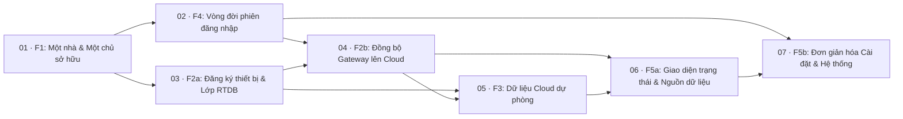

# KẾ HOẠCH TÍCH HỢP TỔNG THỂ — SMART HOME AI CORE INTEGRATION ROADMAP

- **Trạng thái:** Kế hoạch đã chốt phạm vi & kiến trúc (READ-ONLY Planning — chưa triển khai code)
- **Mô hình mục tiêu:** **MỘT NHÀ — MỘT ESP32 — MỘT TÀI KHOẢN CHỦ NHÀ**
- **Kiến trúc bất biến:** `LAN-first` (`Android → Esp32Client → HTTP LAN → ESP32`) + `RTDB-only` (chỉ Firebase Realtime Database)
- **Checkpoint đầu vào:** Branch `master`, HEAD `0cea70f3cd83f69568ab35a00af013930544450f` (`checkpoint task audit b4`), working tree sạch

---

## 1. Executive Summary

Dự án **SmartHomeAI** đã hoàn thành nền tảng Firebase RTDB (`P1.1-B0`..`P1.1-B3`) và tái cơ cấu phạm vi tại `P1.1-C0` theo mô hình **Một nhà — Một ESP32 — Một tài khoản chủ nhà**. Tuy nhiên, đối chiếu trực tiếp source code tại checkpoint `0cea70f` cho thấy mới chỉ có phần quản lý phiên Auth và danh sách `homes`/`members` trên Local Emulator; toàn bộ đường đồng bộ dữ liệu thiết bị ESP32 lên RTDB (`F2`), cơ chế hiển thị dự phòng từ Cloud khi mất LAN (`F3`), đồng bộ vòng đời phiên từ `CloudSession` vào `SmartHomeViewModel` (`F4`), đơn giản hóa trải nghiệm một nhà (`F1`) và hiển thị trạng thái đồng bộ Cloud trên UI (`F5`) vẫn chưa hoàn chỉnh hoặc chưa có code.

Kế hoạch này định nghĩa **7 prompt triển khai độc lập theo thứ tự phụ thuộc** (mỗi tính năng F1–F5 chỉ từ 1 đến 2 prompt, tổng 7/10 prompt tối đa), tuân thủ toàn bộ 6 quyết định đã chốt `CD-1`..`CD-6`, bảo toàn 100% lớp LAN/firmware đã xác minh và toàn bộ bộ test B3 (`151 JVM + 69 Instrumented + 80 Rules + 4 Rules Build`). Mỗi prompt áp dụng quy trình 2 model nối tiếp trong một hội thoại: **Nhánh A (Triển khai + static checks + commit tiếng Việt)** và **Nhánh B (Kiểm thử độc lập)**. Sau khi cả 7 prompt đạt PASS mới tiến hành Audit tổng thể (`AUDIT-PLAN-POST-INTEGRATION.md`).

---

## 2. Checkpoint đầu vào thực tế

| Hạng mục | Giá trị xác minh từ workspace `[REPO]` |
|---|---|
| **Repository** | `Do-An2-App-Nha-Thong-Minh` (`d:\MMO\DoAn2\app-nha-thong-minh`) |
| **Branch** | `master` |
| **HEAD Commit** | `0cea70f3cd83f69568ab35a00af013930544450f` (`0cea70f`) — `"checkpoint task audit b4"` |
| **Working tree** | Sạch (`git status --porcelain` rỗng) |
| **Ghi chú C0 vs `0cea70f`** | Tài liệu C0 ghi `e7a805c`; commit `0cea70f` chỉ bổ sung 4 file tài liệu B4/C0 (`docs/p1-1-b4/*`, `docs/p1-1-c0/*`), toàn bộ source Android/Rules/Firmware giữ nguyên như `e7a805c`. |
| **Graphify index** | Không tồn tại `graphify-out/` trong workspace; phân tích dựa trên đọc trực tiếp source và tài liệu. |
| **Build / Toolchain** | Gradle Wrapper `8.10.2`, AGP `8.5.2`, Kotlin `1.9.24`, Compose Compiler `1.5.14`, `compileSdk/targetSdk = 34`, `minSdk = 24`, `versionName = "3.6.0"` (`versionCode = 11`), `firebase-bom:33.1.2` (`firebase-auth`, `firebase-database`), Coroutines `1.8.1`. |
| **Gate bảo lưu** | `B1-A2` (LAN offline trên phần cứng thật): `PENDING USER VERIFICATION`; `B1-D` (Production `appaintm`): `LOCKED`. |

---

## 3. Kiểm kê kiến trúc hiện tại

### 3.1 Cấu trúc Package & Layer (`app/src/main/java/com/example/smarthomeai/`)

| Layer | Package / File chính | Thành phần & Trạng thái thực tế |
|---|---|---|
| **Entry & Navigation** | `MainActivity.kt` (`LOCKED` theo `CD-3`) | `AppRoot` giữ `NavHost` (`login`, `home`, `env`, `system`, `camera`, `register`, `alerts`, `settings`), đọc `vm.state` & `vm.loggedIn`. Không tự điều hướng khi `loggedIn` đổi ngoài thao tác nút. |
| **Cloud Domain & Firebase** | `cloud/CloudModels.kt`, `CloudRepository.kt`, `CloudSession.kt`, `FirebaseProvider.kt`, `CloudErrorMapper.kt`, `RtdbPaths.kt`, `RtdbPayloadBuilder.kt`, `RtdbHomeMerger.kt`, `RtdbCloudRepository.kt`, `CloudHomeManager.kt` | Đã cô lập Firebase SDK trong `cloud/`. `CloudHomeManager` quản lý `sessionGen` (`AtomicLong`), `lifecycleMutex` (`Mutex`), `cancelAndJoin()` khi đổi session, phát `StateFlow<CloudUiState>` qua `CloudUiBridgeRegistry` (`WeakReference<CloudUiBridge>`). `FirebaseProvider` không gọi `setPersistenceEnabled(...)`. |
| **Data / ViewModel / LAN** | `data/SmartHomeViewModel.kt`, `AuthRepository.kt` (`LOCKED`), `Esp32Client.kt` (`LOCKED`), `Storage.kt` (`LOCKED`), `Models.kt`, `Security.kt`, `HardwareStatus.kt`, `AlarmSettings.kt`, `Insights.kt`, `Notifier.kt` | `SmartHomeViewModel` sở hữu `network: Mutex`, `_state: MutableStateFlow<SmartHomeState>`, `_loggedIn: MutableStateFlow<Boolean>`, `cloudManager: CloudHomeManager`. Vòng polling LAN 1s (`viewModelScope.launch(Dispatchers.IO)`) chạy khi `_loggedIn.value == true`. `Storage` lưu `SharedPreferences("smart_home")` + SQLite `smart_home_history.db` (chưa phân tách theo UID). |
| **Face AI (On-device)** | `face/FaceEngine.kt`, `face/FaceMath.kt`, `FaceStore`, `FaceAccessSession` | 100% cục bộ trên máy (CameraX + MLKit + TFLite `mobile_face_net.tflite`). Không liên quan Cloud. |
| **UI (Compose)** | `ui/components/CloudHomeSection.kt`, `SecurityCard.kt`, `AlarmSettingsCard.kt`, `OwnerConfirmation.kt`, `Components.kt`; `ui/screens/HomeScreen.kt`, `SettingsScreen.kt`, `SystemScreen.kt`, `LoginScreen.kt`, `AlertsScreen.kt`, `EnvironmentScreen.kt`, `AutomationScreen.kt`, `CameraScreens.kt`, `SensorChart.kt` | `HomeScreen` gắn `CloudHomeBannerFromBridge`; `SettingsScreen` gắn `CloudHomeManagementFromBridge` và mục `"Thành viên"` (line 66, FaceStore cục bộ). `CloudHomeSection` hiện hiển thị UI Multi-Home/Multi-Member B3. |

### 3.2 Các ràng buộc hợp đồng kỹ thuật then chốt phát hiện từ Source

1. **Test Doubles đang implement `CloudRepository` và `CloudUiBridge`:**
   - `CloudRepository` (5 hàm) được implement tại 3 nơi: `app/src/test/java/com/example/smarthomeai/cloud/FakeCloudRepository.kt`, object ẩn danh trong `CloudSessionAndMultiHomeTest.kt:161`, và `InstrumentedFakeCloudRepo` trong `CloudB3IntegrationTest.kt:86`.
   - `CloudUiBridge` (7 thành viên) được implement ẩn danh tại `CloudB3IntegrationTest.kt:293-301`.
   - `CloudHomeManager(scope, session, repository)` được gọi với 3 tham số trong 9 test ở `CloudSessionAndMultiHomeTest.kt` và 1 test ở `CloudB3IntegrationTest.kt:191`.
   - **Hệ quả kiến trúc:** Không được thêm hàm abstract vào `CloudRepository` hay `CloudUiBridge`; không được bắt buộc tham số mới trên constructor `CloudHomeManager` hoặc Composable `HomeScreen`/`SettingsScreen`/`CloudHomeManagementCard` (chỉ thêm tham số mặc định ở cuối, và tách giao tiếp thiết bị/gateway sang `CloudDeviceRepository` + `CloudDeviceUiBridge` riêng).
2. **RTDB Paths & Security Rules (`cloud-rules/database.rules.src.json` — `LOCKED` theo `CD-2`):**
   - `userHomes/$uid/$homeId` (line 26-34): cần `homes/$homeId/members/$uid/role === 'owner'` khi tạo entry owner (`MIN-01`).
   - `homes/$homeId/meta` (line 38-58): chỉ tạo khi chưa tồn tại, `ownerUid === auth.uid`, `createdAt === now`, `schemaVersion === 1`.
   - `homes/$homeId/devices/$deviceId` (line 80-110): tạo bởi `@OWNER`, `$deviceId` khớp `^[A-Za-z0-9_-]{8,64}$`, bắt buộc `name` (1..60, không chứa `'deviceKey'`), `model` (1..40), `status` (`'active'` | `'revoked'`, chỉ đổi `active -> revoked`), `createdAt === now`, `createdBy === auth.uid`, `$other: false`.
   - `homes/$homeId/deviceData/$deviceId/state/gateway` (line 115-146): `@MEMBER && @ACTIVE && newData.exists()`, bắt buộc `online` (bool), `reportedBy === auth.uid`, `receivedAt === now`, `values` (≥1 trường, whitelist 8 khóa: `light`, `door`, `alarm`, `motion`, `monitoring` bool; `temp` `(-50, 150)`; `hum` `0..100`; `mode` chuỗi `1..16`, `$other: false`), tùy chọn `deviceTs` (number).
   - `homes/$homeId/deviceData/$deviceId/config` (line 181-193): `@OWNER && @ACTIVE`, bắt buộc `rev === (data.exists() ? data.child('rev').val() + 1 : 1)`, `updatedBy === auth.uid`, `updatedAt === now`, `tempLimit` `0..80`, `humLimit` `0..100`, `coldLimit` `-10..40`, `autoAlarm` bool, `$other: false`.
   - `homes/$homeId/deviceData/$deviceId/telemetry/$recordId` (line 195-212): create-only bởi `@MEMBER && @ACTIVE`, `$recordId` khớp `^[0-9]{12}_g$`, `source === 'gateway'`, `reportedBy`, `receivedAt === now`, `values { temp, hum }`, tùy chọn `deviceTs`. Chỉ `@OWNER` được xóa.
   - `homes/$homeId/deviceData/$deviceId/events/$eventId` (line 255-272): `.indexOn: ["receivedAt"]`, create-only bởi `@MEMBER && @ACTIVE`, `$eventId` khớp `^(g|d)_[A-Za-z0-9]{1,16}_[0-9]{1,10}$` và bằng `'g_' + stream + '_' + seq`, `type` (1..32), `severity` (`info|warn|critical`), `stream` khớp `^[A-Za-z0-9]{1,16}$`, `seq` nguyên `0..9999999999`, `source === 'gateway'`, `reportedBy`, `receivedAt === now`, tùy chọn `deviceTs`, `detail` ≤120 không chứa `'deviceKey'`.
3. **Bất tương thích `stream_id` Firmware với Rules `events`:**
   - `esp32/SmartHomeESP32/SmartHomeESP32.ino:871-874` tạo `streamId = String(efuseMac, HEX) + "-" + String(journal.generation, HEX)` — chứa dấu `-` và có thể dài hơn 16 ký tự (tối đa ~21 ký tự).
   - Rules `events/$eventId` dòng 263 ép `stream` phải khớp `^[A-Za-z0-9]{1,16}$` (không dấu `-`, tối đa 16 ký tự).
   - Vì firmware bị `LOCKED`, giải pháp không đổi phạm vi là băm tất định phía Android (`cloudStream = 16 ký tự hex đầu của SHA-256(streamId)`).

---

## 4. Phạm vi đã chốt (`F1`–`F5` & `CD-1`..`CD-6`)

| Hạng mục | Phạm vi áp dụng |
|---|---|
| **F1 — Single Home / Single Owner** | Tự chọn 1 nhà chính (ưu tiên `OWNER`, id nhỏ nhất/cũ nhất) sau đăng nhập; chặn tạo nhà mới khi đã có nhà `OWNER` hợp lệ; ẩn UI chuyển nhà & quản trị thành viên Cloud ở chế độ một nhà; nếu tài khoản cũ có >1 nhà thì KHÔNG xóa dữ liệu cũ mà cảnh báo + cho chọn tạm trong phiên. Giữ `members/{ownerUid}`, `userHomes/{ownerUid}/{homeId}`, B3 domain logic. |
| **F2 — Gateway Registration & Cloud State Sync** | Đăng ký/tìm lại `homes/{homeId}/devices/{deviceId}` (`@ACTIVE`, `push()` key, 0 `deviceKey`); xây dựng `CloudMapper`, `CloudDeviceRepository`, `RtdbDeviceRepository`, `CloudGatewaySync`; đồng bộ `state/gateway` (8 trường hợp lệ), `config`, `telemetry/{yyyyMMddHHmm}_g` (UTC), `events/g_{cloudStream}_{seq}` kèm chống trùng, cursor, retry backoff có giới hạn, tách khỏi `network: Mutex`. Không làm Remote Command / ACK. |
| **F3 — Cloud Data Fallback & Hybrid View** | Khi `!esp32Online` (debounce 5s), quan sát `state/gateway`, `telemetry` mới nhất, 20 `events` gần nhất; cung cấp `DataSourceResolver` phân biệt `LAN` / `CLOUD` / `LOCAL_CACHE` / `NONE` và nhận diện dữ liệu cũ; LAN thắng ngay khi phục hồi; Cloud không ghi ngược xuống ESP32 và không mở khóa nút điều khiển. |
| **F4 — Auth & Session Lifecycle Integration** | Đồng bộ `SmartHomeViewModel` với `CloudSession.observeSession()`; khi phiên bị thu hồi/hết hạn bên ngoài (`SignedOut` trong khi `_loggedIn && auth.configured`), giữ nguyên `_loggedIn = true` để bảo toàn LAN-first, bật cờ `reauthRequired` và hiện nút "Đăng nhập lại" điều hướng `"login"`; đổi UID cập nhật `userEmail` & hủy toàn bộ job cũ; mất WAN vẫn giữ `SignedIn` nhờ cached Firebase user. Không sửa `MainActivity.kt` và `AuthRepository.kt`. |
| **F5 — Core Cloud UI Integration** | Hiển thị nguồn dữ liệu (`LAN` / `Cloud` / `Bộ nhớ máy`), trạng thái đồng bộ Gateway, thời điểm cập nhật/dữ liệu cũ, chế độ xem Cloud chỉ đọc khi ngoài LAN trên `HomeScreen`; đơn giản hóa `SettingsScreen` (giữ mục `"Thành viên"` = FaceStore kèm mô tả rõ), cập nhật dialog `"Về ứng dụng"` lỗi thời, bổ sung chẩn đoán Cloud/Gateway trên `SystemScreen`. |
| **`CD-1`..`CD-6`** | `CD-1`: cho phép chạy code+Emulator F1–F5 trước khi user test phần cứng C1 (C1 vẫn khóa nghiệm thu cuối C4). `CD-2`: giữ nguyên 100% `database.rules.*`; mưa/giàn phơi chỉ ghi qua `events`. `CD-3`: giữ nguyên `MainActivity.kt`. `CD-4`: giữ nguyên toàn bộ test B3, dùng flag mặc định B3 + test mới cho Single Owner. `CD-5`: `B1-D` giữ `LOCKED`. `CD-6`: giữ nguyên Release signing. |

---

## 5. Gap Analysis theo `F1`–`F5`

| Tính năng | Phân loại hiện tại | Bằng chứng trong Source `[REPO]` | Khoảng trống cần tích hợp |
|---|---|---|---|
| **F1 — Single Home / Single Owner** | `PARTIAL` | `CloudHomeManager.kt:548` chọn `validHomes.firstOrNull()` không ưu tiên `OWNER`; dòng `310-366` `createHome()` chỉ kiểm `busy`, không chặn tạo thêm nhà; `CloudHomeSection.kt:135-153, 246-445` hiện nút `"Nhà (N)"`, `HomeSwitcherDialog`, danh sách thành viên Cloud và ghi chú B4. | Thiếu chế độ `singleHomeMode`, quy tắc chọn nhà chính tất định, guard chống tạo trùng nhiều nhà, xử lý cảnh báo không phá hủy khi tài khoản cũ có >1 nhà `OWNER`, và thu gọn UI ở `CloudHomeSection`. |
| **F2 — Gateway Registration & Cloud State Sync** | `NOT IMPLEMENTED` | `RtdbPaths.kt:38-63` mới có `userHomes`/`meta`/`members`; `CloudRepository.kt` chỉ có 5 hàm B1/B3; `RtdbCloudRepository.kt` chưa có hàm nào về `devices`, `state/gateway`, `config`, `telemetry`, `events`; chưa có `CloudMapper` hay coordinator đồng bộ nền. | Thiếu toàn bộ models thiết bị, mapper whitelist khớp Rules + SHA-256 `cloudStream`, repository thiết bị RTDB, logic đăng ký/tìm lại device `@ACTIVE`, cursor/dedup `events` & `telemetry`, sync `config` & `state/gateway`, xử lý lỗi/backoff, và bridge UI trạng thái sync. |
| **F3 — Cloud Data Fallback & Hybrid View** | `NOT IMPLEMENTED` | `SmartHomeViewModel.kt:103-116` khi LAN lỗi chỉ đặt `esp32Online = false` và giữ cache cục bộ từ `Storage`; `HomeScreen.kt:58-60` chỉ hiển thị `"Cập nhật lần cuối lúc ..."` từ `state.lastSeen`. Không có query đọc từ RTDB. | Thiếu hàm đọc/observe `state/gateway`, `telemetry` mới nhất, 20 `events` gần nhất trên `RtdbDeviceRepository`, `CloudFallbackObserver` có điều kiện `!esp32Online`, và `DataSourceResolver` phân tách rành mạch `LAN` / `CLOUD` / `LOCAL_CACHE` + nhận diện dữ liệu cũ. |
| **F4 — Auth & Session Lifecycle** | `PARTIAL` | `FirebaseCloudSession` + `CloudHomeManager.applySessionState()` (`CloudHomeManager.kt:172-212`) đã xử lý `Unavailable`/`SignedOut`/`SignedIn` với `sessionGen` & `cancelAndJoin()`; nhưng `SmartHomeViewModel.kt:35` chỉ gán `_loggedIn` một lần lúc khởi tạo, chưa observe `cloudManager.state`. | Thiếu observer trong `SmartHomeViewModel` phản ứng khi phiên Firebase bị thu hồi bên ngoài (đặt `reauthRequired` mà không tắt LAN `_loggedIn`), cập nhật `userEmail` khi đổi tài khoản, và nút `"Đăng nhập lại"` trên banner Cloud. |
| **F5 — Core Cloud UI Integration** | `PARTIAL` | `CloudHomeSection.kt`, `HomeScreen.kt:24-39`, `SettingsScreen.kt:62-84, 115-116`, `SystemScreen.kt` đã tồn tại nhưng chưa có badge nguồn dữ liệu, chưa có chỉ báo trạng thái đồng bộ Gateway, chưa hiển thị dữ liệu Cloud dự phòng, dialog `"Về ứng dụng"` còn ghi `"chưa có thông báo cloud"`, nhãn `"Thành viên"` ở `SettingsScreen.kt:66` dễ gây hiểu lầm. | Bổ sung hiển thị trạng thái sync Gateway, nguồn dữ liệu `LAN`/`Cloud`/`Bộ nhớ máy`, thời điểm cập nhật/cũ, dữ liệu Cloud chỉ đọc trên `HomeScreen`; dọn dialog `"Về ứng dụng"`, làm rõ nhãn `"Thành viên (Khuôn mặt cục bộ)"` ở `SettingsScreen` và thêm chẩn đoán Cloud/Gateway ở `SystemScreen`. |

**Mâu thuẫn tài liệu vs Source đã đối chiếu:**
1. Báo cáo C0 ghi HEAD `e7a805c`; checkpoint thực tế là `0cea70f` (commit chỉ bổ sung tài liệu, source trùng khớp `e7a805c`).
2. Báo cáo C0 đề xuất mở rộng trực tiếp `CloudRepository` (C0 §13); đối chiếu source bác bỏ phương án này vì 3 test double B3 implement trực tiếp `CloudRepository` (`CD-4`). Thay bằng interface riêng `CloudDeviceRepository`.
3. Báo cáo C0 gợi ý ghi trực tiếp `eventStream` của ESP32 vào khóa event RTDB `g_{stream}_{seq}`; đối chiếu `SmartHomeESP32.ino:871-874` vs `database.rules.src.json:263` cho thấy `streamId` có dấu `-` và vượt 16 ký tự. Giải quyết bằng băm SHA-256 lấy 16 hex ký tự đầu (`cloudStream`).

---

## 6. Dependency Graph & Thứ tự triển khai tối ưu

**Giải thích thứ tự tối ưu (tuần tự `01 → 02 → 03 → 04 → 05 → 06 → 07`):**
1. **`01` (`F1`) làm nền tảng:** Xác định duy nhất 1 `selectedHomeId` (quyền `OWNER`) và khóa tạo nhà trùng. Mọi thao tác Gateway (`03`, `04`) phụ thuộc `selectedHome` ổn định này.
2. **`02` (`F4`) nối tiếp `01`:** Hoàn tất đồng bộ phiên Auth giữa `CloudSession` và `SmartHomeViewModel` trước khi gắn thêm vòng lặp đồng bộ nền Gateway (`04`) để đảm bảo thu hồi phiên / đổi tài khoản không bao giờ ghi nhầm dữ liệu.
3. **`03` (`F2a`) tạo tầng dữ liệu thuần & RTDB:** Có thể độc lập logic với `02`, nhưng xếp ngay sau `02` để tránh xung đột rẽ nhánh Git và cô lập hoàn toàn `CloudMapper` + `RtdbPaths` + `RtdbDeviceRepository` để kiểm chứng bằng Emulator Rules trước khi chạy vòng lặp nền.
4. **`04` (`F2b`) gắn `CloudGatewaySync` vào `SmartHomeViewModel`:** Phụ thuộc `01` (home chính), `02` (vòng đời phiên) và `03` (repository/mapper).
5. **`05` (`F3`) bổ sung đọc Cloud dự phòng:** Phụ thuộc cấu trúc dữ liệu do `03`/`04` tạo ra trên RTDB (`state/gateway`, `telemetry`, `events`).
6. **`06` (`F5a`) hiển thị trạng thái sync & Hybrid View trên `HomeScreen`:** Phụ thuộc state từ `04` (`GatewaySyncStatus`) và `05` (`CloudDeviceSnapshot`, `DataSource`).
7. **`07` (`F5b`) hoàn thiện `SettingsScreen` & `SystemScreen`:** Xếp cuối để không đụng độ file UI (`CloudHomeSection.kt`) với `01`, `02`, `06`.

---

## 7. Các quyết định thiết kế đã chốt (`D1`–`D14`)

| Mã | Nội dung quyết định cụ thể |
|---|---|
| **D1** | **Định danh `deviceId`:** Dùng khóa `push()` do Firebase sinh khi tạo lần đầu. Mỗi phiên khi đồng bộ, owner đọc `homes/{homeId}/devices` chọn node `status == "active"` cũ nhất (ưu tiên `createdAt` nhỏ nhất, hòa thì `deviceId` nhỏ nhất). Chỉ tạo mới (`name="ESP32 Smart Home"`, `model="esp32-smarthome"`, `status="active"`, `createdAt=ServerValue.TIMESTAMP`, `createdBy=uid`) khi nhánh `devices` rỗng hoàn toàn. Nếu tất cả đều `revoked` → KHÔNG tự tạo lại, chuyển trạng thái `BLOCKED`. Nếu phát hiện >1 `active` (do race trên 2 thiết bị) → chọn bản cũ nhất, hiển thị cảnh báo, không tự xóa. Không lưu `deviceId` trong `Storage`; không đưa `deviceKey`/IP/MAC lên Cloud. |
| **D2** | **Chuyển đổi Event & `cloudStream`:** `cloudStream = sha256(streamId).take(16)` (hex chữ thường `^[0-9a-f]{16}$`). Event key `g_{cloudStream}_{seq}`, `type = kind` (tối đa 24 ký tự của firmware), `detail = "boot=$boot;incident=$incident"`, `deviceTs = timestamp` (chỉ đính kèm khi `> 0`). Bảng `severity`: `critical` (`alarm_started`, `motion_alarm`, `proximity_alarm`); `warn` (`rain_started`, `servo_overdue`, `servo_blocked`, `exit_waiting`, `motion_entry`, `motion_waiting`, `alarm_silent`, `clothes_rain_retract`, `proximity_detected`, `motion_detected`); còn lại `info`. |
| **D3** | **Cursor & Dedup Events:** Khi bắt đầu phiên sync cho một `(uid, homeId, deviceId)`, đọc `events orderByChild("receivedAt").limitToLast(100)` để dựng `cursorMap[cloudStream] = maxSeq`. Mỗi chu kỳ đẩy các phần tử `deviceEvents` có `seq > cursorMap[cloudStream]` theo thứ tự `seq` tăng dần (tối đa 20 event/chu kỳ), cập nhật cursor ngay sau mỗi lần ghi thành công. Nếu ghi gặp `PermissionDenied` → đọc kiểm tra đúng node event đó: nếu đã tồn tại thì coi là trùng (cập nhật cursor và đi tiếp); nếu chưa tồn tại thì coi là lỗi quyền thật, dừng sync và báo `ERROR`. Không dùng `updateChildren` đa nhánh cho `events`. |
| **D4** | **Đồng bộ `state/gateway`:** Chỉ ghi khi `esp32Online && (now - lastSeen <= 5_000L)`. Ghi khi 8 giá trị (`light`, `door`, `alarm`, `motion`, `monitoring`, `temp`, `hum`, `mode`) thay đổi (giãn cách tối thiểu `2_000L` ms) hoặc heartbeat mỗi `60_000L` ms. Bỏ qua khóa `temp`/`hum` nếu `null`. `mode = HomeMode.name`, `deviceTs = lastSeen`. Khi chính phiên này đã từng đẩy `online=true` mà sau đó `esp32Online` chuyển `false` → ghi đúng 1 lần `online=false` kèm giá trị hợp lệ gần nhất. |
| **D5** | **Đồng bộ `telemetry`:** Chỉ lấy mẫu mới nhất trong `state.samples` (đã giới hạn 60s tại `applySensor`), dựng khóa `yyyyMMddHHmm_g` theo múi giờ **UTC** từ `sample.timestamp`. Không backfill mẫu cũ. Ghi trùng gặp `PermissionDenied` → kiểm tra tồn tại như `D3`. |
| **D6** | **Đồng bộ `config`:** Phản chiếu `temperatureLimit`, `humidityLimit`, `coldLimit`, `autoAlarm`. Đọc `config` hiện có 1 lần mỗi phiên để lấy `rev` và giá trị hiện tại; chỉ ghi khi giá trị khác, với `rev = (hiện có + 1) ?: 1`. Nếu ghi bị từ chối/xung đột → đọc lại 1 lần và thử lại 1 lần; vẫn thất bại thì báo lỗi. |
| **D7** | **Retry & Cách ly LAN:** Lỗi `Offline` / `Timeout` áp dụng backoff `5s → 10s → 20s → 40s → 60s` (reset về 0 khi thành công). Lỗi `PermissionDenied` / `InvalidData` / `Unauthenticated` không tự retry (chờ đổi phiên/nhà hoặc user bấm retry). Mọi lời gọi suspend dùng `timeoutMs = 10_000L`. **Cấm tuyệt đối** chạm vào `SmartHomeViewModel.network` Mutex hay gọi Cloud trong `network.withLock`. |
| **D8** | **Cô lập Session & UID:** `CloudGatewaySync` quan sát khóa `(currentUid, selectedHomeId, status == READY, isOwner)` qua `collectLatest` để tự động hủy mọi job sync cũ khi đổi tài khoản, đăng xuất (`onSignedOut()`), mất quyền hoặc đổi nhà. Mọi hàm trong `CloudDeviceRepository` nhận `expectedUid: String` và kiểm tra `provider.uid == expectedUid` trước khi thực thi/trả kết quả. |
| **D9** | **Cầu nối UI (`CloudDeviceUiBridge`):** Bổ sung interface `CloudDeviceUiBridge` + `CloudDeviceUiBridgeRegistry` (`WeakReference`) + `rememberActiveCloudDeviceBridge()` theo đúng mẫu `CloudUiBridgeRegistry`, đăng ký trong `SmartHomeViewModel.init` và hủy trong `onCleared()`. Không sửa `MainActivity.kt`. |
| **D10** | **F1 Chế độ Một nhà:** Thêm `singleHomeMode: Boolean = false` vào `CloudHomeManager` (`SmartHomeViewModel` truyền `true`, test B3 mặc định `false`). Khi `true`: tự chọn nhà `OWNER` có `id` nhỏ nhất theo thứ tự từ điển (`push()` id cũ nhất) nếu chưa có chọn hợp lệ; `createHome` bị chặn (trả feedback lỗi nhẹ nhàng) nếu đã tồn tại ít nhất 1 nhà `OWNER` hợp lệ; thêm `ownedHomeCount`/`hasMultipleOwnedHomes` (có giá trị mặc định) vào `CloudUiState`. Tài khoản cũ có >1 nhà `OWNER`: giữ nguyên dữ liệu, hiển thị cảnh báo `"Tài khoản có N nhà Cloud; đang dùng «X»"` và cho chọn nhà chính tạm thời trong phiên; nếu tài khoản chỉ có nhà `MEMBER`, không chọn làm nhà chính và hiển thị ghi chú chia sẻ nhà đang tạm hoãn. |
| **D11** | **F4 Đồng bộ Auth không tắt LAN:** Khi `CloudHomeManager.state.status == SIGNED_OUT` trong lúc `_loggedIn.value && auth.configured` → **giữ `_loggedIn = true`** để vòng polling LAN tiếp tục chạy, đồng thời bật `reauthRequired = true`; khi `SignedIn(uid)` mới → cập nhật `userEmail = auth.currentEmail` và tắt `reauthRequired`. Mất WAN (còn cached Firebase user) và chế độ demo (`Unavailable`) không làm phát sinh yêu cầu đăng nhập lại. Nút `"Đăng nhập lại"` trên banner gọi `onNavigate("login")`. *(Giới hạn chấp nhận theo `CD-3`: sau khi đăng nhập lại từ `login`, `LoginScreen` gọi `navigate("home")` nên back stack giữ lại một màn hình `home` cũ).* |
| **D12** | **F3 Hybrid View:** Tách hoàn toàn dữ liệu Cloud khỏi `SmartHomeState` bằng `cloudSnapshot: StateFlow<CloudDeviceSnapshot?>`. `CloudFallbackObserver` chỉ chạy khi `!esp32Online` (debounce `5_000L` ms) và Cloud `READY`; hủy ngay khi LAN online. Hàm thuần `resolveDataSource(state, snapshot, now)` quyết định: `LAN` nếu `esp32Online`; `CLOUD` nếu có snapshot với `receivedAt > state.lastSeen`; `LOCAL_CACHE` nếu `state.lastSeen > 0`; `NONE` ngược lại. Đánh dấu dữ liệu cũ khi tuổi `> 300_000L` ms (5 phút) hoặc `gateway.online == false`. Ghi chú lệch đồng hồ giữa `receivedAt` (server) và `lastSeen` (điện thoại). Không bao giờ mở khóa điều khiển hoặc ghi ngược xuống ESP32. |
| **D13** | **Retention & Prune:** Chưa triển khai dọn tự động `telemetry`/`events` trong đợt C2 này (`DEFER` sang phần tối ưu/Audit sau). Ước tính tối đa ~1.440 bản ghi `telemetry` mỗi ngày khi chạy liên tục 24/24. |
| **D14** | **Chiến lược Kiểm thử (Nhánh A vs Nhánh B):** Nhánh A được phép tạo unit test file mới cho logic mới nhưng **TUYỆT ĐỐI KHÔNG CHẠY** bất kỳ test, build hay emulator nào. Nhánh B chạy các lệnh kiểm thử chuẩn trên PowerShell (`$env:JAVA_HOME = "D:\Program Files\Android Studio\jbr"`): `.\gradlew.bat :app:testDebugUnitTest --console=plain`, `:app:assembleDebug`, `:app:assembleDebugAndroidTest`, Emulator Rules (`cd cloud-rules; npm run test:build; npm run test:rules`), Android Instrumented (`cd cloud-rules; node scripts/run-emulator.mjs "..\gradlew.bat -p .. :app:connectedDebugAndroidTest --console=plain"`). Nếu Nhánh B viết thêm test mới, chỉ commit test-only (thông điệp tiếng Việt) và không sửa source implementation. Mốc nền 151/69/80/4 phải luôn PASS. |

---

## 8. Phân tích Rủi ro Tổng thể

| Mức độ | Rủi ro | Nguyên nhân | File / Symbol liên quan | Hậu quả | Biện pháp phòng ngừa | Tiêu chí phát hiện | Rollback |
|---|---|---|---|---|---|---|---|
| **CRITICAL** | **Hồi quy điều khiển / polling LAN** | Đặt lời gọi RTDB bên trong `network.withLock`, hoặc gán `_loggedIn = false` khi mất phiên/mất mạng. | `SmartHomeViewModel.kt:32, 54-59, 102` (`network`, `_loggedIn`, `refreshLocked`). | Đơ vòng lặp 1s hoặc tắt hoàn toàn điều khiển ESP32 khi ra ngoài mạng hay hết token Firebase. | Thực thi `D7`, `D11`: Cloud sync thu thập snapshot qua `Flow` ngoài `network`, tuyệt đối không sửa `_loggedIn` ở listener phiên. | Grep `network.withLock` xung quanh code Cloud; test `CloudSessionLifecycleTest` + `CloudIsolationTest`. | `git revert` commit của prompt `02`/`04`. |
| **CRITICAL** | **Vỡ biên dịch & hồi quy bộ test B3 (`CD-4`)** | Thêm method abstract vào `CloudRepository` / `CloudUiBridge` hoặc sửa mặc định hiển thị `CloudHomeManagementCard`. | `CloudRepository.kt`, `CloudHomeManager.kt:81, 125`, `CloudHomeSection.kt`, `HomeScreen.kt`, `SettingsScreen.kt`. | 3 test double B3 (`FakeCloudRepository`, `CloudSessionAndMultiHomeTest`, `CloudB3IntegrationTest`) lỗi compile hoặc 2 UI test B3 bị FAIL. | Dùng `CloudDeviceRepository` & `CloudDeviceUiBridge` tách biệt; thêm tham số có mặc định giữ nguyên B3 (`singleHomeMode = false` ở card, `true` ở `*FromBridge`). | Biên dịch & chạy toàn bộ `151` JVM + `69` Instrumented tests ở Nhánh B. | `git revert` commit vi phạm signature. |
| **HIGH** | **`PERMISSION_DENIED` trên RTDB Rules** | (1) Ghi `deviceData` trước khi có node `devices/{id}` với `status="active"` (`@ACTIVE`); (2) gửi `stream_id` có dấu `-` từ firmware vào `events`; (3) đẩy trường mưa/giàn phơi bị `$other: false` chặn; (4) `rev` của `config` không tăng đúng `+1`. | `database.rules.src.json:80-272`, `SmartHomeESP32.ino:871-874`, `CloudMapper.kt`, `RtdbDeviceRepository.kt`. | Toàn bộ đồng bộ Cloud thất bại với `PermissionDenied`. | Tuân thủ `D1` (resolve/register trước sync), `D2` (`cloudStream` SHA-256 16 hex), `CD-2` (whitelist 8 khóa), `D6` (đọc `rev` trước khi ghi `config`). | Rules Emulator test mới (`gateway-payload.test.mjs`) trong Nhánh B của prompt `03`. | `git revert` prompt `03`/`04`. |
| **HIGH** | **Ghi trùng `events` / `telemetry` dừng dây chuyền sync** | Khóa `events/g_{stream}_{seq}` và `telemetry/{yyyyMMddHHmm}_g` là create-only; ghi lại trả `PERMISSION_DENIED` giống lỗi quyền thật. | `database.rules.src.json:198, 259`, `CloudGatewaySync.kt`, `RtdbDeviceRepository.kt`. | Nếu đánh đồng `PermissionDenied` là lỗi quyền, coordinator dừng vĩnh viễn và kẹt ở event đã từng ghi. | Thực thi `D3`, `D5`: khởi tạo đọc 100 event cuối lấy cursor; khi ghi bị `PermissionDenied` thì đọc lại chính key đó để phân biệt trùng vs bị từ chối quyền. | Unit test `CloudGatewaySyncTest` kịch bản trùng key và kịch bản từ chối quyền thật. | `git revert` prompt `04`. |
| **HIGH** | **Race điều kiện Auth phiên (ghi nhầm UID mới)** | Coroutine ghi `state/gateway` hoặc `events` của UID cũ hoàn tất trễ sau khi user chuyển sang UID mới. | `CloudHomeManager.kt:134, 173`, `CloudGatewaySync.kt`, `RtdbDeviceRepository.kt`. | Rò rỉ dữ liệu hoặc ghi đè state sang nhà của tài khoản mới. | Thực thi `D8`: `collectLatest` theo `(uid, homeId)` hủy job cũ + kiểm tra `provider.uid == expectedUid` trong từng hàm `RtdbDeviceRepository`. | `CloudGatewaySyncTest` & `CloudFallbackObserverTest` test chuyển tài khoản giữa chừng lúc repository đang suspend. | `git revert` prompt `02`/`04`/`05`. |
| **HIGH** | **Trùng tạo nhiều Home khi bấm nhanh / mạng chậm** | Bấm nút `"Tạo nhà"` nhiều lần hoặc tạo lại khi lần trước đang pending; hoặc user đã có nhà cũ. | `CloudHomeManager.kt:310-366`, `CloudHomeSection.kt`. | Tài khoản có nhiều nhà dư thừa vi phạm mô hình 1 nhà. | Thực thi `D10`: `busy` khóa nút tạo, `createHome()` kiểm tra điều kiện 0 nhà `OWNER` hợp lệ trong `singleHomeMode`. | `CloudSingleHomeModeTest` test chặn tạo nhà thứ 2 và double-tap. | `git revert` prompt `01`. |
| **HIGH** | **Trạng thái Cloud cũ ghi đè trạng thái LAN** | Gộp nhầm `CloudDeviceSnapshot` vào `SmartHomeState` hoặc không hủy `CloudFallbackObserver` khi ESP32 online lại. | `SmartHomeViewModel.kt`, `CloudFallbackObserver.kt`, `DataSourceResolver.kt`. | Hiển thị sai trạng thái thực tế hoặc mở nhầm điều khiển dựa trên số liệu cũ. | Thực thi `D12`: tách riêng `cloudSnapshot`, `resolveDataSource` ưu tiên tuyệt đối `LAN` khi `esp32Online == true`. | `DataSourceResolverTest`, `CloudFallbackObserverTest`, `CloudHybridViewUiTest`. | `git revert` prompt `05`/`06`. |
| **MEDIUM** | **Rò rỉ Coroutine / ValueEventListener** | Không gỡ `ValueEventListener` trong `awaitClose` hoặc không gọi `clear()` ở `ViewModel.onCleared()`. | `RtdbDeviceRepository.kt`, `CloudGatewaySync.kt`, `CloudFallbackObserver.kt`, `SmartHomeViewModel.kt:96`. | Rò bộ nhớ và listener nền tiếp tục chạy sau khi thoát màn hình/hủy ViewModel. | Dùng `callbackFlow` + `awaitClose { ref.removeEventListener(listener) }`, mọi job chạy trên `viewModelScope`, gọi `clear()` trong `onCleared()`. | Test collector cancellation trong `CloudFallbackObserverTest` & static grep `awaitClose`. | `git revert` prompt `04`/`05`. |
| **MEDIUM** | **Tạo nhiều device `active` song song trên 2 thiết bị** | Hai điện thoại cùng đăng nhập 1 owner đồng thời thấy `devices` rỗng và cùng gọi `push()`. | `RtdbDeviceRepository.kt` (`resolveOrRegisterDevice`). | Sinh 2 node dưới `homes/{h}/devices`. | Thực thi `D1`: luôn chọn device `active` cũ nhất theo `(createdAt, deviceId)`, báo cảnh báo nhận diện nhiều thiết bị, không xóa dữ liệu. | `CloudGatewaySyncTest` / `RtdbDeviceRepository` test danh sách >1 device `active`. | `git revert` prompt `03`/`04`. |
| **MEDIUM** | **Lệch đồng hồ giữa `receivedAt` (server) và `lastSeen` (điện thoại)** | Đồng hồ trên điện thoại chạy nhanh hơn giờ server Firebase khi so sánh `receivedAt > lastSeen`. | `DataSourceResolver.kt`, `SmartHomeViewModel.kt`. | Khi mất LAN, app ưu tiên `LOCAL_CACHE` thay vì `CLOUD` mới hơn dù thực tế gateway khác vừa đẩy. | Cho phép so sánh với biên an toàn / làm rõ thời điểm cập nhật trên UI và giữ ưu tiên rõ ràng trong `DataSourceResolver` (ghi nhận giới hạn nếu lệch clock lớn). | `DataSourceResolverTest` kiểm tra các mốc `receivedAt` vs `lastSeen`. | `git revert` prompt `05`. |
| **MEDIUM** | **Dữ liệu cục bộ `Storage` dùng chung & Back stack `LoginScreen`** | `Storage.kt` không tách key theo UID (`LOCKED`); `LoginScreen` điều hướng `navigate("home")` khi re-auth từ `HomeScreen` (`MainActivity.kt` `LOCKED`). | `Storage.kt`, `MainActivity.kt:81`. | Khi đổi sang tài khoản khác trên cùng điện thoại, IP/deviceKey/samples cũ vẫn còn; bấm Back sau khi re-auth có thể quay lại instance `home` trước. | Đều là ràng buộc đã biết theo `CD-3` và giữ nguyên `Storage.kt`; ghi rõ vào Audit và thông tin "Về ứng dụng" (`07`). | Đối chiếu `Storage.kt` và `MainActivity.kt`. | Không đổi file `LOCKED`. |
| **LOW** | **Tăng trưởng RTDB & nhầm nhãn "Thành viên"** | Không prune `telemetry`/`events` (`D13`); hai mục cùng tên `"Thành viên"` (FaceStore vs Cloud member). | `SettingsScreen.kt:66`, `CloudHomeSection.kt`. | Dữ liệu tăng ~1.440 mẫu/ngày nếu bật liên tục; người dùng/dev nhầm xóa FaceStore. | Ẩn Cloud Member ở `01`; thêm mô tả phụ `"Khuôn mặt mở cửa cục bộ"` ở `07`; lập kế hoạch prune tại Audit sau tích hợp. | Kiểm tra UI `CloudSettingsSingleOwnerUiTest` & `AppSmokeTest`. | `git revert` prompt `07`. |

---

## 9. Ma trận bảo vệ Source (`KEEP` / `FREEZE` / `DEFER` / `REMOVE`)

Kế thừa và chuẩn hóa theo `C0 §5` với nguyên tắc bất biến **`REMOVE = NONE`**:

| Phân loại | Danh sách thành phần cụ thể | Quy định xử lý |
|---|---|---|
| **KEEP (Tuyệt đối không phá)** | `MainActivity.kt`, `AuthRepository.kt`, `Esp32Client.kt`, `Storage.kt`, `Models.kt`, `Security.kt`, `HardwareStatus.kt`, `AlarmSettings.kt`, `Insights.kt`, `Notifier.kt`, `face/*`, `esp32/SmartHomeESP32/*`, `cloud-rules/database.rules.*`, `cloud-rules/build-rules.mjs`, `AppSmokeTest.kt`, `CloudInitializationIntegrationTest.kt`, `LoginScreen.kt`, `AlertsScreen.kt`, `AutomationScreen.kt`, `CameraScreens.kt`, `EnvironmentScreen.kt`, `SensorChart.kt`, `AlarmSettingsCard.kt`, `Components.kt`, `OwnerConfirmation.kt`, `SecurityCard.kt`, `Theme.kt`. | Giữ nguyên 100% chữ ký, logic LAN, firmware, Rules và các bộ test hiện có. |
| **KEEP & EXTEND (Mở rộng có ranh giới)** | `CloudModels.kt` (giữ nguyên), `CloudSession.kt` (thêm field mặc định cuối `CloudComponents`), `FirebaseProvider.kt` (chỉ thêm factory wiring), `RtdbPaths.kt` (chỉ thêm builder mới), `CloudHomeManager.kt` (thêm `singleHomeMode = false` & field mặc định), `SmartHomeViewModel.kt`, `CloudHomeSection.kt`, `HomeScreen.kt`, `SettingsScreen.kt`, `SystemScreen.kt`. | Chỉ sửa đúng phạm vi từng prompt; không đổi signature cũ mà test B3/Smoke đang gọi. |
| **FREEZE (Không phát triển thêm, không xóa)** | `CloudRepository` (5 hàm B3), `RtdbCloudRepository` (`observeMembers`, `leaveHome`, `removeMember`), `RtdbPayloadBuilder.buildRemoveMembershipUpdates`, `RtdbHomeMetaFetcher`, `CloudHomeManager` (`selectHome`, `leaveSelectedHome`, `removeMember`), `FakeCloudRepository.kt`, `CloudSessionAndMultiHomeTest.kt`, `RtdbHomeMetaFetcherTest.kt`, `CloudB3IntegrationTest.kt`, `rules.test.mjs` (#1–#80), các nhánh Rules `state/device`, `commands`, `acks`, `telemetry/*_d`, `events/d_*`, `deviceAuthUid`, `users/$uid`. | Bắt buộc giữ nguyên để bảo toàn `MIN-01`, rollback và toàn bộ 151 JVM + 69 Instrumented + 80 Rules tests. |
| **DEFER (Ngoài phạm vi C2)** | `docs/p1-1-b4/*` (Invitation / Join / QR), Cloud Functions v2, Blaze, Multi-ESP32, Cloud Remote Commands/ACK, `B1-D` Production Audit/Deploy, `B1-A2` Hardware Test (`C1`), Release Signing/SHA-1 (`C4`), tự động dọn RTDB retention, tách `Storage` theo UID. | Không triển khai trong 7 prompt này; xử lý ở Audit hoặc các phase `C1`/`C3`/`C4` riêng. |
| **REMOVE** | **NONE (0 mục)** | Không xóa bất kỳ file, class, hàm hay rule nào của dự án. |

---

## 10. Tiêu chí hoàn thành tổng thể (Core Integration Exit Criteria)

Đợt tích hợp F1–F5 chỉ được công nhận hoàn thành khi thỏa **đồng thời** tất cả điều kiện sau:
1. Toàn bộ 7 prompt (`01` → `07`) hoàn tất cả **Nhánh A** (có commit tiếng Việt riêng cho từng prompt, không có lỗi static check) và **Nhánh B** (có báo cáo kiểm thử độc lập đạt `PASS`, không còn lỗi `CRITICAL`/`HIGH` chưa vá).
2. Toàn bộ bộ test nền không suy giảm: `4/4` Rules Build, `80/80`+ Rules Emulator (`demo-smarthomeai`), `151/151`+ JVM Unit Tests, `69/69`+ Android Instrumented Tests, `assembleDebug` và `assembleDebugAndroidTest` thành công.
3. Không xuất hiện bất kỳ `deviceKey`, mật khẩu, token hoặc dữ liệu khuôn mặt nào trên RTDB hoặc trong `cloud/CloudMapper` payload.
4. Tất cả file thuộc nhóm `KEEP (Tuyệt đối không phá)` và `FREEZE` vẫn nguyên vẹn (riêng bộ `cloud-rules/test/` có thể được Nhánh B bổ sung file test mới mà không sửa `database.rules.*` hay `rules.test.mjs`).
5. Không có bất kỳ thao tác nào lên Production `appaintm` (`B1-D` giữ `LOCKED`), không push Git lên remote, và `B1-A2` vẫn được báo cáo đúng trạng thái `PENDING USER VERIFICATION` cho tới khi người dùng kiểm tra trên mạch ESP32 + điện thoại thật.
6. Hoàn thành giai đoạn Audit tổng thể theo `AUDIT-PLAN-POST-INTEGRATION.md` sau khi Prompt `07` PASS.
